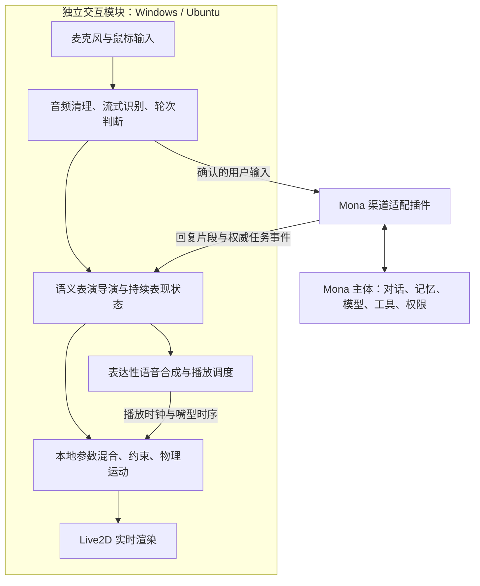

# Mona 连续交互技术方案

- 日期：2026-11-03
- 定位：完整目标设计，尚未全部实现。
- 已确定目标：高质量 2D Mona、随对话持续变化的表演、自然语音交互、独立插件、Windows 开发与 Ubuntu 运行。
- 已有演示的作用：验证独立运行和基础通信，不能作为最终产品形态或最终验收依据。

## 1. 目标体验

交付对象是一套实时数字角色系统。角色根据当前交互、语义、声音韵律与持续的表现状态生成姿态和表情，而不是将“空闲、倾听、思考、说话”分别绑定到一段固定动画。

例如，用户说“今天有点累……不过先帮我看看这个问题”：

1. 开始说话时，Mona 将注意力转向用户，收住正在进行的自主动作。
2. 说到一半短暂停顿时，她继续倾听，不因单纯静音抢话。
3. 根据用户明确说出的“有点累”，她采用较克制的语气和柔和的眉眼，而不是断言用户的真实心理状态。
4. 回复时，声音、嘴型、视线与轻微手势按同一条时间线配合，强调处才有适量动作。
5. 用户插话后，旧音频和对应嘴型一起停止，注意力转回用户；短促的附和不会一概当作打断。
6. 再次回复承接实际听到的内容，保留上一轮的情绪连续性。后台业务任务是否取消，由明确的任务指令决定。

这些表现不是预先录制一整段场景视频。美术模型提供可变形的范围和动作素材，控制器在运行时决定它们如何组合、变化和结束。

## 2. 推荐技术组合

| 层 | 目标选择 | 职责 |
|---|---|---|
| 独立桌面终端 | Electron + TypeScript | 固定 Chromium 运行环境，窗口、音频设备、输入与跨平台交付 |
| 角色渲染 | Live2D Cubism SDK for Web + WebGL | 连续驱动分层模型参数与物理运动 |
| 快速表现控制 | 终端本地 TypeScript 控制器 | 每帧混合视线、呼吸、嘴型、表情和手势，网络延迟不直接决定帧率 |
| 交互运行时 | 独立 Python 服务 | 语音会话、表现意图、音频和消息调度、提供商与生命周期管理 |
| 媒体流水线 | Pipecat，目标采用 SmallWebRTC | 浏览器与本机 Python 服务之间的双向音频；不另建智能体大脑 |
| 语音提供商 | 可替换的流式 STT / TTS | 音质、表达性、时序与中文能力通过试听和实测选定 |
| Mona 接入 | 薄渠道插件 + 有版本的受控消息协议 | 输入准入、会话绑定、回复和权威任务事件 |

Electron 在同一应用中携带 Chromium 和 Node.js，并支持 Windows、macOS 与 Linux，适合保持开发端和交付端的运行环境一致。[官方说明](https://www.electronjs.org/docs/latest/)

Pipecat 的 SmallWebRTC 支持客户端与自托管服务之间的直接连接，符合一台交互电脑、少量会话的部署条件。未来只有出现跨地区、多终端等真实需求时，再评估媒体中继；不为当前单终端先增加云媒体平台。[传输选择说明](https://docs.pipecat.ai/client/concepts/choosing-a-transport)

前端没有 Node.js 全权访问、没有提供商密钥，不直接操作 Mona 本机文件。独立服务只通过明确提供的路径和配置使用资源，角色渲染和音频运行依赖不进入 Mona 的 Agent 核心。

## 3. 完整数据流



媒体通道和控制通道分别处理：WebRTC 负责交互端的实时音频；可靠消息负责会话绑定、输入、回复、表现意图和任务状态。Mona 主体接收用户输入并管理任务，不接收每帧的眼睛或骨骼参数。

## 4. 实时表演系统

### 4.1 两种速度的控制

**语义层**在用户话语、回复语句或重要事件到来时更新：这次是在解释、安慰、提问、强调，还是等待用户继续；表达强度、关注目标和适合的手势是什么。可以使用规则与轻量模型共同生成受约束的表现意图。

**运动层**在终端本地按渲染帧更新：将意图转成连续参数曲线，处理加速、减速、停留、视线移动、眨眼、呼吸和次级物理运动。它不逐帧调用大模型，不等待网络返回一张张画面。

语义模型只输出有限的表现字段，不能执行工具、改变 Mona 人格、独立维护长期记忆，或宣布业务成功。它对可见对话的解释属于表现提案；超范围或低置信度提案由控制器约束为克制的自然表现。

### 4.2 连续表现状态

维护注意力、表达强度、愉悦度与活跃程度等连续值，以及当前话语和动作的进度。状态随上下文逐步变化和回落，不在每句话结束时机械复位，也不将自动推测当作用户真实心理事实。

- 视线：有注视、短暂移开和回看；不能永远追着鼠标抖动。
- 眉眼：分别控制眉形、眼睑、视线和笑意，允许同一表情具有不同强度。
- 头与身体：小幅转向、倾斜、倾听和强调，由语义及说话节奏决定。
- 呼吸与眨眼：连续但有变化；避免按完全相同周期同步循环。
- 手势：使用经过美术设计的动作片段作为词汇，按语境安排时机、幅度和混合，而不是随机抽选。
- Mona 的耳朵、头发与尾巴：服从角色设定和表达强度，保持适量次级运动。

### 4.3 参数混合与冲突处理

按职责管理参数所有权和权重：语音嘴型、情绪眉眼、视线、头身姿态、基础生命动作和物理结果共同合成。共享一个参数的层必须经过统一混合器，避免笑容覆盖口型、眨眼抹掉情绪，或动作播放时角色突然复位。

所有曲线都受模型有效范围、速度、加速度、优先级与过渡时间约束；新意图可平滑接管旧动作。随机变化只在允许的范围内打破重复感，不能替代语义判断。大模型无权直接写任意模型参数。

Live2D 官方 API 支持直接设置、叠加和混合模型参数，其更新流程可以组合表情、视线、呼吸、物理和嘴型。因此“实时驱动”不要求把表现限制为几个动作文件。[参数控制说明](https://docs.live2d.com/en/cubism-sdk-manual/parameters/)

### 4.4 表现意图的示例

```json
{
  "utterance_id": "utterance-17",
  "anchor": {"phrase_index": 2},
  "intent": "reassure",
  "attention": "user",
  "affect": {"valence": 0.2, "activation": 0.25},
  "gesture": {"name": "small_nod", "strength": 0.3},
  "transition_ms": 350
}
```

意图绑定语句锚点，真正开始时间由音频播放时序决定。模型专用参数映射留在角色资源包中；换一套模型不要求修改 Mona 的回复或智能体循环。

## 5. 自然语音会话

完整目标是可打断的全双工交互，按键说话作为用户可选的控制方式，不作为成品能力上限。

### 5.1 输入和轮次判断

麦克风输入先做回声消除、降噪和增益处理，再结合语音活动检测、流式识别结果与语义停顿判断决定何时接话。播放的 Mona 声音必须进入回声参考，避免被重新识别为用户输入。

“听到了声音”“用户说完一句话”“用户有意打断”和“用户只是嗯了一声”是不同事件。轮次、插话和误打断恢复需要分别处理，不能由一个固定静音时长替代全部判断。成熟语音框架同样将这些阶段分开配置。[轮次与打断参考](https://docs.livekit.io/agents/logic/turns/tuning/)

用户未确认说完之前，可以提前做无副作用的表现准备和语言理解；不得据不稳定的识别片段提前执行写入任务。涉及工具的工作仍沿 Mona 的正常准入和授权执行。

### 5.2 回复和声音

采用流式识别 → Mona → 流式语音合成的可控链路，保持 Mona 是唯一的任务大脑。回复按有语义和韵律的语句片段进入语音合成，避免每个 token 分别发音；也不要求先等整段长回答全部生成。

声音需要稳定的角色音色，以及停顿、轻重、语速和表达强度控制。不能通过频繁切换不同音色来表现情绪。最终提供商按中文自然度、角色匹配、时序能力、延迟和实际授权共同选定，不能仅凭 API 功能表宣称最优。

提供商能力必须显式声明，例如是否支持流式输出、时间戳、嘴型数据和情绪控制。语音模型若换成端到端实时模型，也不能绕开 Mona 的会话与工具权限。

### 5.3 口型、声音与动作的共同时间线

音频实际播放位置是主时钟。声音、口型、表情变化和语义手势均绑定 `utterance_id` 及对应时间位置，不以文本到达时间或网络包到达时间直接驱动嘴型。

正式嘴型采用可见发音形状（viseme）序列与连续插值，处理闭唇、圆唇、张口和相邻发音过渡；音量只用于补充张口强度。声音提供商有时序输出时优先使用；没有时由独立口型分析提供商补齐，并测量其额外延迟。微软语音服务公开提供带音频偏移的 viseme 等输出，可作为实现此类接口的参考；具体中文音色和输出模式仍需验证。[语音嘴型事件说明](https://learn.microsoft.com/en-us/azure/cognitive-services/speech-service/how-to-speech-synthesis-viseme)

Live2D MotionSync 展示了按 viseme 混合口型的方案，但官方平台表没有将 Linux 列为已支持的 MotionSync 目标，不能因普通 Cubism Web 可运行就假定 MotionSync 也已获得 Ubuntu 支持。因此嘴型接口独立设计，不把该插件作为 Ubuntu 的唯一依赖。[MotionSync 原理](https://docs.live2d.com/en/cubism-editor-manual/motion-sync/)、[平台表](https://docs.live2d.com/en/cubism-sdk-manual/motionsync-plugin-platform/)

### 5.4 打断与恢复

- 确认插话后，停止或淡出当前音频，清空旧话语的未播放片段，嘴型回到自然闭合并收住相应手势。
- 迟到的旧音频和表现事件按话语标识与播放代次丢弃，不得突然重新开口。
- 如果判定为噪声或无意附和，按策略恢复被中断的话语；不能重新向 Mona 发起同一任务。
- “先别说了”只控制表达；“取消刚才那个任务”才经过已授权接口请求取消具体任务。界面显示的取消结果以 Mona 的权威回执为准。
- 记录终端实际播放到哪里，使下一轮能够知道哪些话用户尚未听到。Mona 的完整回复记录保留，播放进度作为动态运行信息传递，不重写原始历史或轮内 system prompt。

## 6. 美术资源是完整模型，不是几张状态图

单张图片和少量眼口关键帧可以用于确认人设，不能作为本方案全部美术交付。需要基于同一正式 Mona 母版制作可控模型，包含动作时会露出的补绘区域和合理的变形。

| 资源 | 必须解决的问题 |
|---|---|
| 分层原画 | 头发、脸、眉眼、口、身体、服饰、耳朵和尾巴等按表现需要拆分并补绘 |
| 精细绑定 | 头部与身体转向、眼神、眼睑、眉形、笑意、多个口型及有效运动范围 |
| 次级运动 | 发丝、配饰、耳朵和尾巴在动作后自然跟随和收束 |
| 手势与特殊表情 | 少量高质量动作素材，用于连续表演中的有意义片段 |
| 参数清单 | 中性值、上下限、通道映射、混合规则与互斥约束 |
| 工程与授权 | 可维护的源文件、运行资源、制作说明及实际可分发的授权 |

高质量 2D 的可变形空间有边界。已绑定范围内可以持续生成丰富表现；没有画过、补绘过或绑定过的大角度与新姿态不能保证凭空产生。若未来要求自由绕角色观察或任意全身空间动作，应单独评估新的美术与渲染方案，不能把当前 2D 模型包装成无限动作生成器。

我负责资源规范、程序接入、表现控制和质量验收；精细拆图、绑定与修形必须作为明确的美术生产环节管理，不能承诺从一张 PNG 全自动获得专业成品，也不要求用户自行学习建模软件。

## 7. 插件协议与智能体解耦

Mona 渠道插件只承担认证、会话绑定、输入准入和事件转换。交互运行时维护临时的注意力、表现状态与播放进度；长期记忆、用户画像、人格与业务任务归 Mona。

目标协议覆盖：

| 类别 | 语义 |
|---|---|
| 输入 | 最终用户文本、允许传递的语音上下文、鼠标交互意图 |
| 对话 | 回复增量、语句锚点、完整回复、可见的用户问题与确认请求 |
| 任务 | 开始、进行、等待用户、完成、失败、取消请求及回执 |
| 语音 | 话语开始、音频片段、对齐信息、播放进度、打断和播放结束 |
| 表现 | 受约束的表现意图、有效范围与降级能力 |
| 恢复 | 输入处理状态、任务状态、播放代次及待核对结果 |

任务、对话轮次和一次音频话语各自有稳定标识，不共用一个 `speaking/thinking` 字段。接入端持久化准入与权威结果，允许断线后查询原输入而不重发。流片段结束不能冒充整轮完成，音频播放结束也不能冒充工具任务完成。

智能体不负责每帧动作；表现模型不能发起工具操作。插件退出不终止 Mona 正常工作，终端恢复不自动重放未知写入。

## 8. Windows 开发与 Ubuntu 交付

目标硬件为 32GB 内存、RTX 2060、1080P、麦克风和扬声器，无触摸屏。交互程序使用鼠标与语音，不把摄像头、表情识别或额外传感器作为必需条件。

Windows 开发和 Ubuntu 使用同一套 TypeScript、模型资源及协议实现；Linux 的 Python 依赖和桌面包在目标系统或对应构建环境中准备，不能直接复制 Windows 虚拟环境。RTX 2060 优先保证图形表现和经过测量的轻量音频能力，不假定需要在交互电脑上运行完整大语言模型。

依赖固定版本，提供独立启动、健康状态、诊断和更新边界。可下载模型与原生组件仍复用项目统一运行时机制；独立程序消费显式提供的资源路径，不导入 Mona 下载器或另造资源仓库。

Ubuntu 验证必须包含真实显卡驱动、音频输入输出、回声环境、暂停恢复、进程重启与图形桌面启动。所有目标性能都需要实测，不用 Windows 单机结果替代 Ubuntu 验收。

## 9. 完整验收标准

以下数值是设计目标，不是目前已测得的性能或对外保证。首包语音指标适用于不等待长工具执行的普通会话，并需要选定网络与提供商作为测量条件。

| 指标 | 设计目标 |
|---|---|
| 1080P 常规角色表现 | 目标 60 FPS，按真实模型和并行语音负载测试 |
| 本地输入后的可见反馈 | p95 不超过 100ms |
| 确认为真实插话后的音频与口型停止 | p95 不超过 150ms；插话判定时间另行记录 |
| 语句结束到首段可听回复 | 中位数约 1 秒、p95 不超过 2.5 秒，依实测评估 |
| 音画同步 | p95 偏差不超过 100ms，且停顿、闭唇与打断无明显错位 |

必要场景：不同语速、句中停顿、长叙述、短附和、真正插话、语气转变、工具等待、授权确认、断线恢复和语音提供商失败。

美术验收单独进行：转头不破脸、表情符合人设、无突然复位、无明显重复循环、耳发尾动作克制、相同情绪有不同强度和时间变化。自动化可检查时序和参数边界，不能替代画面审美验收。

现有 13 项 HTTP/WebSocket 测试只证明开发基线的一部分，不代表上述完整体验已完成。

## 10. 开发顺序

以完整目标拆分工作，分批只决定顺序，不删减成品要求：

1. 先冻结角色参数、语音时序、任务/对话/话语标识及插件契约；同步推进正式可绑定美术资源。
2. 用有授权的可控模型验证连续参数混合与音素口型；接入完整双向音频会话，不以四段动画代替此项验证。
3. 接入 Mona 的真实会话和任务事件，建立持久准入、播放进度与打断语义。
4. 加入语义表演导演、情绪连续性、语义手势和声音表达，完成数分钟自然交谈的纵向样片。
5. 用正式 Mona 模型完成美术调校，在 Ubuntu 实机验证后交付独立模块。

Open-LLM-VTuber 可以参考其语音、角色与会话分层，但不能直接将其既有情绪标签和动作组当成本方案的完整导演层。实际复制代码前还必须区分主仓库和独立前端的许可，不能统一按 MIT 处理。[角色文档](https://github.com/Open-LLM-VTuber/open-llm-vtuber.github.io/blob/main/docs/user-guide/live2d.md)、[独立前端许可](https://github.com/Open-LLM-VTuber/Open-LLM-VTuber-Web/blob/main/LICENSE)
