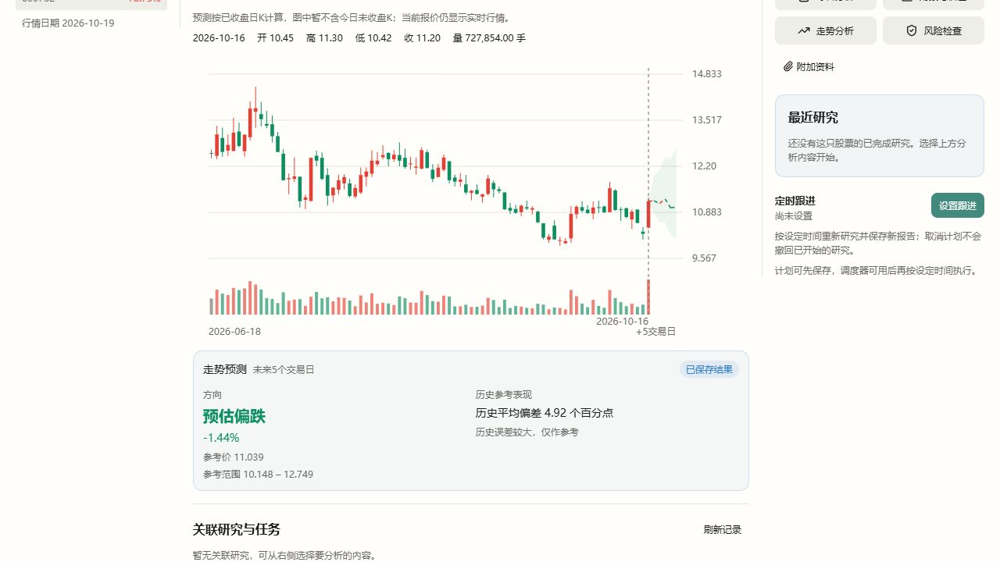

# 爱旭股份日K预测数据准备修复

- 日期：2026-10-19
- 范围：投资工作台日K预测的数据准备；分时和分类模型不在本轮修改范围。
- 补丁：`0036-daily-return-history.json`。

## 真实故障

对正常开发服务读取600732.SH：分时预测可返回7个未来点，日K返回`forecast_data_insufficient`。脱敏日志精确定位在`_daily_bars(adjusted=True)`，尚未进入因子和模型阶段；不是模型判断横盘或未通过历史成绩门槛。

腾讯原始日线本次返回990根、包含2026-10-19盘中未完成K；前复权返回989根、截至2026-10-16。除当前日历不齐之外，去掉今日后，较早183根历史的价差也不符合原生加法复权转换器支持的条件，转换失败。旧实现要求整段标记为`split_dividend`才使用，因而把有效后缀一起拒绝。

实测从2023-06-16至2026-10-16的最近806根，原始价与真实`qfqday`的开高低收逐项相同且均正，原生转换器因“没有要转换的行动”同样返回None。这不代表该连续区间的真实价格不能用于收益计算。

## 修复与Vibe能力来源

1. 先通过原生Tencent Loader读取原始日线，按已有行情时间规则确定最后已完成交易日；再把同一截止日交给复权Loader，不让未完成当日K参与复权转换。原始1500天请求起点保持不变。
2. 沿用原生`DataLoader.fetch`、`convert_additive_to_multiplicative`；原生成功转换的历史仍按原逻辑使用，没有放宽转换器或给不兼容数据强行盖章。
3. 当整段转换不可用时，只有所有分页确实来自`qfqday`，且原始/前复权日历完全一致，才比较四个价格字段，保留最后连续、逐项相同（绝对误差不超过1e-8）且均正的后缀。缺少qfq来源、没有有效后缀、日期不齐仍拒绝。
4. 原生Loader只新增实际响应来源标记，避免其`qfqday or day`退化被误判为成功取得复权数据。不新增下载器、第三方依赖或Host金融计算。
5. 后缀明确记录`adjustment=none`、`return_basis=raw_equals_qfq`及排除行数，不伪造送转、分红或历史价格。该区间收益口径与已取得的前复权价格等价，公共`adjusted_return`指收益评价口径，不表示对原始价格实际做了缩放。
6. 训练数据、价格口径及排除行数进入原生实验留档；原有至少50条已知标签、训练内特征选择、独立时间检验、日K持久缓存均保持。分时解析只在分时分支执行，日K不再要求存在分钟记录。

实际完整服务器验证时还遇到腾讯复权端点的HTTP501。独立无服务器进程的同请求也失败，返回腾讯WAF访问限制页，不能归因于服务器导入或模型。现仅在腾讯复权读取无数据时调用Vibe已有`EastmoneyLoader.fetch`，沿其固定`fqt=1`取复权；不绕过访问限制、不新增金融Loader。原始行情与备用复权仍须按上面相同的日历和四价规则核对，并分别留档`raw_source=tencent`、`qfq_source=eastmoney`。两源都不可用时仍准确报告不可用。

这属于Vibe数据接入适配，预测仍使用已交付的原生方向分类模型、因子、时间检验和数学期望价格路径；不能把恢复计算说成准确率提高。

## 实际修复结果

最终源码使用真实公开行情计算，基于2026-10-16已收盘价11.20，806根已验证历史、最远预测步801条已知训练标签，排除旧183根。腾讯来源可用时首次实际计算20.29秒；腾讯受限、使用Vibe东方财富备用源核对时23.65秒，五个预测点完全一致。

| 未来交易日 | 参考价格 |
| --- | ---: |
| 1 | 11.2126 |
| 2 | 11.1368 |
| 3 | 11.2673 |
| 4 | 11.0086 |
| 5 | 11.0388 |

最后5日预测的独立历史检验267条：方向命中48.69%、平衡方向命中51.10%，平均偏差4.92个百分点，价格不变对照4.74个百分点。真实到期结果尚未齐备，未证明可靠方向优势；没有用这些成绩隐藏计算结果或改成横盘。

## 验证与运行包

- 新增6项原生数据准备回归通过，网络只在叶节点替换，实际执行Tencent请求解析、分页、复权转换、日期截断和预测数据准备；覆盖缺少真实qfq来源拒绝以及标签不足仍拒绝，另在双方网络叶被替换的条件下，实际验证原生东方财富备用源及来源留档。
- 现有原生预测服务与行情契约8项回归通过，包含日K缓存跨新进程复用。共14项相关回归，未运行与本次无关的前端/Rust全量检查。
- 新代码和测试Ruff检查通过；原生Tencent Loader既有导入排序I001未改，仅该原生文件检查时忽略该既有项，没有批量格式化。
- 最终受管包`stock-vibe@0.1.16+mona.forecast.7`，195,812,711字节，SHA256 `015f1454d5f5b444e46732adecb1de72c2801d048185359ee365a3c20751a96f`，通过统一安装器安装、激活，Python generation `4c5ca9f26b6861d4cd55d583d04fbe52`。较早的本轮试构建不是最终交付版本。
- 保留旧版本和用户数据。已运行的旧原生实例不会被强制终止；正常dev重启后使用修复包。

- 最终包首次安装在清理占用中的旧Python环境时遇到Windows文件访问错误；只读核对确认新环境已就绪，重试统一安装器成功。本轮未修改通用环境清理策略。

- 最终包通过正式Host、鉴权、受管进程及原生存储实际返回`mona-directional-curve-v4+9a034f997fd21813`，五个日K点、起点11.20、截止2026-10-16；`Cache-Control:no-store`。第二次读取保留编号和点位，标记`reused=true`。原生实验留档确认本次qfq验证来源实际为eastmoney。
- 实际页面完成添加600732、切日K和开启预测，可见曲线、未来5交易日、-1.44%、参考价11.039及历史平均偏差4.92个百分点；浏览器错误日志为空。页面明确按已收盘日K计算，当前实时报价另外显示。
- 前端本轮没有源代码改动；临时验证页面、只读代理和隔离Host核对后关闭，没有通过强制停止当前用户实例应用更新。运行包可能同时包含其他并行开发模块，本轮只验证上述日K链路。

