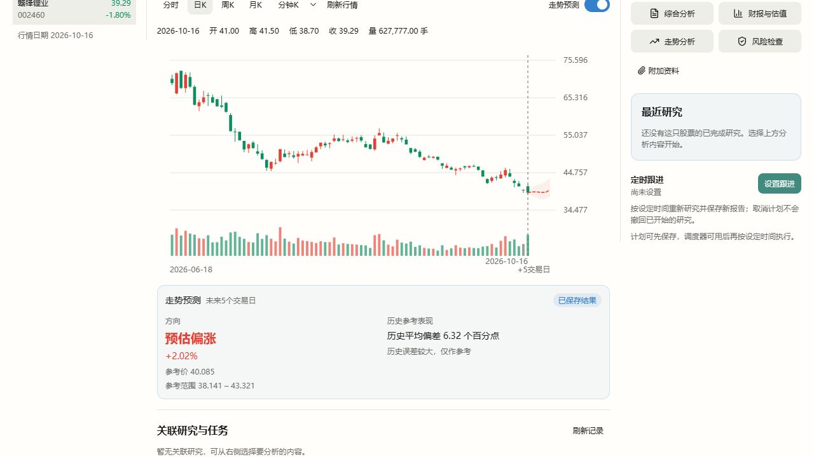

# 投资工作台：方向模型与价格曲线交付

- 日期：2026-10-18
- 范围：投资工作台的日K和分时预测；其他Tab与全局主题不在本轮范围。
- 当前实现：`0035-directional-curve.json`，在固定Vibe源码上扩展，不使用已删除的旧股票逻辑。
- 替代：[0031/0032历史方案](stock-vibe-forecast-v2.md)中“必须胜过价格不变才发布”的规则。按用户最新要求，将计算结果与效果评价分开展示。

## 来源与实现边界

| 复用或扩展 | 实际来源和作用 | 本轮限制 |
| --- | --- | --- |
| 原生ML方向模型 | `agent/src/skills/ml-strategy/SKILL.md`中的随机森林、梯度提升、L2逻辑回归；沿用未来收益>0分类和`2p-1`方向分数 | 上游是研究代码模板，不是已训练好、可保证准确的预测服务 |
| 原生ML特征 | 同一模板的10项OHLCV特征；回归测试直接提取原函数对照，输出完全一致 | 仅日K使用完整OHLCV；分钟源没有真实OHLC，不能伪造 |
| 原生因子库 | 实际审核478项，当前三股日K可计算271项，207项按跨股票需求、缺数据/依赖等原因排除 | 不是478项全用于拟合；每个预测步仅在训练段内筛选最多12项，5个模型的并集可超过12 |
| 原生时间工具 | 分钟11项因果特征、原生purged walk-forward切分与泄漏检查 | 分钟特征按交易日及缺口重置；目标不得跨日或跨观测缺口 |
| 数学价格路径扩展 | 分类倾向×训练集涨跌幅条件均值，逐预测步生成期望价格 | 不是Vibe已有的成品价格预测API，也不承诺方向正确 |
| 接入与展示 | 原生侧完成数据、模型、留档、历史检验和跟踪；Mona只鉴权/读取/展示 | 不把金融计算迁到Host或前端 |

没有为了凑“全部能力”而混用不同含义的工具：跨股票IC需要股票面板；财务、行业、事件需要当时可获得的历史数据；GARCH是波动率工具且可选依赖未锁定；策略PBO/DSR与费用回测衡量交易策略，不能冒称价格预测准确率。LLM不编造价格。上述缺口不做全局启用门槛。

## 如何算出走势

对每一个未来时间点h，使用当时已知的历史分别训练方向模型：

1. 估计上涨倾向p。标签规则与Vibe模板相同：h步收益大于0记为上涨，否则记为非上涨。
2. 只用该次训练数据，计算上涨时的平均收益a，以及非上涨时的平均收益b。
3. 参考收益为`m = p × a + (1-p) × b`，参考价为`当前价格 × (1+m)`。
4. 日K分别算未来1、2、3、4、5个交易日；分时分别算未来1、5、10、15、20、25、30个交易分钟，临近收盘只保留当日仍在未来的点。直接连接这些估计点，不添加好看的随机波浪、未来K线或未来成交量。

这是全期望公式下的类条件均值近似：同一类别内暂以历史平均幅度代表未来幅度。上涨倾向与预期收益方向可能不同，例如上涨较少但平均涨幅更大；页面的偏涨/偏跌按参考价格计算。模型分数不当作已校准上涨概率，更不当作准确率。

样本中只有一类、或没有可用特征时，明确采用历史涨跌分布参考：`p=历史上涨比例`，公式退化为历史平均收益；这不是强制替换成不变价格。至少需要50条真实、已有结果的训练标签；不足时才无法计算。验证窗口不足时使用事先固定的随机森林，保留估算、标明验证不足，不制造成绩。

## 如何选择模型和评价

- 三种原生分类器加等权组合，固定参数、固定随机种子；未新增依赖或按最终成绩反复调参。
- 缺失处理、截尾、方向相关性排序、去冗余及标准化仅在训练段拟合。内层按时间比较价格估计方向的平衡命中率，平均绝对收益误差用于同分选择。
- 最终独立检验之前冻结模型家族；报告该家族在后段的实际成绩，之后才用全部已知标签重新拟合同一家族。最终检验成绩不决定换成更好看的模型，也不决定是否展示曲线。
- 阴影使用更早的外层窗口产生的历史误差10%/90%分位数；排除最终检验及与其重叠的标签。它描述的是整套预测流程的历史偏差参考，不是经过概率校准的80%置信区间，也不保证未来落入。
- 保存原始训练数据摘要、适用性审计、特征、选型窗口、参数、条件均值和预测点；保持已发结果不可改写，到期再核对。

日K按证券、算法版本及已完成收盘日保存结果；同版本同日跨新进程读取不取训练数据、不重新拟合。新版本首次计算会替换旧版本的读取身份。分时随最新真实分钟更新推断，拟合仅用先前完整交易日；冷拟合后重新取最新分钟，缓存返回时剔除已过期的未来点。

## 用户界面

图中显示红绿虚线走势及淡色历史误差范围。下方只保留未来周期、预估方向/幅度、参考价/范围和简短历史偏差；没有算法名、训练记录大段说明或用户已要求删除的行情说明/底部时间文字。历史较弱不隐藏计算结果；数据不足不伪造价格或成绩。已保存日K、盘中更新分别显示简短状态。

## 真实行情核对

以下为公开真实行情、截止2026-10-16收盘的三只股票；每只990根日线。每个5日最终检验有329个可核对起点，窗口2025-06-03至2026-10-09。多日目标有重叠，这些不是329次相互独立实验，不能直接推出统计显著优势。

| 标的 | 起点价格 | 第5日参考价 | 参考涨跌 | 历史方向命中 | 平衡方向命中 | 平均偏差 | 价格不变对照偏差 |
| --- | ---: | ---: | ---: | ---: | ---: | ---: | ---: |
| 赣锋锂业 002460 | 39.29 | 40.08 | +2.02% | 42.86% | 44.77% | 6.32个百分点 | 5.73个百分点 |
| 包钢股份 600010 | 2.09 | 2.08 | -0.46% | 55.02% | 55.08% | 4.68个百分点 | 4.70个百分点 |
| 贵州茅台 600519 | 1329.00 | 1330.33 | +0.10% | 51.37% | 52.12% | 2.19个百分点 | 2.15个百分点 |

平衡命中将上涨、非上涨两类分别核对再平均，避免只猜占多数的一类就得到虚高数字。只猜同一方向时，两类齐备的平衡命中为50%。本轮不能证明系统性优于简单参考，更不能称最佳方案。包钢的误差仅略好，不据此宣传稳定优势。三个标的都输出真实计算的非恒定路径，但“能输出”不等于“更准确”。

首次计算约24.53、20.43、22.71秒；跨全新解释器验证保存复用，三股各仍只有一条发出记录，预测点、编号、原始生成时间完全不变；复用时约0.01秒，数据获取和拟合函数被设为失败仍可读取。

分钟为明确标识的历史回放，时钟2026-10-16 13:40:20，训练截至前一日15:00。起点39.21，输出13:41至14:10七个未来点，30分钟参考价39.16（-0.12%）。最终历史检验212条，方向命中45.28%、平衡命中46.41%，平均偏差0.62个百分点，价格不变对照0.52个百分点；短历史未满足完整内层比较，使用预先固定随机森林。冷计算12.11秒，缓存0.63秒。回放没有记作真实事先预测，到期核对数0。

当前周日休市，本轮未声称完成真实盘中持续观测；新发日K也尚未到期。更高准确率需后续独立股票/时段评价和真实到期跟踪，不能反复针对上述检验窗口改算法再称独立验证。

## 验证与运行交付

- 原生引擎、特征、服务与SQLite近端回归21项通过；Host预测鉴权/状态/禁止缓存契约3项通过。测试直接准备并执行0035最终源码，含原生ML模板特征一致性、强因果/噪声/单类、独立窗口扰动、50条标签边界、跨新解释器复用和过期分钟过滤。
- 前端摘要/图表/工作台相关42项通过；新增历史均值回退标识不冒称当前特征驱动的识别。TypeScript、股票模块边界检查及桌面模式Vite构建通过，相关Ruff检查通过。未声称全项目测试或真实盘中连续观察通过。
- 最终统一运行包`stock-vibe@0.1.16+mona.forecast.4`，包含0001–0035；195,810,356字节，SHA256 `b675bb825440705378b1f71a08605da7a8f065438be6d7a7c5a02eed0236cec7`。统一安装器已激活，Python环境generation `051720b317ca77856deac6c41250324d`，保留旧版本和用户数据。包内其他并行模块不在本轮验证声明内。
- 交付最后核对时，并行任务已激活`stock-vibe@0.1.16+mona.opportunity.5`。只读确认其收据包含0035，且预测引擎、特征、服务三个文件与本轮已验证源码逐字一致；保留该更新包，没有回切覆盖并行开发。以上真实界面/成绩仍以本轮实际验证的forecast.4身份记录。
- 正式Host路由、现有鉴权、受管进程和Gateway模型绑定完成真实读取；仅隔离本轮股票数据根，没有写用户模型配置、没有调用LLM研究。实际新模型版本`mona-directional-curve-v4+a7cf4574eb77d005`，与真实行情探针相同。Host返回五个真实计算点、`Cache-Control: no-store`，第二次读取保留编号/点位并标记已复用。
- 当前工作树前端经仅允许本机同源GET的临时代理连接上述正式Host，实际完成添加002460、日K、开启预测。页面可见+2.02%、参考价40.085、历史偏差6.32个百分点及“历史误差较大，仅作参考”；有预测虚线和范围，无被删除的行情脚注/生成时间长段落。浏览器错误日志为空。
- 临时页面、代理与隔离Host验收后关闭；未关闭用户9527/17173/17174现有dev实例。已运行原生进程保留旧版本，重启当前dev后加载已安装新包。

