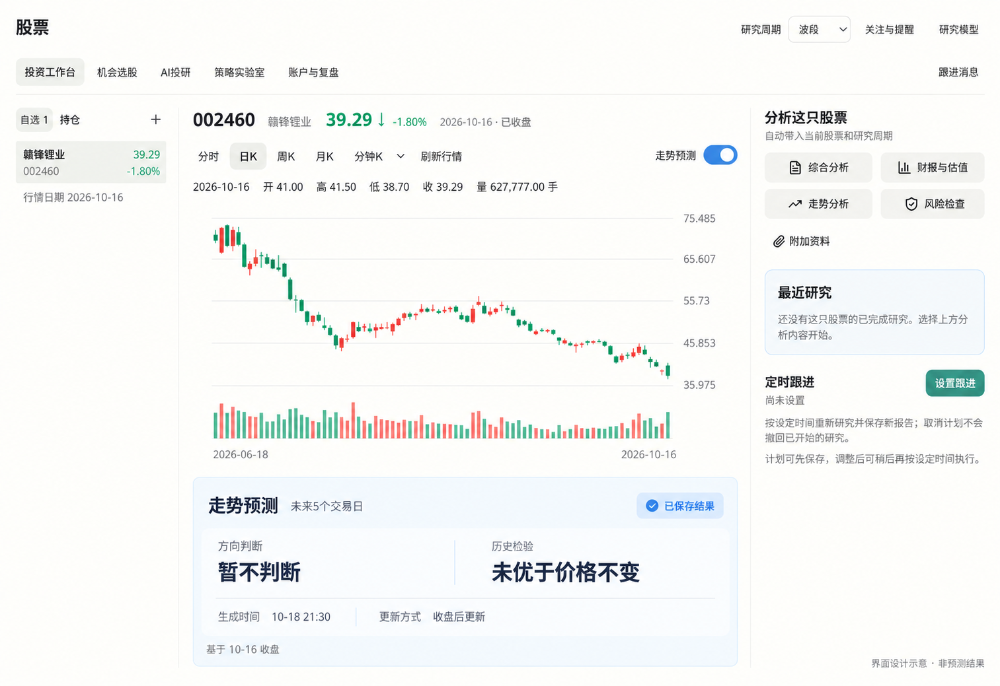
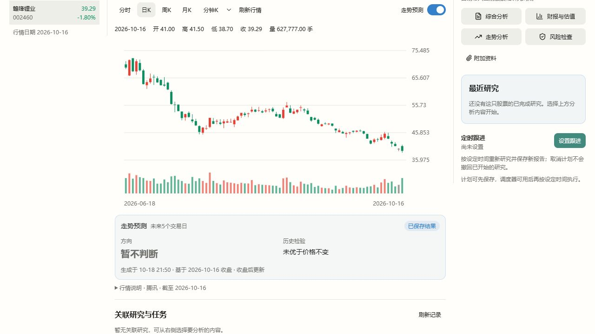

# 投资工作台预测区：产品界面与日K复用

日期：2026-10-18。本轮只调整投资工作台预测结果展示及原生日K结果复用，不更改全局主题、其他Tab、预测模型类别或发布门槛。

展示修订：按用户后续反馈，删除整段“行情说明”和摘要底部的生成时间、数据截止与更新说明；日K持久复用逻辑及已保存标记保留。“历史检验”改为“预测可靠性”，无优势时显示“暂未证明能准确预测”，数据不足时显示“数据不足，暂无法评估”。下方原型与首轮验证截图保留为历史设计记录。

## 功能来源与用户价值

| 用户要知道什么 | 数据来源 | 用户界面 |
| --- | --- | --- |
| 当前能否判断方向 | 原生signal_state、实际发布预测点与理由 | 方向判断：偏涨、偏跌、接近持平、暂不判断或数据不足 |
| 有没有可用的价格预测 | 已发布步的价格、起点和历史误差范围 | 只有有效预测才显示预计涨跌、参考价格、参考范围；没有结果不填0、不画平线、不堆空价格卡 |
| 过去的预测是否可靠 | 独立时间检验的mae、baseline_mae与适用状态 | 预测可靠性：暂未证明能准确预测、数据不足暂无法评估，或历史预测误差减少比例；不冒充未来命中概率 |
| 是否正在复用已有结果 | 日K持久结果命中标记与分时周期 | 已保存结果、本次生成、盘中更新；不再显示底部时间与更新说明 |

面板复用现有语义Token，采用浅蓝连续表面和清晰的两列信息层级；普通操作保持中性，金融数据涨红跌绿。模型个数、训练过程、复权解释和长段成绩说明不占默认界面。

## 更新规则

- 日K按股票、预测算法来源版本、已完成收盘日保存第一次完成的结果，含“暂不判断”。重启后可以直接读取SQLite，既不重新取训练行情，也不重新计算因子或拟合模型。它是结果缓存，不能把放弃预测算作已发出的方向预测。
- 同一份收盘数据不重复计算；新收盘数据到来才生成新结果。交易时段内使用上一完整收盘日。周末沿用已保存结果，不按自然日零点反复训练。
- 缓存有效期到下个可能收盘时点。收盘后源仍滞后时短时重查行情，同一个收盘日仍读取原结果；不能把昨日收盘冻结到明天。只延长同一结果的有效期，不覆盖首次生成时间或内容。
- 临时错误不长期缓存。算法来源版本变化需重新评估；这是模型升级，不是普通重启。
- 分时绕过日K持久缓存，随可用源的新交易分钟推理。日内模型可复用，但预测时点保持当前观测，不把日K保存结果当实时预测。

## 对算法的判断

当前方案作为带对照的研究基线有意义，作为向普通投资者普遍提供走势判断的最终算法，证据不足。原生固定实现实际只有Ridge、随机森林、梯度提升三个家族；参数组合与基准不能当成七种独立先进算法。

此前三只真实股票的同日期诊断里，所有固定方向候选均产生非零估计，但误差全部高于价格不变。短历史验证与模型身份错误已在0032修复；修复不能转化成预测有效的结论。用户仍普遍拿不到有效方向，说明功能尚未达到预测产品的效果目标，而非应当继续包装成“价格不变”。

下一轮模型工作应先固定跨股票、不同时间段的评测集，以Vibe已有方向分类研究步骤和真实市场/行业上下文开展对照实验，再判断是否改变预测目标及模型。不得为输出涨跌而取消独立检验、让LLM编目标价、套用未经验证的股票池分数，或宣称“用了更多因子就是最佳”。本轮不在没有实测证据时另换算法。

## 图像原型

以下为使用内置imagegen编辑参考界面产生的原型。参考为实际股票页08截图，仅改变预测结果区；图中时间用于版式示意，不能当真实计算记录。



<details>
<summary>最终生成提示词与方式</summary>

方式：内置image_gen，参考现有股票界面，非HTML或Canvas代替原型。

```text
Use case: ui-mockup. Edit the reference screenshot into a polished, credible high fidelity Chinese desktop stock investment workbench UI prototype. Reference is the actual Mona stock module; preserve its existing white warm surface, header, 5 tabs, compact watchlist on left, candlestick chart in center, research sidebar on right. Change ONLY the forecast result area beneath the chart into a productized summary panel. Keep neutral ordinary research buttons, restrained soft blue for the forecast panel accents, Chinese A-share rise red / fall green for all financial data; no global theme changes, no colorful rainbow buttons. Wider desktop composition 1600x1100-ish so the whole forecast panel is readable. Existing stock is 002460 赣锋锂业, current price 39.29, -1.80% green, last market date 2026-10-16. The chart is historical only; DO NOT draw a flat future prediction, future fan, or fictitious directional forecast. Forecast switch is ON and blue. Under chart, a single continuous lightly tinted forecast panel with subtle borders and precise aligned information hierarchy, not a paragraph. Panel exact Chinese heading '走势预测', small period '未来5个交易日', right aligned pale blue badge '已保存结果'. Two prominent aligned groups: small label '方向判断', large value '暂不判断'; small label '历史检验', value '未优于价格不变'. Lower metadata row: '生成时间 10-18 21:30' and '更新方式 收盘后更新'. Bottom minimal caption '基于 10-16 收盘'. Use readable elegant Chinese system sans-serif, clean type hierarchy, enough spacing but compact density. No model names, model counts, training terms, confidence percentage, invented target price, lengthy warnings, explanatory paragraphs or extra product features. Preserve sidebar practical analysis entry points and a quiet empty recent research state. Bottom corner unobtrusive label '界面设计示意 · 非预测结果'. This is a prototype of the no-valid-direction state, not a claim of prediction performance. Make panel easy to scan in one glance and visually cohesive with the reference.
```

</details>

## 实施与验证

新增0034原生补丁实现日K保存和读取；Mona只展示结果，不在宿主训练。

- 原生SQLite相关12项、服务相关6项回归通过。新解释器中将行情及训练叶子设为“调用即失败”，仍可同步读回同一笔已保存日K结果；分时仍进入自身实时处理，不复用日K记录。
- 图表、摘要和工作台共40项前端回归通过，类型检查与桌面模式前端构建通过。仅更新必要的原文案断言，保留股票身份、周期切换、无方向不绘线等检查。
- 使用最终包源码的真实002460行情：首次生成32.2927秒；全新解释器复用0.0016秒。该数字只衡量原生预测读取/计算，不代表桌面或引擎完整启动耗时。生成时间仍为2026-10-18 21:50:58（上海），日K结果表保持1行，真实发出预测表保持0行。
- 真实安装包通过正式Host及Gateway绑定读取，直接返回`status=ok`、`generation.reused=true`，没有重新排队；生成时间与首次一致。正式HTTP读取约0.672秒，未将它描述为完整桌面启动耗时。响应仍禁止HTTP缓存，持久复用由原生显式管理。
- 受管包为`stock-vibe@0.1.16+mona.forecast.3`，195,808,643字节，SHA256为`b2fecdebad94c694a21d3fa09b1f7aad2ed957d6c2f8c0fb45cc3fd827bf24f5`；统一环境generation为`eee146d0042c3913fbe95544aa64c5e4`。安装包的来源收据含0001–0034，其中0033属于并行机会模块；本轮只验证和提交本任务内容，不能把打包等同于其它模块完成。
- 实际页面核对已保存标记、原始生成时间、真实行情、浅蓝摘要、无方向不绘平线；浏览器没有JavaScript错误。检查使用正式路由/真实受管包、隔离股票数据根及只读本机代理，没有重启用户实例或改模型设置。临时页面与Host均已关闭；用户当前dev重启后加载新运行包。
- 当前三只真实股票仍没有获得通过检验的方向预测。本轮没有更改预测模型、降低发布门槛或宣称准确率提升。




## 0035：数学价格路径与效果分开

按用户最新要求，已取消历史成绩不胜过价格不变就隐藏预测的规则。实际复用Vibe方向分类器、10项原生ML特征和适用因子，以类条件收益均值生成日K/分时价格路径；弱历史成绩单独显示，日K持久复用保持。当前规则、真实成绩与边界见[价格曲线交付](stock-vibe-directional-curve.md)，前文保留为历史验证记录。
