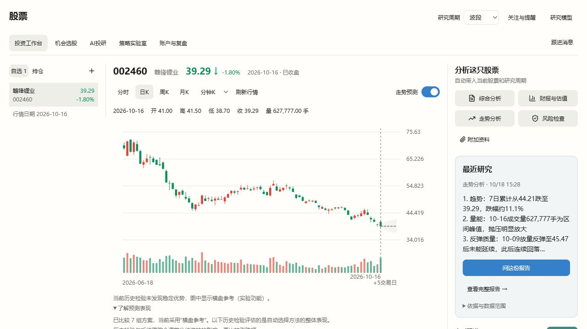
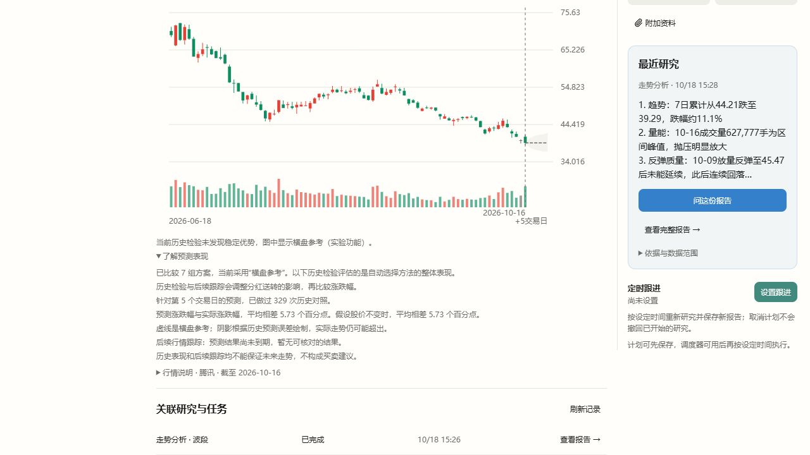
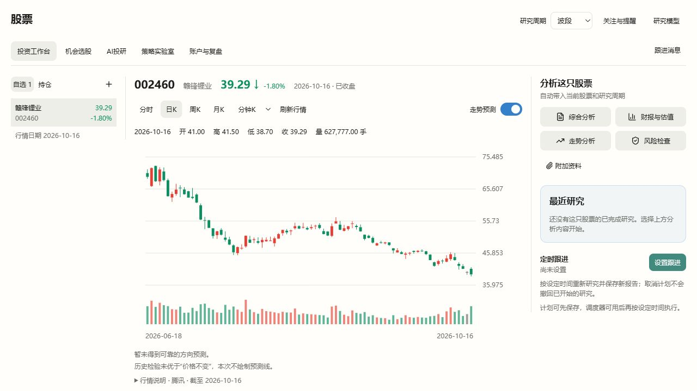

# 投资工作台走势预测交付版

范围：只升级现有分时和日K预测；保持股票模块的现有入口，不改全局主题、不引入旧股票逻辑、不保证预测准确率。

当前状态：下文0031记录保留为历史。0032已修正短历史验证、发布模型身份和“无预测”语义，见文末。此功能没有被证明具有真实方向预测优势，不能称为最佳预测方案。

## 能力映射

| Vibe能力 | 本次用途 | 边界 |
| --- | --- | --- |
| 行情加载器及真实分钟数据 | 历史训练、当前价格、到期结果核对 | 日K只用已收盘数据，分钟标签不跨日或缺失观测；不伪造OHLC/VWAP |
| 全部478项因子元数据、Registry | 检查市场、频率、字段、行业与额外依赖，计算适合单股的日频候选 | 排除横截面算子、语义降级和缺依赖因子；计算失败逐项记录，不能声称全部有效 |
| 因子时序算子 | 分钟收益、均值、波动、量比等 | 分钟特征是频率适配扩展，不冒充原生日频因子库的分钟验证 |
| ml-strategy、ml_quant_lab | 实现其特征处理、模型比较、时间验证和集成研究流程 | 这些是示例与研究预设；不冒充现成预训练模型，不在每次刷新时派发LLM研究 |
| scikit-learn受管依赖 | 比较正则回归、随机森林、梯度提升及候选集成 | 固定有限搜索空间、确定性种子；不临时安装未锁定依赖 |
| purged walk-forward及泄漏审计 | 外层评价、内层选型，按标签终点隔离训练与测试 | 所有处理只在训练折拟合；最终独立检验只允许按预定规则退回中性参考，不能借此重新挑选模型 |
| 多重检验工具 | 对候选相对零收益对照的历史改善作校正 | 配合有时序块结构的重采样；不将统计量当成未来命中概率 |
| 原生数据根/产物 | 保存预测版本、数据指纹、方法选择、各预测步的比较与到期结果 | 原始预测不可改写，到期核对幂等；只有实际已发生且口径一致的数据才评分 |
| 横截面IC、严格因子基准、行业状态 | 保留为股票池研究能力，说明本次不适用原因 | 单只股票不伪造股票池，不能把IC当价格误差 |
| 交易回测、DSR/PBO、组合风险、账户/Shadow | 不混入本次数值预测的成绩 | 本次不生成交易策略或仓位；不能把价格误差冒充策略收益、交易可行性或风险收益比 |
| 财报、估值、新闻/情绪、LLM团队 | 保持现有研究入口 | 缺少历史PIT字段和可验证数值目标时，不把模型文字编成价格因子或改写统计预测 |

## 交付行为

- 冷计算后台运行，页面显示当前步骤并自动读取结果；相同标的、周期、行情时点复用工作，避免刷新重复训练。
- 日K与分时保持独立开关；没有模型稳定超过价格不变对照时，明确显示中性参考，不锁住行情、研究或其他页面。
- 用户默认看到预测范围、参考方法、历史表现和实际跟踪结果；模型代号、完整因子清单和训练诊断留在原生产物中。
- 模型选择和特征处理在内层历史窗口进行，外层时段独立检验。最终模型只使用截至预测时点已观察到目标的记录。
- 保存真实预测与后续结果；没有到期预测时明确说明尚无实际跟踪成绩，不拿历史回放冒充实际效果。
- 在原生数据根按标的积累最近20个交易日的真实分钟观测，按完整日期保留。盘中模型只用已结束的交易日训练，日内新分钟复用模型推理；缺失分钟与隔夜重置特征窗口。
- 原生SQLite保存不可改写的预测与幂等到期评分；训练数据另存压缩CSV、数据哈希、原生源码版本和各预测步的选型记录。已发生的预测始终按原版本评分，不把后续模型版本的成绩混入。

## 具体方法与取舍

日K逐一审核全部478项原生因子，包括市场、频率、字段依赖、行业依赖和是否存在横截面计算。适用项通过两段历史前缀的一致性检查后进入训练。缺失值、异常值截断、目标相关性排序与高相关去重都只在训练窗口拟合；最多保留30项特征，并随样本数收紧上限。

比较7组固定方案：价格不变、3种强度的Ridge正则回归、随机森林、梯度提升，以及Ridge/森林/梯度提升的等权组合。复用运行时已锁定的scikit-learn，不临时下载训练库。分时复用Vibe时序算子形成11个分钟特征，不能把原生日频库直接当分钟库使用。

每个预测步独立选择方法。内层按时间先后比较，收益标签终点在训练与测试之间留隔离；候选还须通过分块重采样、多重检验校正，以及多数时间窗口优于零收益对照。外层再独立检查整个选择流程。最晚的外层窗口只用于独立成绩和预先声明的发布检查：没有超过零收益对照则发布横盘参考，不借该窗口更换另一种模型。误差范围只由更早外层窗口、且标签已在最终检验前结束的误差校准。

因此“横盘参考”表示当前证据不足以给出有优势的方向预测，不是宣称股票会横盘。阴影是历史误差参考范围，不是未来落入其中的概率保证。界面保留这一差别。

## 验证

### 源码及相关检查

- 新增精确补丁`0031-adaptive-forecast.json`，删除0029中旧的7因子预测实现，替换为4个原生模块。Mona只处理鉴权、读取和展示，未引入旧股票模块。
- 最终补丁的原生引擎、因子、SQLite、行情路由与证券搜索回归共16项通过；原生任务服务3项通过，覆盖后台任务去重、未完成日K过滤和不可覆盖的实验留档。
- 前端两个近端文件25项测试通过；TypeScript检查、Vite桌面模式构建通过。相关Python Ruff检查通过。
- Host预测接口3项契约回归通过，覆盖鉴权、pending/完成/不可用透传及`Cache-Control: no-store`；股票模块依赖边界检查通过。
- 原生测试覆盖训练/测试标签隔离、最终检验扰动不影响已冻结选择及校准范围、可学习的合成信号、无优势回退、分钟缺口、版本隔离、真实分钟积累和到期时间。合成信号测试不能当成真实市场准确率。

### 真实日K

使用最终运行包源码及公开行情，截止2026-10-16收盘。三个标的均审核478项、计算271项、排除207项；当前全部选择横盘参考。表中为5个交易日后涨跌幅的平均绝对误差，单位为百分点；与价格不变对照使用同一最终独立窗口、各329条可核对样本。

| 标的 | 收盘价 | 自动选型流程平均误差 | 价格不变对照 | 冷计算耗时 |
| --- | ---: | ---: | ---: | ---: |
| 赣锋锂业 002460 | 39.29 | 5.73 | 5.73 | 28.09秒 |
| 包钢股份 600010 | 2.09 | 4.70 | 4.70 | 22.37秒 |
| 贵州茅台 600519 | 1329.00 | 2.15 | 2.15 | 23.03秒 |

这些结果证明链路可运行、会保留无优势的结论，不能证明预测准确率提升，也不能与旧版不同验证窗口的数值直接比较。

### 真实分钟历史回放

在隔离原生数据根使用真实历史分钟行情，明确把回放时钟设为2026-10-16 13:40:20；这不是盘中实际持续观测，也不会写入用户的实际预测成绩。

- 起点13:40，价格39.21；训练截止前一交易日10-15 15:00，未使用回放当天未来数据训练。
- 实际返回+1、5、10、15、20、25、30交易分钟，目标13:41至14:10，全部晚于回放时点。
- 首次计算9.27秒，同一数据缓存读取0.59秒；11项分钟特征，当前横盘参考。
- 真实后续跟踪核对数为0，回放没有被计为事先发出的预测。

当前为周日休市，交易时段连续更新尚待真实交易时段观察。实际新预测也尚未到期，没有前向准确率或收益结论。该限制不封锁行情、研究或已有预测入口。

### 正常开发环境

最终包`stock-vibe-runtime-forecast-1-final.zip`为195,786,687字节，SHA256为`ef3a91184f88774c24a34d62dec4ec9c41b4f64a225f13a6422f32047bf79e62`，版本`stock-vibe@0.1.16+mona.forecast.1`，包含0001–0031。通过统一安装器激活并保留旧版本与用户数据；Python环境generation为`0a4ccdf1e487ec06e2f03079dd447ead`。

- 在工作树根目录执行`npm run dev`时，9527已被用户从`D:\liuzhe\Desktop\code\Mona`启动的主线前端占用；其Services也没有本分支股票接口。因此本轮没有声称完整普通桌面启动通过，也没有关闭或改动该实例。
- 最终页面改用本分支Vite 9528和本分支原生产Host路由17175核对，连接上述真实安装包及正常用户股票数据根。Host使用现有鉴权、进程所有权、受管Python环境和原生存储；只在核对进程内设置不绑定研究模型，未写用户设置，证明行情预测不需要调用LLM。未在该备用端口验证研究模型桥接。
- 真实Host读取经历queued/data/features/validation后返回5个日K预测点，模型版本为`mona-adaptive-walkforward-v2+78964fdd2c7b3343`、当前价格39.29、原生来源收据匹配、响应`no-store`；实际跟踪为等待到期且核对数0。
- 实际页面完成代码添加、分时切换日K、预测开启及“了解预测表现”展开。明确展示7组方案、横盘参考、329次历史对照、5.73个百分点偏差及尚无到期结果；浏览器没有JavaScript错误。正常行情及已存研究照常显示。
- 临时页面、只读代理、备用前端和核对Host均在验收后关闭。测试本分支时，先关闭占用默认端口的另一份Mona，再在本工作树运行`npm run dev`；没有新增启动配置或功能启用门槛。

## 0032纠正：无有效预测不等于横盘（2026-10-18）

用户反馈全部横盘与说明难懂后，重新检查了最终补丁、原始训练产物和同日期对照，确认此前交付不能据“链路运行和回归通过”称为有价值的方向预测，更不能称最佳方案。

### 确定问题和修正

- 旧版360根日线、预测5日后时，两个外层训练段只有0、1个合格内验证窗，因此都回退价格不变；发布检查又比较这个回退结果与同一个对照，恒等地拒绝方向输出。用360根强因果合成信号复现了“全量已选Ridge，最终仍为zero”。现改用原生5折内层切分；80条训练、30条检验、至少2个窗口及统计门槛保持不变。实际窗口不足仍明确放弃，不能仅凭240条标签宣称数据足够。
- 旧版外层检验模型A，却可能在全历史重选模型B后以A的成绩判断是否发布B。现在类别在最终检验前冻结，检验后只用已知历史重拟合同一类别；记录选择截止位置。不能观察检验结果后另换一种模型。
- 分块检验现按验证折、交易日和观测缺口分段，采用真正的滑动块重采样并保留尾部观测；不是将原先非重叠分块均值重采样冒称moving-block。它仍是有限历史下的近似检验，不证明最优。
- 没有有效模型时返回`signal_state=abstain`和空预测点，区分历史不足与未发现优势，不保存为实际发出的预测、不进入到期成绩。部分预测步放弃时，只发布已通过的步，并使摘要成绩对应最后实际发布的步。
- 页面无方向时只显示简短结果，不画横盘虚线、阴影或未来坐标，也不再展示一大段“预测表现”。只有有效预测才展示紧凑的历史偏差和实际跟踪；算法名、数量、训练与复权说明移出默认用户文案。

### 真实对照揭示的效果边界

对0031留档的三只真实股票、同一个5日最终检验窗口重算所有预先声明的固定方向候选。每组都产生了非零估计，证明并非数值被写死；但全部候选在这三个窗口中都比价格不变差。

| 标的 | 价格不变平均偏差 | 固定方向候选中的最低偏差 |
| --- | ---: | ---: |
| 002460 | 5.73个百分点 | 6.27个百分点 |
| 600010 | 4.70个百分点 | 4.82个百分点 |
| 600519 | 2.15个百分点 | 2.23个百分点 |

该最低值仅为诊断统计，不得据检验结果事后选型。新修正解决确定性错误，不构成真实股票准确率提高的证据。

固定Vibe中没有遗漏一个已部署、已锁定依赖、可直接替换且已证明更好的价格预测器。`ml-strategy/SKILL.md`含RF/GB/Logistic方向分类示例，`ml_quant_lab.yaml`是研究编排；LightGBM等只是提示词要求。`quantlib/timeseries.py`的GARCH波动、OU参数与Markov状态识别不是价格路径服务，所需`arch/statsmodels`也未进入现有锁定运行环境。当前7组实际只有3个模型家族，加参数设置、组合和基准；数量不能说明预测质量。分类目标、股票池及更多时点有效数据需要另立公平实验，不能为避免空结果而临时套入后宣称升级有效。

### 本轮验证与安装

- 预测引擎与服务5项近端回归通过；360根强因果信号可选非zero，最终检验扰动不能改变检验前选定类别，4个完整训练日的分钟历史明确标为验证不足。真实SQLite核对放弃预测不入库，混合有效步只发布3、4步且摘要指向4步。
- 因子、行情和名称搜索6项相关回归通过；图表及工作台30项前端测试、TypeScript、Vite桌面模式构建和相关Ruff检查通过。未对未改动模块扩大全量测试。
- 最终受管包版本`stock-vibe@0.1.16+mona.forecast.2`，包含0001–0032；195,787,164字节，SHA256为`aa55f17e4ee706f1e8b57b515ab3c0f13decba0236efd03108f1d941aa4dfa3d`。统一安装器已激活，Python环境generation为`7f9d67640d0d650b2e6b8f966208fbc5`，保留旧版本和用户数据。
- 对最终包源码重新读取三股真实行情，均返回`abstain`、空预测点、不含预测编号/发出时间，隔离SQLite预测记录数均为0。冷计算分别约19.99、15.09、11.99秒；这不构成准确率改善。
- 实际安装包经正式Host、鉴权、受管进程及当前Gateway模型绑定启动；仅隔离原生数据根，未改用户模型配置、未执行研究请求、未打断当前普通dev。真实响应为`mona-adaptive-walkforward-v3+fa3d9e2c32851eb3`，`no-store`，无有效预测不入账。
- 实际页面核对日K开关开启、真实行情保持可用、仅两句无方向说明，没有旧长段落、预测平线或未来坐标，浏览器没有JavaScript错误。临时页面、只读代理及核对Host均已关闭。
- 已运行的旧原生进程保持其版本以免中断任务；当前dev重启后使用新运行包。此次没有把验证状态做成用户启用条件。

## 0034：产品化摘要与日K持久复用

预测区域已改为方向、历史检验、生成时间和更新方式的摘要面板。日K连同无方向结果按已完成收盘日持久保存，重启后直接读取，不重新取训练数据或拟合；新收盘数据到来才生成新结果。分时保持盘中更新。算法本轮未变，也没有新增有效性结论。[原型、规则及真实验证](stock-vibe-forecast-product-ui.md)记录了跨新解释器复用、原始生成时间和实际运行界面。

## 0035：数学价格路径与效果分开

按用户最新要求，已取消历史成绩不胜过价格不变就隐藏预测的规则。实际复用Vibe方向分类器、10项原生ML特征和适用因子，以类条件收益均值生成日K/分时价格路径；弱历史成绩单独显示，日K持久复用保持。当前规则、真实成绩与边界见[价格曲线交付](stock-vibe-directional-curve.md)，前文保留为历史验证记录。
