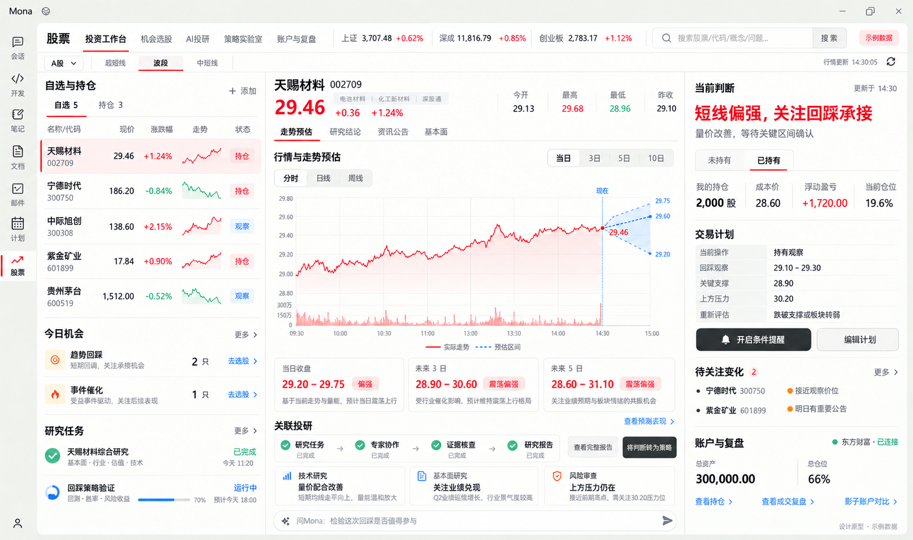
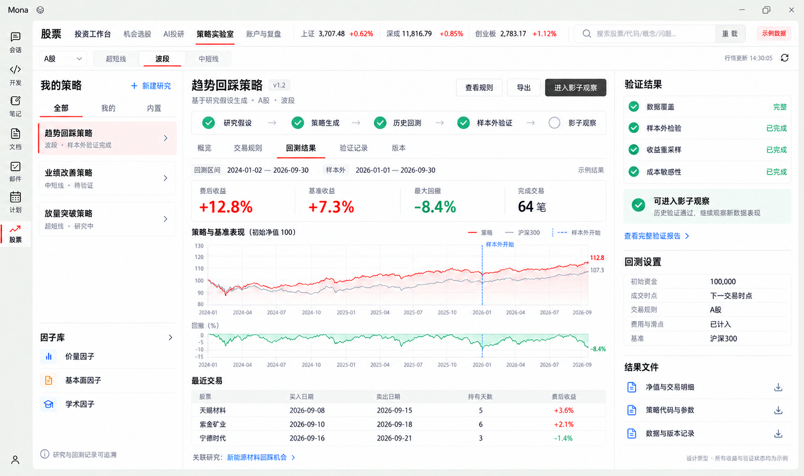
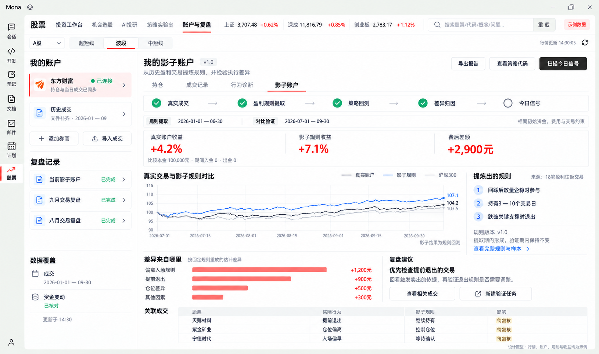

# Mona 股票模块功能设计方案 V1

- 状态：历史讨论稿；后续开发以 [股票模块 Vibe 开发实施方案](../plans/stock-vibe-development-plan.md) 为准
- 日期：2026-10-16
- 产品范围：A 股；超短线、短线波段、中短线由用户选择
- 上游基线：本地 Vibe-Trading 0.1.16 源码包；实施前须确认对应提交和依赖版本
- 本次交付：功能设计与三张原型图，不涉及产品代码实现

## 1 产品方向与复用原则

股票模块以 Vibe-Trading 的金融研究体系作为长期基础，提供从自然语言研究、专家协作、策略生成、回测验证，到真实成交复盘和 Shadow Account 的完整流程。用户每天可以找到值得研究的机会、判断自己的持仓、跟踪重要变化，并查看 AI 方法与个人交易的实际表现。

**建议采用 Mona 宿主加 Vibe 金融引擎的方式。Vibe 已经完成的能力按完整调用链沿用，Mona 负责应用入口、界面、平台连接和必要适配。现有 Mona 股票业务逻辑不作为新方案的实现基础。**

具体遵循五项原则：

1. 保留 Vibe 的研究运行、团队调度、工具与技能、证据核查、策略资产、回测产物、交易记录和 Shadow 数据模型。
2. 一次研究、一次回测和一份账户快照各有唯一事实来源。界面直接读取原生产物，不重新计算另一套收益、胜率或结论分数。
3. 新增能力进入 Vibe 现有的工具、数据源、连接器或团队配置边界。新增原因和对上游的改动单独记录。
4. 以固定上游版本维护可追踪的适配补丁，保留来源与许可文件，持续评估上游升级。遇到缺陷时修复真实问题，不用旧 Mona 逻辑替代整段流程。
5. Mona 的桌面、模型接入、权限、通知和统一运行时管理继续承担平台职责。金融算法和研究流程由 Vibe 运行域负责。

这意味着，使用 Vibe 的回测引擎，就同时保留配置、策略代码、数据加载、市场规则、交易记录、指标与验证产物；使用 Shadow Account，就保留从成交解析到规则提取、代码生成、回测、归因和信号扫描的完整流程。

## 2 一期功能范围

一期交付以下能力。它们共同构成可用的 A 股研究和复盘产品，不以页面数量或专家数量作为完成标准。

| 功能域 | 一期交付 | 与 Vibe 的关系 |
| --- | --- | --- |
| AI 市场研究与选股 | 自然语言提出研究问题；分析市场、行业和催化；筛出候选；比较候选；查看入选与排除依据 | 沿用研究运行、工具、技能和团队；增加 A 股预设与产品入口 |
| AI 诊股与研究报告 | 结合行情、财务、公告、网页、文件和账户快照研究个股；展示团队进度、证据、分歧与结论；支持继续追问 | 整体沿用 AgentLoop、swarm、grounding 与报告产物 |
| 策略实验室 | 从研究假设生成策略草稿与代码；浏览适用因子；回测、比较、严格验证、保存版本和导出 | 整体沿用 hypotheses、strategy、factors、backtest 及其原生产物 |
| 研究记忆与方法改进 | 保存偏好、研究反馈、假设、结果和自定义方法；后续研究召回；改进建议形成新研究任务并重新验证 | 沿用 memory、skills 与原生写入工具；绩效反馈转为改进任务是新增产品流程 |
| 账户与真实交易复盘 | 连接券商或导入成交；查看资产、持仓与记录；分析交易表现、行为偏差和组合风险 | 沿用 trading、portfolio、trade journal；扩展 A 股在线连接与必要账本字段 |
| Shadow Account | 从个人盈利交易提炼规则；生成策略并回测；比较实际交易与规则结果；查看归因、报告、代码和今日信号 | 整体沿用原生 Shadow 流程；补充公平比较的时间和账户数据约束 |
| 当日及短期走势预估 | 按周期输出方向、区间和变化原因；展示预测时间；到期自动检验；概率仅在校准后提供 | 新增预测能力，使用 Vibe 的数据、计算和产物边界 |
| 主动盯盘与定时研究 | 持仓和观察池的条件变化提醒；盘前研究、盘后复盘、定期策略复验 | 沿用 scheduled research；新增低延迟条件事件入口与 Mona 通知适配 |

一期的市场入口限定 A 股，账户接入以读取与分析为范围。保留上游多市场和交易连接的扩展结构；其他市场、自动实盘执行和完整前向模拟账户账本安排到后续阶段。

## 3 交易周期与结果口径

| 用户模式 | 默认研究与预估期限 | 筛选和诊股重点 | 验证与复盘重点 |
| --- | --- | --- | --- |
| 超短线 | 当日余下时段、次日及随后数日 | 盘中量价、题材持续性、相对强弱、隔夜事件 | 交易时点、可成交性、价格限制、费用与隔夜风险 |
| 短线波段 | 未来 3、5、10 个交易日 | 趋势、回踩、事件催化、行业强弱 | 费后收益、回撤、持有期和退出规则 |
| 中短线 | 未来 10、20、40 个交易日 | 业绩改善、行业景气、估值和催化兑现 | 行业与市场贡献、资本占用、假设兑现和组合风险 |

模式影响候选排序、团队预设、预测期限、策略约束、提醒和成绩评价。历史结果始终保留产生时的模式；切换模式创建新的分析视图或运行，不改写旧结果。

同一只股票可以同时具有不同期限的判断。界面将当日变化与持有周期结论并列显示，交易计划以用户选择的周期为主。

## 4 产品入口与页面关系

顶层设置五个入口：投资工作台、机会选股、AI 投研、策略实验室、账户与复盘。运行历史、报告与任务进度在这些页面共用，不另建一套任务系统。

| 页面 | 主要内容 | 主要行动 |
| --- | --- | --- |
| 投资工作台 | 自选与持仓、行情与走势预估、当前判断、交易条件、待关注变化、关联研究与任务 | 发起研究、调整观察条件、查看报告、进入策略验证 |
| 机会选股 | 市场状态、行业线索、自然语言条件、候选列表、依据和风险；每天突出少量值得研究的候选 | 比较候选、加入观察、启动团队研究、验证选股方法 |
| AI 投研 | 问题和附件、研究范围与截止时间、团队阶段、证据、分歧、报告和后续问题 | 继续追问、打开来源、保存假设、转为策略实验 |
| 策略实验室 | 我的策略、适用因子、假设、规则、代码与参数、回测、验证、版本和方法表现 | 生成策略、运行实验、比较结果、导出、创建定期复验 |
| 账户与复盘 | 券商连接、资金与持仓、成交记录、行为诊断、组合风险、影子账户 | 同步或导入、核对覆盖范围、提取规则、运行影子对比、扫描信号 |

AI 投研是一项完整任务。Mona 普通会话也可发起该任务，结果仍属于同一个金融研究运行；界面、会话和后台通知共同引用它。

## 5 核心使用流程

### 5.1 从研究问题到选股和诊股

用户选择交易周期，输入自然语言问题，也可以提交网页或资料。系统沿 Vibe 的原生工具与技能取得数据，选择适用于 A 股的团队预设，基于同一研究上下文执行任务，最后通过证据核查生成持久报告。

候选卡展示入选原因、主要催化、相对行业优势、数据时间、适用周期和需要继续验证的问题。重点候选默认控制在 3 至 5 个，完整筛选结果可以展开。没有合适结果时，说明筛选条件与排除原因。

个股报告优先回答：当前主要判断是什么、最有力的依据是什么、什么变化会改变判断、已有持仓与尚未持有各应关注什么。详细过程、专家分歧和原始材料按需展开。

多智能体采用 Vibe 的原生依赖与工具授权机制。A 股产品预设从研究、技术或量化、基本面与事件、风险和汇总等职责组合；角色数量由任务决定，不将旧 Mona 的固定六角色流程重新套入。

### 5.2 从研究假设到策略验证

用户可以将报告中的可检验判断保存为假设，也可以直接描述策略。原生策略生成流程产生明确的股票范围、信号、入场、退出、持仓、参数和代码，然后进入原生回测。

完整流程为：研究假设 → 策略草稿与代码 → 数据准备 → 回测 → 验证 → 保存策略与证据 → 定期复验。

每次实验都保存数据来源与时间、配置、代码版本、交易成本、基准、净值、交易记录和验证产物。页面以这些原始结果生成图表和下载，不在前端或另一套服务中重新定义金融指标。

| 结果分区 | 用户可查看的内容 |
| --- | --- |
| 策略定义 | 信号、入场与退出规则、持有期、仓位、适用范围、参数和代码 |
| 回测表现 | 费后收益、基准、净值与回撤、交易次数、持仓和逐笔明细 |
| 策略回测验证 | 原生交易盈亏序列重排、收益统计重采样和分窗口评价；独立区间运行与成本敏感性属于一期新增实验编排 |
| 严格因子验证 | 原生同一股票池随机因子对照、可选训练与测试拆分；按实际调用展示多重检验修正，不代替整套策略验证 |
| 数据质量 | 覆盖范围、复权方式、历史成分、财务发布时间、缺失和不支持的市场规则 |
| 方法生命周期 | 研究中、验证中、可观察、效果变化、需要复验；映射原生策略状态 |

严格因子验证应接通上游现有计算入口。原生普通 Web 因子评测并不自动执行全部严格检验；一期须把可用的严格方法与产品验证状态连通，不能仅增加一个“已验证”标记。因子验证通过也不等于策略交易效果通过。

对固定策略，分别在开发区间和未用于修改规则的验证区间调用同一原生回测引擎，以及用不同费用假设重复运行，属于一期新增的实验编排。它保留原生策略、配置和运行产物，不另写回测算法。不同类型的实验只显示实际执行的检验，未运行的检验不得统一显示绿色通过。

原生通用验证中的分窗口评价不等于重新训练策略。页面明确写出实际执行的方法；任何滚动重训能力只有真正实施后才可以按该名称展示。

### 5.3 从真实成交到 Shadow Account

Shadow Account 保留 Vibe 的原生含义：**从用户历史盈利的完整买卖交易中提炼规则，并将规则生成策略代码进行回测、归因和当日信号扫描。**

完整流程为：成交解析 → 买卖配对与行为诊断 → 盈利交易特征与规则提取 → 策略代码生成 → Shadow 回测 → 结果归因 → 报告与代码导出 → 今日信号扫描。

东方财富成交文件解析已经存在，应直接沿用。原生规则提取至少需要 5 笔盈利往返交易；未满足时仍提供普通成交复盘，并明确指出无法提取个性化规则的原因。

影子页面展示规则来源、样本数量、适用市场、提取时间段、验证时间段、规则版本、策略代码和结果。提取规则的数据与评价规则的数据应分开；相同区间的回放只能标为历史解释，不能当作独立验证。

公平对照还需要明确初始持仓、现金、入出金、费用、分红、价格口径、股票范围和同一比较期间。原生 Shadow 回测包含选定股票篮子，并非完整重建用户全账户。实际交易与影子测试的股票范围不同时，界面分别列出，不把差额直接解释为执行纪律损失。

**完整真实账户净值曲线属于账户数据补全项。** 只有成交文件而缺少期初持仓、资金流水或期间持仓快照时，不能从已实现盈亏伪造全账户净值；此时展示可以核对的交易级结果与原生 Shadow 指标。

原生归因只按实际提供的字段展示。原型中的额外归因分组、独立验证区间和完整真实净值是目标界面要求，须补齐对应计算或数据后才开放。无法计算的项保留缺失状态，不以零代替。

从策略实验室进入“影子观察”，一期含义是记录已验证版本在新数据上的信号与到期结果。这是原生扫描和研究调度上的轻量扩展；完整实时模拟成交、资金与持仓账本属于后续能力，不与本节历史 Shadow 回测混称。

### 5.4 当日与短期走势预估

价格方向和区间预测是本方案明确新增的能力。Vibe 有数据、因子和金融计算基础，但当前没有可直接交付的 A 股盘中及未来多个期限的成套股价概率预测服务。

预测扩展使用 Vibe 的数据访问、时间口径、量化计算与运行产物。每次输出至少包含：标的、行情时点、生成时点、预测期限、方向、价格区间、方法版本、输入依据和适用条件。模型提供数值，语言模型解释事件与条件，不自行编造概率。

行情按数据到达更新；预估默认按分钟级节奏或重要事件更新，并根据周期调整。连续更新追加新预测，旧预测保留。用户能查看判断为何变化，也能在到期后看到对应的真实结果。

预测验证独立评价各期限的方向表现、区间覆盖与宽度、相对简单基准的改善、不同市场阶段的稳定性。涉及交易评价时计入费用和可成交限制。通过校准后才显示概率；暂不具备验证条件时展示实验状态和可核验情景。

一期应交付可运行的预测扩展与评价流程。是否能作为可靠产品能力发布，取决于样本外和后续观察结果，不能从原型里的曲线推断模型已经有效。

### 5.5 账户接入和真实交易复盘

账户使用 Vibe 的连接器、能力声明、快照与组合服务。新增东方财富及 QMT 或 miniQMT 连接器，向同一套交易记录和研究输入供数；不为每家券商另建复盘逻辑。

一期以东方财富为首要验收对象，主流券商纳入适配计划。首批候选为东方财富、华泰、中信、国泰海通、招商、广发和国信；这是产品适配目标名单，自动连接能力需逐家验证后确定。

| 能力 | 展示与验收要求 |
| --- | --- |
| 资产与持仓 | 展示现金、持仓、可卖数量、来源和最后同步时间；研究读取固定快照 |
| 当日成交 | 持续同步、去重、保留券商成交身份；重复同步不重复记账 |
| 历史记录 | 分别标明接口回补或文件导入、覆盖区间和缺失项 |
| 账户收益 | 区分已实现、未实现、费用、分红与资金进出；缺少必要数据时不显示完整账户收益结论 |
| 行为诊断 | 沿用交易配对和行为分析，查看持有期、交易频率、盈亏分布和相关样本 |
| 组合风险 | 使用快照检查集中度、相关敞口、可用资金和再平衡提案；提案与执行分开 |

界面按券商列出“自动同步持仓”“自动同步成交”“历史回补”“文件导入”等能力。接口可用性受客户端、授权和账户条件影响；文件兼容不等于自动直连。

东方财富官方量化文档提供资金、持仓及日内执行回报接口；普通个人账户的开通条件与历史成交范围尚需实际核验。迅投常用成交查询明确针对当日；另有带日期范围的通用查询，但各券商柜台历史覆盖不应统一假设。相关官方文档见第 12 节。

### 5.6 盯盘和定时任务

定时研究沿用 Vibe 的 scheduled research，覆盖盘前简报、盘后复盘、组合检查和定期策略复验。桌面关闭后的任务是否可继续执行，取决于用户选择的后台运行状态；界面明确任务下次执行时间及运行条件。

新增条件事件入口处理价格、量价、公告、行业变化和原计划失效。事件调用原研究或评估流程，提醒说明变化、相关判断和可采取的下一步。重复事件合并，事件恢复和数据延迟有明确状态。

研究、回测与同步共享原生任务身份。页面可以查看阶段、取消、继续或重试；已完成的产物保留。运行结果未知的写入先核对，不重复提交。

### 5.7 研究记忆和方法改进

沿用 Vibe 的持久记忆、相关内容召回、研究假设与技能修订能力。用户可以查看研究偏好、个人反馈、已验证方法和失效记录，也可以纠正或删除相关内容。

交易反馈可以形成改进假设，例如调整退出规则或观察周期。将绩效反馈整理成改进任务是基于上游原语新增的产品流程，不是声称 Vibe 已经能够自动改好买卖规则。用户采纳改进任务后，经原生策略生成、回测和验证流程产生新结果，保留旧版本结果。

原生 strategy adaptation 保持父策略的信号、入场和退出定义，只允许其已支持的范围、名称或仓位说明等变化。需要改变信号或退出逻辑时，建立新的研究假设与策略，记录来源关系，不能扩大 adaptation 的含义或继承父策略绩效。短期盈亏不会直接被当作能力改进，也不会静默改变已经记录的计划。

普通偏好记忆与金融绩效证据各自保持原有语义。Mona 的用户偏好可作为明确输入提供给研究；股票运行中仍由 Vibe 保存和使用金融研究记忆。

## 6 原型图

三张原型是同一产品结构下的关键页面，全部行情、账户连接、收益与验证状态均为示例。原型表达目标交互，不能作为上游已实现全部图表或预测已通过验证的证明。具体能力来源与新增项以第 7 节为准。

### 6.1 投资工作台

左侧组织自选、持仓、机会和任务，中间展示行情、预估及关联投研，右侧展示持仓上下文、计划和待关注变化。页面提供进入完整研究和策略验证的入口，三个区域共享标的与时间口径。



### 6.2 策略实验室

围绕一份策略显示假设、代码、回测、验证和后续观察。图表、交易明细与下载文件来自同一运行；验证状态可打开查看真实方法和结果。



### 6.3 影子账户

显示从真实成交到盈利规则提取、回测、归因和信号扫描的完整流程。规则提取期和比较期分别列出，真实账户曲线仅在数据充分时出现。



原型由内置 image_gen 生成，生成说明与提示词规格见 [原型提示词](stock-vibe-functional-design-v1/prototype-prompts.md)。AI 投研和机会选股的专门页面将在本方案结构确定后细化，不把它们压缩成工作台里的一张卡片。

## 7 完整复用与必要扩展

| 能力链 | 保留的上游模块和事实来源 | 允许的适配或扩展 |
| --- | --- | --- |
| 自然语言研究与证据报告 | AgentLoop、tools、skills、grounding、session 和 run 产物 | 模型接入、界面和 A 股预设 |
| 多智能体研究 | swarm preset、runtime、worker、依赖关系和持久运行记录 | 选择或新增 A 股团队预设、产品级进度展示 |
| 策略与因子研究 | hypotheses、factors、strategy store、strategy discovery | A 股可用性展示、方法选择和验证入口接线 |
| 回测与验证 | loader registry、市场引擎、配置、代码、交易与指标产物 | 修复确认的规则缺口、接通严格因子验证；新增策略独立区间与成本实验编排；结果可视化 |
| 成交复盘与 Shadow | 原生成交解析、交易配对、extractor、codegen、backtester、reporter、scanner | 在线成交接入、对比期间与初始账户条件校验；缺失的真实净值和归因扩展 |
| 账户与组合 | connector、profile、capability、portfolio 快照与提案 | 东方财富与 QMT 在线适配、必要现金流和历史字段 |
| 研究记忆与技能 | memory、skills loader、skill writer | Mona 平台目录、权限与可查看界面；新增绩效反馈转为改进任务的产品流程 |
| 研究调度 | scheduled research 的任务、执行、结果和投递 | Mona 通知、实时条件事件入口 |
| 价格走势预测 | 原有数据与计算工具作为依赖 | 新增方向、区间模型、校准和预测产物，不宣称上游已有 |

明确禁止的替换方式：用旧 Mona 专家流程再次编排 Vibe 工具；用旧因子评分冒充策略回测；把 Shadow 改成另一个简化止损模拟器；界面重算金融收益；分别保存两份互相覆盖的策略和研究状态。

上游已有但存在边界的能力要如实保留。A 股规则的未覆盖情况、历史成分和数据权限缺口、生成代码的隔离限制，都应成为可定位的补丁或可用性状态。数据截止时间或快照哈希本身不能证明全部数据符合当时可得原则。

## 8 宿主接入与长期维护

建议将 Vibe 金融引擎作为独立受管运行单元，保留原生研究循环和依赖，避免把它逐文件拆进 Mona 的通用 Agent 核心。Mona 前端经宿主适配层调用它，宿主处理安装、启动、模型连接、权限和通知。

拟议结构为：

```text
Mona 股票界面和普通会话入口
            │
Mona 宿主适配层
  模型接入  权限  运行生命周期  通知  UI投影
            │
Vibe 金融引擎
  研究会话与团队  技能与记忆  策略与回测
  成交复盘与Shadow  账户快照  研究调度
            │
按原扩展边界新增
  A股券商连接  价格预测  实时条件事件
```

这是新的运行架构建议。实施前须在长期架构文档中明确受管进程所有权、跨进程契约与鉴权，不能由本讨论稿默默改变现有 Gateway 与 Services 职责。金融研究任务不依赖 Mona AgentLoop 内部对象，模型与通用会话能力通过明确接口取得。

运行时安装使用 Mona 统一组件仓库，固定版本、文件大小和校验值；用户研究、成交、账户和记忆数据与可重建程序分开。前端不暴露内部进程和端口。

上游基线须固定到确切提交。当前本地源码包未带 Git 历史，不能仅以 0.1.16 认定其全部内容与某个发行包一致。保留上游目录与测试契约，维护一份适配差异清单；算法结果的修补必须有输入、输出和原因证据。

现有用户的自选和资料可迁移，旧研究报告保留为历史记录。新引擎的运行、预测与收益统计不混入旧版本产生的结果。

## 9 一期交付顺序

| 批次 | 交付重点 | 可观察的完成结果 |
| --- | --- | --- |
| 1 | 确认上游基线、宿主边界、A 股数据与券商可行性；接通原生研究和团队 | 用户可以从自然语言到持久报告，并查看进度、证据与后续追问 |
| 2 | 完整策略实验和 Shadow 历史流程 | 同一策略可生成、回测、验证和导出；东方财富成交文件可进入原生复盘及规则提取 |
| 3 | 东方财富优先的在线账户接入、主流券商能力矩阵、预测扩展、条件提醒 | 真实账户快照和成交持续进入统一分析；预测按时留档并检验；关键变化可提醒 |
| 4 | 多周期一致性、定时复验、研究记忆、异常恢复和产品验收 | 日常选股、持仓、策略验证与复盘形成连续可使用流程 |

批次是依赖顺序，不是缩减一期目标。预测效果、券商权限和历史数据覆盖属于应尽早验证的阻碍，不能等到界面全部完成再发现。

## 10 后续演进方向

| 阶段 | 向 Vibe 靠拢的重点 | 保持的连续性 |
| --- | --- | --- |
| 一期 | 完整 A 股研究、团队、策略、回测、成交复盘和 Shadow；补齐必要预测与账户入口 | 原生运行、策略身份、数据和产物契约 |
| 二期 | 更充分的策略证据、持续衰减监控、前向模拟账户、更多券商自动连接与更可靠的预测 | 在同一方法和账户体系中积累新证据 |
| 三期 | 在用户明确选择后扩展受控实盘执行及更多专业金融能力 | 沿用上游授权、风险门禁、订单核对和审计链 |

其他市场不进入当前路线承诺，但实现保持上游市场扩展方式。以后增加市场时启用并验证相应数据、规则与连接器，不推倒重做 A 股专用架构。

## 11 一期验收标准

1. **完整链路**：自然语言问题可生成研究与策略，策略可进入真实回测和验证，交易记录可进入原生 Shadow；各环节前后关联可查。
2. **单一事实来源**：同一结果在工作台、报告、导出和复盘中的标的、时间、收益和方法版本一致。
3. **模式一致**：超短线、波段和中短线分别使用对应期限与评价；切换模式不改写旧结果。
4. **回测可信**：明确费用、滑点、市场规则、数据覆盖和验证方法；不把同一净值切片称为滚动重训，不把数据缺口填成通过。
5. **Shadow 对比可解释**：规则来源、提取期、验证期和股票范围明确；真实净值及差异只在账户数据支持时计算。
6. **券商接入真实**：逐家验证持仓、成交、历史回补和导入能力；重复同步不重复记账，示例数据不进入真实统计。
7. **预测可评价**：每次预测事先留档，到期自动核对；按期限显示结果和基准比较，概率有校准依据。
8. **持续使用与恢复**：定时研究、提醒、记忆和任务恢复可用；失败可定位、部分产物保留，已完成的有副作用操作不被自动重放。

## 12 核心依据

以下为本方案对应的上游功能边界和官方接入资料，实施时据此确认固定版本的实际能力。

| 内容 | 依据 |
| --- | --- |
| 研究结果证据核查 | [Vibe loop_grounding.py](/D:/liuzhe/Desktop/code/Vibe-Trading/agent/src/agent/loop_grounding.py:30) |
| 团队执行与恢复 | [Vibe swarm runtime](/D:/liuzhe/Desktop/code/Vibe-Trading/agent/src/swarm/runtime.py:425) |
| 假设到回测桥接 | [Vibe autopilot tools](/D:/liuzhe/Desktop/code/Vibe-Trading/agent/src/tools/autopilot_tool.py:1) |
| 回测运行与产物 | [Vibe backtest tool](/D:/liuzhe/Desktop/code/Vibe-Trading/agent/src/tools/backtest_tool.py:193) |
| 严格因子验证 | [Vibe strict bench](/D:/liuzhe/Desktop/code/Vibe-Trading/agent/src/factors/bench_runner_strict.py:1) |
| 策略证据体系 | [Vibe strategy discovery](/D:/liuzhe/Desktop/code/Vibe-Trading/agent/src/strategy_discovery/facade.py:135) |
| 东方财富成交解析 | [Vibe trade journal parsers](/D:/liuzhe/Desktop/code/Vibe-Trading/agent/src/tools/trade_journal_parsers.py:401) |
| Shadow 规则提取 | [Vibe extractor](/D:/liuzhe/Desktop/code/Vibe-Trading/agent/src/shadow_account/extractor.py:1) |
| Shadow 回测边界 | [Vibe shadow backtester](/D:/liuzhe/Desktop/code/Vibe-Trading/agent/src/shadow_account/backtester.py:164) |
| 券商连接器扩展 | [Vibe trading profiles](/D:/liuzhe/Desktop/code/Vibe-Trading/agent/src/trading/profiles.py:61) |
| 账户快照与研究 | [Vibe portfolio service](/D:/liuzhe/Desktop/code/Vibe-Trading/agent/src/portfolio/service.py:126) |
| 东方财富查询接口 | [东财掘金官方文档](https://emt.18.cn/api/quant-help/python/trade_data.html) |
| 东方财富接口申请入口 | [官方服务平台](https://emt.eastmoneysec.com/) |
| 迅投账户与成交接口 | [XtTrader 官方文档](https://dict.thinktrader.net/nativeApi/xttrader.html) |
| 迅投历史与实时行情 | [XtData 官方文档](https://dict.thinktrader.net/nativeApi/xtdata.html) |

后续讨论首先确认三个选择：是否接受整体 Vibe 金融引擎作为基础；是否接受本方案一期范围与五个产品入口；首批券商自动同步的验收名单如何确定。确认后再细化交互、数据契约和实施计划。
