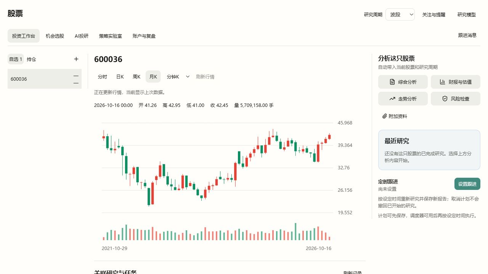

# 投资工作台：先展示行情快照，再异步刷新

- 日期：2026-10-19
- 范围：投资工作台的图表、股票标题和自选报价展示。原生行情读取、身份校验和预测算法保持原有职责。

## 原因与能力映射

原先`StockVibeView`在进入工作台、切股、切周期和手动刷新时都先清空`marketRead`，等待原生接口返回。Workbench/Watchlist的报价只存于React内存，重新进入或重启后报价也丢失。原生`mona_workbench_market.market_snapshot`每次请求真实行情，Host还需完成受管进程和来源身份校验，因此用户会长时间看到空图和“—”。

Vibe的Parquet loader缓存用于过去窗口，当前展示路径不直接读它；`ForecastStore.merge_minutes`的分钟积累用于原生预测训练，缺少完整报价字段，不能当作界面快照。日K预测结果保存也是独立链路。因此本轮新增的是Mona展示适配，不是第二套行情服务或金融算法。

| 用户动作/状态 | 当前行为 |
| --- | --- |
| 打开/重启工作台 | 有成功快照时先显示同股票、同周期的原始行情和自选报价；同时发起真实刷新 |
| 切股票/周期 | 只显示目标股票和周期的快照；该组合从未成功读取时才显示加载状态 |
| 手动刷新 | 保留当前图表、价格和名称，后台取数，成功后替换 |
| 刷新等待/失败 | 标明“上次行情”，保留原始行情日期；失败不清空、不用空响应覆盖，不为同一次后台失败重复弹窗 |
| 请求晚返回 | 已离开的视图不被覆盖；缓存也拒绝比已存`observed_at`更早的结构化报价 |

## 数据边界

- 快照位于浏览器现有localStorage，以`mona.stock-vibe.market-snapshots.v1`保存，按规范证券身份+原生周期隔离。
- 只保存成功、身份和周期吻合、含有效可显示记录的完整公开响应；失败、空数据、畸形数据均不覆盖成功快照。
- 保留实际来源、`quote.as_of`、`trading_date`、`observed_at`和价格口径。缓存读取不会修改观测时间，也不把上次行情标成实时。
- 有界保留最近24份、约2MiB的展示快照，旧快照随容量淘汰。存储损坏或配额不足不阻断真实读取。首次从未获取数据或快照已淘汰时仍需等待实际取数。
- 自选后台成功获取的报价同样保存，下一次挂载可立即恢复所有已缓存名称/价格。
- 缓存不用于原生预测训练、收益评价、研究依据或成交执行。预测请求仍仅发送股票和周期，Vibe自己取真实数据并沿用已交付的数学计算、日K持久保存与分时更新。
- 没有改HTTP `no-store`、本机鉴权、进程归属、运行时仓库或用户模型配置。

## 必要验证

- 展示快照11项近端测试、页面读取流程4项回归通过；覆盖跨新模块读取/新挂载、股票周期隔离、异步成功、失败保护、乱序和容量限制。
- Workbench/Watchlist相关31项回归通过，含后台取数前先显示已保存名称/报价、成功后台结果持久保存。现有View相关12项回归通过。
- TypeScript和桌面模式Vite构建通过。未更改Python/Rust或预测数学代码，没有宣称预测正确率改善。

## 实际页面核对

专用Vite服务使用独立预构建缓存；仅允许本机同源GET的临时代理连接正式Host路由、鉴权和已安装的Vibe受管运行包，使用隔离数据根。仅在核对进程内关闭研究模型绑定，未写用户配置、没有调用LLM。没有关闭用户开发实例。

- 招商银行600036真实月K成功返回61根，最后记录2026-10-16、收42.45；页面重载后恢复同一股票周期和真实图表。
- 手动刷新后请求尚未返回时，实际页面保留K线、OHLC和成交量，并显示“正在更新行情，当前显示上次数据。”；成功后刷新提示移除。
- 本轮盘前分时接口对600036、002460实际返回unavailable及空记录，未伪造成功数据或写入快照。分时/日K的缓存先显示、后台成功替换、失败保留及报价恢复由近端回归验证；没有把月K页面证据冒称当日分时成功验收。
- 验证代理仅为workbench-market增加8秒传输延迟，返回体仍为真实原生结果；月K走未延迟的market-data路径，其截图是实际请求进行中的页面。
- 临时浏览器页、代理、前端和隔离Host均在核对后关闭，独立Vite预构建缓存随之清理。生产端的no-store及安全校验保持原样。

