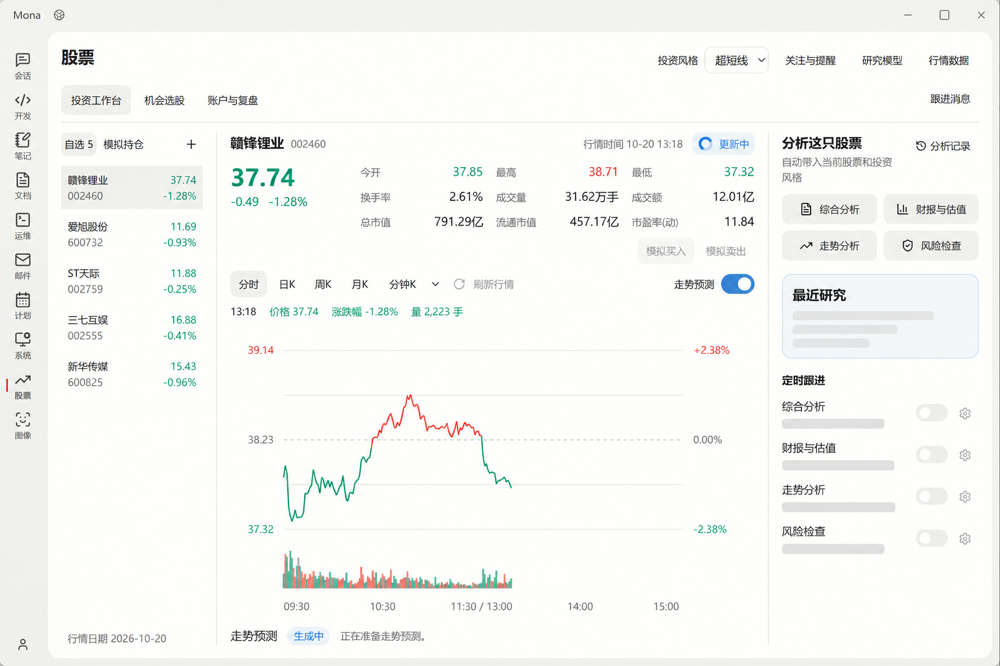

# 投资工作台：行情读取反馈

- 日期：2026-10-21
- 状态：交互设计，尚未实现
- 范围：现有工作台的数据读取反馈；沿用现有布局、配色与行情接口。

图中演示“已有行情，后台更新中”。价格、日期与曲线来自用户提供的界面，仅用于说明交互，不代表实时行情或执行结果。

## 状态与反馈

| 状态 | 内容区 | 行情区右上角 | 操作 |
| --- | --- | --- | --- |
| 首次读取，没有缓存 | 已知的名称、代码保留；报价和图表用贴合最终布局的浅灰骨架占位 | 转圈图标＋“获取中” | 仅禁用重复刷新；其他导航可用 |
| 有缓存，更新中 | 立即显示同一股票、同一图表周期的上次数据，保持正常红绿配色和交互 | 原行情时间＋蓝色转圈图标＋“更新中” | “刷新行情”保持原位置与宽度，暂时不可重复点击 |
| 更新成功 | 原位替换确实取得的新数据，不清空、不重建页面 | 短暂显示勾号＋“已更新”，随后恢复行情时间与盘中／休市／已收盘状态 | 恢复刷新；不发成功弹窗 |
| 后台更新失败 | 已有数据继续可读，原行情时间保留；没有数据时保留局部失败状态 | 同一位置显示“未更新”，提供“重试” | 不弹出打断阅读的自动刷新错误；重试仅获取数据 |

“已更新”依据实际返回数据及其时点判定，不能把读取旧缓存成功当作获得最新行情。更新失败不能把旧数据时间改成当前时间。

## 交互约束

- 行情状态只占用现有右上角区域，不新增提示行、横幅、全屏遮罩或进度卡片；工具栏不重复写一份加载文案。
- 按规范，请求超过 400ms 才显示加载动画，避免快速请求闪烁。没有真实进度时不显示百分比或预计剩余时间。
- 切换股票时只恢复该股票的数据；分时、日 K 等周期也分别匹配缓存。迟到的请求不能覆盖当前股票或周期。
- 自选列表已有报价继续显示；首次尚无报价的数字位置使用局部占位，不把未知值写成零。
- 研究与定时跟进独立读取。首次无记录时，最近研究用短文本骨架，跟进时间与开关使用不可操作的浅灰占位；未读到设置前，不显示“未开启”。已有同一股票记录时保留原记录，读取完成后原位更新。
- 行情更新、研究记录读取、走势预测是独立状态；行情取得成功不能让仍在生成的预测显示完成，任何一项读取也不阻塞整个页面。
- 用户手动刷新失败沿用现有操作失败弹窗，说明行情没有更新并保留原数据；同一次失败不再同时追加错误横幅、Toast 或重复原因。自动刷新失败只在右上角反馈。
- 不扩大或改造原有研究、预测、模拟交易流程；对报价时效有要求的操作继续遵循已有规则。
- 加载区使用可访问的忙碌状态；减少动态设置下保留静态图标和文字。状态变化不改变控件尺寸或页面高度。

## 图像生成记录

- 工具：内置 imagegen，基于当前工作台截图编辑。
- 交付图：`stock-vibe-market-loading/loading-feedback-v1.png`。
- 输入：用户提供的 `codex-clipboard-111aedfc-c729-48a0-a4d1-deb9003739c5.png`，作为编辑目标。
- 最终提示词：保持截图的应用外壳、三个页签、三栏布局、现有控件和红绿行情不变；演示“保留缓存并异步刷新”的状态。仅在行情区右上角原提示位置显示原行情时间和蓝色转圈图标＋“更新中”，工具栏刷新按钮保持原位并暂时禁用。最近研究以三条浅灰文本骨架替换“正在读取”，四个定时跟进任务保留名称、以骨架表示尚未读到的时间和设置，不把未知状态写成“未开启”。不加提示行、横幅、大卡片、遮罩、虚假百分比或页面外标注；输出清晰的浅色桌面界面。
