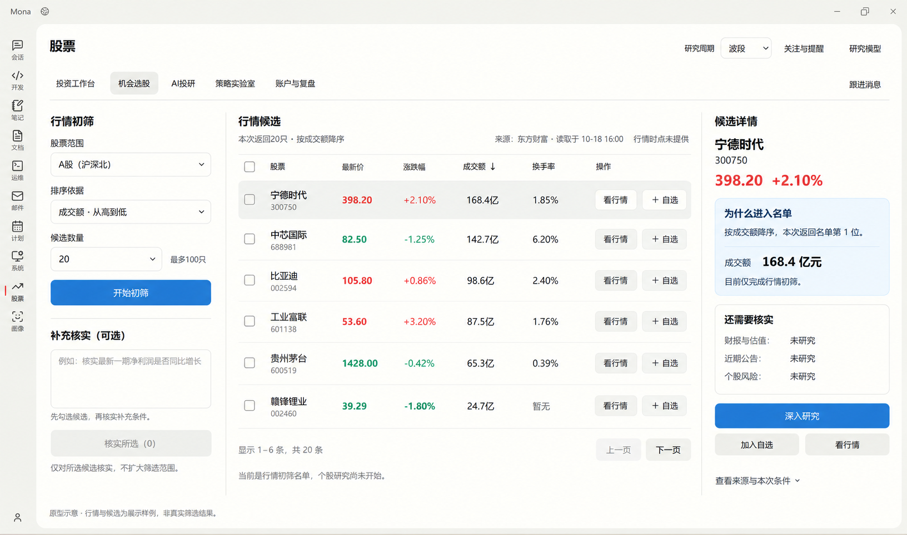
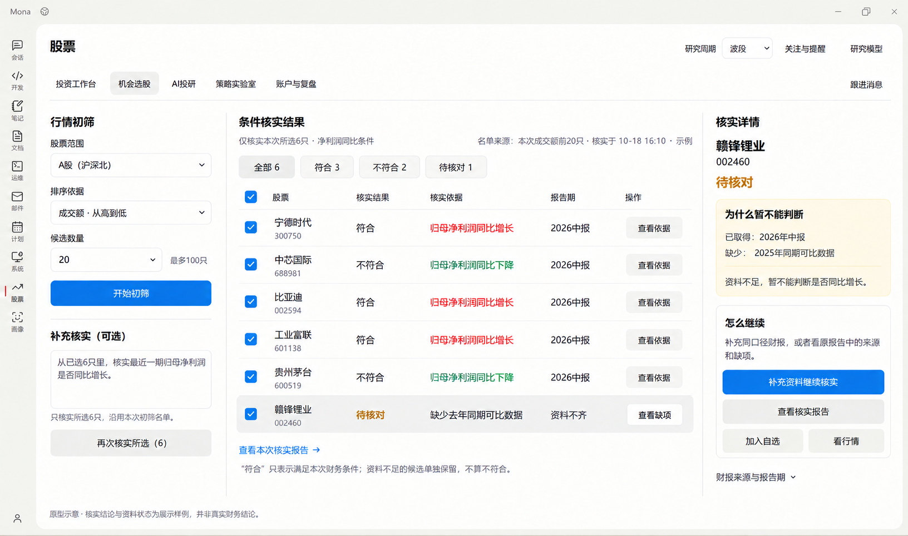

# 机会选股 V1：原生能力、功能价值评估与原型

> 已否决的能力取舍，仅保留复盘。用户明确要求前端友好、后台充分整合Vibe高级科学算法。此版把行情排行作为主流程并将因子/模型/验证后置，偏离目标；后续以[V2完整科学选股链](stock-vibe-opportunity-v2.md)为准，勿据此开发排行榜式机会页。

- 日期：2026-10-18。
- 状态：设计提案，本轮不修改产品代码、不重新生成工作台原型。
- 方法：遵循[股票模块开发标准](../architecture/stock-module-development-standard.md)，先核对原生能力，再做功能映射、普通用户价值评估与图像原型。
- 基础：[原生能力清单与Tab映射](stock-vibe-native-capabilities.md)、[工具/技能清单](stock-vibe-native-capabilities/tools-skills-inventory.json)、[当前工作台实现](stock-vibe-workbench-implementation.md)。
- 视觉：沿用Mona原外壳和导航；只在股票内部使用既有局部配色，普通按钮中性、主要操作蓝色、金融涨红跌绿，不能全局染蓝。
- 当前Mona机会页仍是symbol为空的通用研究表单。以下专用候选页和结构化核实结果尚未实现，不能把本轮原型当完成证据。

## 1. 页面目标与最小闭环

普通用户需要先表达范围和找股依据，拿到一份来源清楚的候选名单，再核实自己关心的条件，最后进入自选、行情或进一步研究。

首批闭环为：**行情初筛 → 查看候选及入选依据 → 可选地核实所选候选 → 加入自选 / 看行情 / 继续原生研究。**

行情指标进入名单和满足财务研究条件是两件分别记录的事。列表必须明确当前属于哪一阶段；不会因为成交额排名靠前就显示“符合财务条件”。

不以账户连接、问财密钥、专业团队授权或验收状态封住基础页面。模型只在实际发起研究时按既有设置校验；免费行情初筛不应要求配置模型。

## 2. 核实后的原生能力边界

以下为锁定Vibe 0.1.16的源码核对，未在本轮联网验证筛选数据源。源码路径相对于锁定的[原始归档](../../third_party/vibe-trading/vibe-trading-source.zip)，本地参考副本为D:/liuzhe/Desktop/code/Vibe-Trading；工具核心文件已与归档对照。

| 原生能力 | 可直接复用的真实含义 | 不能据此声称的能力 |
| --- | --- | --- |
| screen_market | A股/美股/港股当前行情；四字段降序TopN；top_n=1–100、默认30；A股覆盖沪深主创科及北交所 | 任意阈值/多条件、升序跌幅榜、行业/指数成分池、指定代码池、全量分页 |
| 返回行情行 | code、name、price、change_pct、change、volume、amount、turnover_rate；缺值null | PE、ROE、行业、推荐理由、风险分、证券交易所标记、源行情时点 |
| 返回来源 | market、source=eastmoney、排序参数和实际rows | 全市场总数、扫描覆盖率、完整漏斗、逐行排除原因、供应商行情截至时间 |
| /screen | 原生会话中的研究playbook：明确范围/条件、核实数据、区分缺项、形成后续研究队列 | 独立可执行的全A财务筛选服务；文字参数不等于计算已执行 |
| 单股财报与公告研究 | 原生免费Eastmoney财务工具、公告/新闻、资料读取等工具，按候选逐项核实 | 无需数据权限、固定延迟、完整全A多因子批量筛选 |
| iwencai_search | 有独立key时的自然语言查询工具，保留其实际返回字段 | 普通东财账号即已开通问财；免费默认链路必有此能力 |
| 行业信息 | 东财行业/概念归属与行业板块涨跌、涨跌家数、领涨股 | 申万31行业已统一覆盖、行业成分股筛选、景气度分数或轮动买点 |
| 比较研究 | Session和/comps同业估值研究；同口径行情可投影对照 | 回测Compare、因子alpha_compare可以直接当股票比较打分 |
| 保存与重跑 | 原生会话、消息、Attempt、报告/文件及Scheduled | 专用选股方案库、持久候选表、名单新增/移出差异已现成存在 |

### 精确源码证据

- `agent/src/tools/market_screener_tool.py`：35市场、43排序、92行字段、136请求第一页/降序、179参数schema、246 envelope。
- `agent/cli/commands/institutional/playbooks.py:546–638`：/screen；`runner.py:104`的build_prompt及run_playbook只组装研究提示。
- `agent/src/tools/iwencai_tool.py:36,153,171,237`：密钥、注册条件、输入与结果。
- `agent/src/tools/financial_statements_tool.py:764,779,903`：单股、报表/年季/offset与分页结果；`stock_news_tool.py`提供新闻资料，公告使用原生公告工具。
- `agent/src/tools/sector_tool.py:53,160,257,315`：membership/ranking两种能力及参数。
- `agent/src/skills/fundamental-filter/SKILL.md:14`及`agent/backtest/loaders/tushare.py:134,284`：技能示例与真实数据权限边界。
- `agent/src/api/sessions_routes.py`、`agent/src/session/models.py`、`agent/src/session/store.py`：研究与原报告持久化；`agent/src/api/scheduled_routes.py`：原生定时执行。
- `agent/src/swarm/presets/{equity_research_team,sector_rotation_team,quant_strategy_desk}.yaml`：有依据的团队研究方向，但Mona当前Swarm白名单仍只有mona_ashare_research，不能宣称这些团队已接通。
- `agent/src/tools/strategy_discovery_tool.py`检索策略证据，`factor_analysis_tool.py`对输入CSV做因子分析；均不是股票候选发现API。

## 3. 功能逐项评估

| 功能项 | 普通投资者价值 | 用户心智 | 原生依据 / 适配边界 | 设计取舍 |
| --- | --- | --- | --- | --- |
| A股范围与初筛参数 | 高：知道这次从哪里找 | 符合，范围要先讲清 | 原生screen_market支持A股；首版固定沪深北，不假装支持行业池 | 首批保留 |
| 四类行情初筛 | 高：快速找成交活跃或涨幅靠前的股票 | 符合常见看盘习惯 | 原生按涨跌幅/成交量/成交额/换手率降序；不自造综合排序 | 首批保留 |
| 候选数量与条件记忆 | 中高：控制名单长度、避免反复设置 | 符合；数量是最多返回几只 | 原生1–100、默认30；界面可默认20，记住本页参数属Mona偏好适配 | 首批保留 |
| 候选列表与行情字段 | 高：方便浏览和横向看数值 | 符合，名称与六位代码并列 | 原生8个行情字段；金额/百分比/成交量单位须先真实核验 | 首批保留 |
| 来源、读取时间与覆盖 | 高：知道数据是否新、有没有漏项 | 符合；读取时间与行情时点要分开 | 原生仅有eastmoney来源，无行情时点/市场总量；Mona真实记录取数时间 | 首批保留 |
| 为什么进入名单 | 高：能理解排序依据 | 符合，说明指标与本次名次即可 | 由原参数、返回顺序和字段作确定性解释，非原生推荐理由或评分 | 首批保留 |
| 自然语言补充核实 | 高：把榜单变成针对自己问题的研究 | 符合，但必须限定所选候选 | 复用原生Session与/screen研究步骤；默认免费链路不依赖问财密钥 | 首批保留 |
| 条件结果、报告期与依据 | 高：分清符合、不符合和无法判断 | 符合；需明确只对应本次条件 | 原生财报/公告工具与报告；逐条件证据投影是Mona适配，不是现成全A财务筛选服务 | 首批保留 |
| 缺数、部分完成与失败 | 高：避免把缺数据当成好机会或不符合 | 符合，给出可行动的下一步 | 空值保留；未核实/待核对分开；源失败不能伪称无候选 | 首批保留 |
| 加入自选 | 高：把发现转成持续关注 | 符合常用选股动作 | 复用Mona现有自选与证券身份核实，已添加时显示状态 | 首批保留 |
| 查看行情 | 高：核对价量后再决定是否研究 | 符合，不必重复输入代码 | 跳转投资工作台并带同一证券身份；保留本次选股快照 | 首批保留 |
| 深入研究、看报告、继续追问 | 高：理解候选和信息缺口 | 符合，沿着同一问题继续 | 复用Session/Attempt与原报告，附件可补资料；查看不能自动重筛或重跑 | 首批保留 |
| 候选比较 | 中高：在少量候选中取舍 | 符合，先统一口径 | 首批表内对照；专门同业估值比较复用/comps研究流程，非现成打分API | 表内保留，专门比较后续 |
| 行业涨跌与行业研究 | 中：帮助理解背景 | 符合，但涨幅不能叫景气度 | 原生东财行业涨跌/归属工具；无行业成分池筛选，轮动团队另有数据条件 | 后续轻入口 |
| 保存方案与历史快照 | 中高：重复使用、复核变化 | 符合，但不必先做方案库 | 原生会话/报告能留档；独立方案、候选快照与历史索引需最小适配 | 原报告留档，方案库后续 |
| 定时再选一次 | 中高：省去周期性重复操作 | 符合，需要用户主动设时间 | 复用原生Scheduled；机会上下文与结果关联需适配，名单变化diff另需快照 | 后续建议 |
| 验证这个选股方法 | 有条件高：判断规则在历史上是否有效 | 需要解释方法与单次名单的区别 | 原生策略生成/quant团队/回测；进入策略实验室验证，不能由本次排名证明有效 | 跨Tab后续入口 |
| 全A多条件财务筛选或问财增强 | 潜在高，取决于可靠数据 | 用户熟悉，但当前不能误画成已可用 | screen_market不支持；问财另需key，Tushare另需权限；批量/PIT等按缺口单列 | 不放默认免费首屏 |
| 机会分、胜率、自动买卖 | 缺乏可信输入时没有可兑现价值 | 容易被误认成确定建议 | 没有现成可靠股票综合评分/胜率服务；一期不开放交易写入 | 不设计 |

“首批”指设计优先范围，不代表已开发。保存本页排序/数量/补充问题是Mona显示偏好适配，不等于新增独立金融方案库。

## 4. 首批功能与产物映射

| 用户动作 | 原生调用/产物 | Mona最小适配与用户结果 |
| --- | --- | --- |
| 开始初筛 | 原生screen_market；参数market=a、四种sort_by之一、top_n≤100 | 有界Services入口调用原生；投影实际rows、来源、请求参数与宿主读取时间，不重写排名算法 |
| 查看一只候选 | 同一批次原始行情行与排序参数 | 说明本次排序名次及指标；不自动生成风险评级或入选故事 |
| 勾选候选并填写补充问题 | 原生Session、/screen步骤及适用数据工具 | 固定所选证券身份、原初筛批次/参数/来源/读取时间，补充条件仅核实这批标的，不悄悄扩展全市场 |
| 读核实结果 | 原生Attempt、工具证据、报告/文件 | 最小结构化投影条件、报告期、实测值/单位、证据引用与结论；缺关键输入为待核对，未经执行为未核实 |
| 查看原报告/补充资料/追问 | 原Session/Attempt及附件 | 保留对象身份，查看只读取，继续核实沿用原问题及证据，不重新筛全部市场 |
| 加入自选 | 已有Mona自选偏好、证券身份核实 | 去重并显示已添加，当前代码不让用户输入后缀；不创建影子股票身份 |
| 看行情 | 已有投资工作台 | 携带同一证券身份；返回时保留当前选股结果与选中项 |

结构化条件结果不是screen_market原生字段，必须明确归为接入适配。原生只有自然语言报告而没有可核验证据时，可先显示报告和缺项，不能把模型自称“符合”直接计入符合数量。不会另造Mona金融核心、调度或评分引擎。

## 5. 页面布局与交互

### 5.1 三栏与动作层级

- 左：股票范围、四类排序依据、候选数量和“开始初筛”；下方可选补充问题和“核实所选”。
- 中：当前批次参数、实际返回条数、来源/读取时间、候选表；核实后切换为该批所选候选的条件结果，不新增一层产品Tab。
- 右：所选候选为什么进入名单、研究覆盖、缺项和下一步；不做泛化市场仪表或固定成立/失效卡。
- 指标释义使用固定、可核实的普通话：涨幅表示本次行情变化，成交额/量表示交易活跃程度，换手率表示交易相对流通盘的活跃程度。解释只说明找股依据，不推导经营质量、资金净流入或未来上涨。
- 顶部保留当前五Tab和研究周期；研究周期用于后续研究，不改变当前行情排名的时间口径。
- 三栏在桌面宽度下连续收缩，更窄时优先模块内部横向滚动，不轻微缩放就把右栏放到最下面。
- 普通按钮/结果筛选选中中性；蓝色仅用于开始初筛、深入研究等主要动作；涨跌和增长/下降使用红绿并保留符号/文字，缺项用文字说明。

### 5.2 两个不同的范围

行情初筛范围为A股市场，返回所选指标靠前的最多N只。补充核实范围为用户明确选中的候选，不能把“核实6只”写成“全A满足条件6只”。

原型一返回20只、表内显示6只；原型二只核实其中选中的6只，3符合+2不符合+1待核对。上述计数是展示样例，但数量关系一致；不是供应商全市场总数。

### 5.3 条件、数据与版本一致

- 改左侧表单只改草稿；点击开始初筛才创建新批次，旧结果继续标注原条件，不能改名冒充新结果。
- 当前列表内重排与重新获取全市场TopN必须分清；换排序依据若重新请求，记录新批次。
- 核实不重新随机生成候选。允许读取更新资料，但分别保留初筛快照时点与研究资料时点。
- 每个财务条件明确指标口径、报告期和同比比较基期。累计财报不能和不相同口径的单季/全年直接比较；无法对齐为待核对。
- 多条件分别保留证据；符合只表示满足本次明确条件，不能扩展为“值得买入”或“风险已排除”。
- 公告/新闻只对实际取得的覆盖范围作说明，不能把“本次未取得风险公告”写成“没有风险”。
- 已核实和未核实分开；部分完成时报告真实进度，剩余候选继续可看行情和加自选。
- 不显示预测收益/胜率/综合机会分，不将因子IC/IR冒充股票胜率。

### 5.4 数据可用性与缺项

| 状态 | 用户看到与可做的事 |
| --- | --- |
| 未开始 | 说明可选行情排序与范围，开始按钮正常可用；不预填示例候选到正式产品 |
| 初筛运行中 | 显示真实读取进度，保留上批数据及其时点，不反复派发 |
| 初筛返回空行/源异常 | 先确认有效空响应与源失败，不能将不合协议的空数组说成“没有机会”；可重试，不影响工作台/投研 |
| 数值缺失/单位未核实 | 未取得显示“暂无”，单位不明不强行换算或用于条件判断 |
| 核实部分完成 | 已核实/未核实数量与真实任务一致；不先把剩余标为符合 |
| 符合/不符合/待核对 | 逐项理由、报告期与来源；待核对保留并可补资料，不计成不符合 |
| 研究失败/中断/结果未知 | 使用已有反馈和原任务记录；未知写入先核对回执，不自动重新开始选股 |
| 已加入自选 | 明确已添加，重复点击不重复写入；不改变当前批次 |

## 6. 原型

以下由内置image_gen根据Mona现有界面生成。全部行情、名单、财务结论和缺项均为UI展示样例，不是本轮真实选股结果或对图中公司的事实判断。

### 原型一：行情初筛

### 原型二：只核实所选候选

第一张右栏解释为何进名单和哪些尚未研究；第二张针对缺失同比基期说明为什么不能判断，以及如何补充资料。两张均保留全局外壳、普通中性按钮、股票内部主要动作彩色及金融红绿。

## 7. 开发缺口与必要验证

1. 初筛数值口径：原生screener未设置fltt=2且直接_num，不能只按字段名相信价格/百分比/换手率已归一；开发前用真实响应逐字段核对量纲、金额和成交量单位，必要时在原生数据适配边界做最小修正。
2. 原生空响应：当前底层若data/diff缺失会返回空列表，接入时必须区分无数据与错误响应，防止假“无机会”。
3. 专用页面和结果结构：当前Mona只是通用研究表单，需要窄API、候选视图与证据投影；原生没有独立选股方案/列表对象。
4. 结果身份：保存批次、原参数、取数时间、证券身份和原Session/Attempt引用；复用既有请求幂等、事件与报告访问边界。
5. 免费与增强：默认不依赖问财key、Tushare积分或普通东财账户直连；缺一项只影响相应条件。
6. 必要真实验证：四个排序/数量限制、真实价格单位、缺值与源失败、选股与核实范围一致、同比口径、缺项分流、加自选去重、同一股票行情跳转、看旧报告不重跑。
7. 后续建议单列：专门比较研究、行业研究、保存方案/名单差异、定时再选、方法回测，不在首批重建专业平台。

本轮仅交付设计、原生证据和图像原型；未改变运行中股票功能、配置或运行时，也不以本轮设计状态限制用户测试既有能力。

## 8. 生图记录

精确提示词、参考图与最终文件见[生图记录](stock-vibe-opportunity-v1/prompts.md)。使用内置image_gen，无CLI/API密钥路径。
