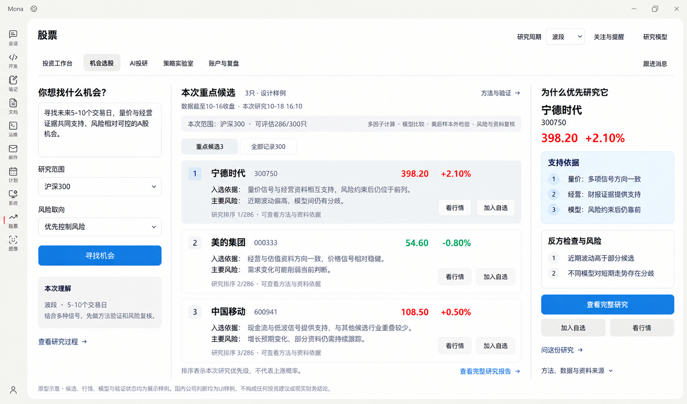
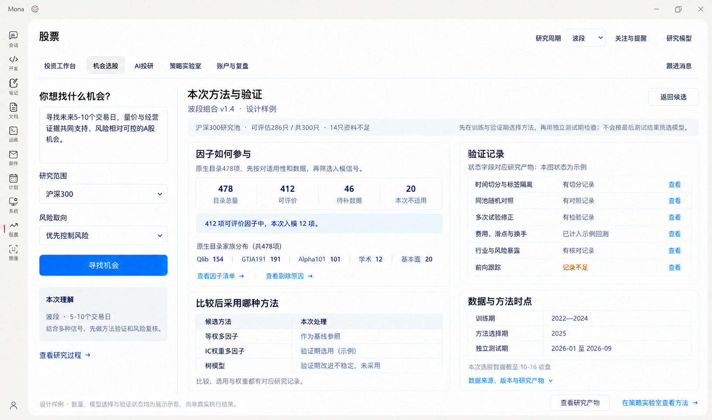

# 机会选股 V2：简单交互背后的完整科学选股链

> 历史方案。2026-10-20起，五个Mona自建策略及自研历史选股评价已退役，只读保留旧产物。当前按Vibe原生团队、SDM策略、AlphaZoo及Backtest产品化，开发以[实施记录第18节](stock-vibe-opportunity-implementation.md#18-原生能力产品化映射与当前验收2026-10-20)和[当前目标](../plans/stock-vibe-native-product-goal.md)为准。

- 日期：2026-10-18。
- 状态：已开发双入口、原生量化选股与研究候选投影；实际执行、验证与未覆盖项见[实施记录](stock-vibe-opportunity-implementation.md)，不等于全部原生能力已完成接入。
- 产品目标：提供有来源的可选选股方案与独立的自然语言选股路径，普通投资者不必先会描述条件；先复用Vibe原生选股机制，缺少现成方案时才组合已有因子与研究能力补齐产品封装。
- 本文件替代[机会选股V1](stock-vibe-opportunity-v1.md)的能力取舍。V1及图片仅保留复盘，不作为后续开发依据。
- 基线：[股票模块开发标准](../architecture/stock-module-development-standard.md)、[原生能力底册](stock-vibe-native-capabilities.md)、[最初功能方向](stock-vibe-functional-design-v1.md)。
- 最初设计阶段完成源码回顾、方案纠偏和[两张V2原型](#10-v2原型与交互状态)；后续已直接开发运行界面，代码与真实执行证据以[实施记录](stock-vibe-opportunity-implementation.md)为准。

## 1. 上一版偏差与当前事实

原先的方向是自然语言研究目标、市场/行业/催化研究、候选比较和验证，并为用户突出3–5个值得继续研究的候选。V1却把screen_market的三个参数当作机会选股的能力边界，把高级因子、方法研究和验证移到实验室或后续，导致主要交付成了行情排行榜。

三个错误需要修正：

1. 普通用户无需操作高级算法，不代表后台无需运行高级算法。
2. 某项能力的专业配置入口在策略实验室，不代表机会选股不能在后台调用同一方法与计算服务。
3. 用自然语言代替筛选表单，不等于产品已经提供AI研究价值；不能把提出研究方向、定义方法与判断依据的责任转给普通用户。

当前真实状态：

| 问题 | 核对结论 |
| --- | --- |
| 机会选股是否已用478个因子？ | 全478项已进入量化方案的逐项适用性/字段/实际计算审计；可计算与最终入模数量由真实数据和训练证据决定，不机械使用全部因子 |
| 是否已调用所有适用高级方法？ | 尚未全部。已接原生因子计算/去冗余、多因子及ML比较、独立时间检验、费用与随机对照；研究技能走Session；完整高级团队、全A/PIT、长期证据和前向复验等仍需贯通 |
| 工作台预测能代替选股吗？ | 不能。工作台预测已由并行的0031–0034补丁更新；它是单股预测。本Tab使用独立的真实多股截面与选股产物，不能相互冒称 |
| Vibe是否只有排行榜和技能文案？ | 否。Registry、ZooSignalEngine、IC/分组/严格因子检验、原生回测、交叉验证、多重检验、策略证据和衰减都有真实代码 |
| Vibe是否已有全部集成完的一键服务？ | 没有。部分高级方法在技能/团队执行要求中，部分数据/编排/训练服务需要适配；应补齐这些工程任务，不能据此退回普通排行榜 |

## 2. 前端与后台的新职责

### 可选方案与自然语言，两条选股路径

- 不会描述条件的用户：直接选择有依据的选股方案，了解方案寻找什么、适合什么周期及主要局限后运行；不要求先填写专业条件。
- 会描述条件的用户：可独立使用“自定义选股”输入自然语言条件，系统核实含义、转换为可执行条件并复用同一数据/筛选/验证链。自然语言不限于排除行业等偏好补充，也不替代可选方案路径。
- 可选方案先从原生已有选股机制和流程中提炼；只有缺少现成用户方案时，才基于已有因子/研究能力组合封装。趋势量价、业绩价值、行业、事件等名称是待核实映射的产品方向，不能先起名字再寻找算法依据。
- 有匹配范围、周期和时点的既有结果可显示结果及时间，没有结果时按所选方案发起研究；不在打开页面时重复启动昂贵研究。
- 后台按方案实际要求构建假设、执行计算与研究、核查反证，不强制每个方案先走一遍相同的市场/行业团队。可以得出没有合适候选，不为填满卡片放宽依据。
- 研究周期沿用顶部选择，范围和风险取向提供易懂的调整项；无需连接账户才能使用基础机会发现。
- 自然语言也可用于微调已有方案，但独立自定义选股入口必须保留；两条路径都提供条件解释、来源、结果和排除原因。
- 结果回答为什么现在值得研究、与其他候选相比的理由、主要风险、什么变化会改变判断，以及依据和时点。

不要求用户勾478个因子、调IC阈值、选模型库或先去实验室完成研究。

### 后台负责

将所选方案或自然语言条件、已选周期与可选偏好变成可复现的任务，优先执行适用的原生机制，构建时点正确的数据，评估因子和方法，按实际任务选择/组合模型、验证含成本结果并研究反证，最后保存有来源的候选与方法证据。即使用户能清楚描述目标，系统仍负责方法选择、竞争假设、验证与反证，而非只执行数据查询。

复杂度体现在真实执行、可复现产物和验证上，不以团队数量、报告长度、因子数量或“顶级AI”字样作为效果证据。

### 两个Tab共享同一能力

| 入口 | 用户职责 | 后台职责 |
| --- | --- | --- |
| 机会选股 | 选择有依据的选股方案，或独立用自然语言自定义，理解候选并继续研究 | 优先执行原生选股机制，按任务组合计算/研究/验证，读取和更新方法资产与证据 |
| 策略实验室 | 深入配置、比较、诊断、修改方法 | 使用同一批原生因子、模型、回测与验证服务；修改产生新版本并重新检验 |
| AI投研 | 读完整研究、追问、补充资料 | 引用同一机会任务、候选、报告与证据，不重新拼一套选股计算 |

screen_market保留为可选行情参考或候选种子。只有明确研究目标需要该种子池时才使用，不能将“成交额前20”隐式变成所有AI机会任务的证券池。

## 3. 478个因子的真实处理方式

| 家族 | 静态实现数 | 本轮核实的适配重点 |
| --- | ---: | --- |
| Qlib158 | 154 | 日频量价；核对输入、warmup、缺失与对应研究期限 |
| GTJA191 | 191 | 日频量价，部分依赖成交额等字段 |
| Academic | 12 | 动量、反转、波动、流动性等；需要同口径数据 |
| Fundamental | 20 | 6项val:*有A股日指标路径；14项fund:*现有bench加载以SEC美股财报为主，A股PIT财报加载是必须补齐的数据适配任务 |
| Alpha101 | 101 | 元数据未标equity_cn不等于公式硬锁市场；可作为A股适配/再验证候选，含行业中性化依赖，不能静默永久砍掉 |
| 合计 | **478** | 全部为日频；目录里377项标注equity_cn并不表示这些已全部算通 |

要求整库进入可审计的适用性/可计算性清单，逐项记录：

- 可计算并已评价；
- 数据字段、历史长度或时点资料不足；
- 该市场/频率/研究目标不适用；
- 计算或验证失败；
- 重复信息、稳定性或成本不合要求而未采用；
- 已进入本次模型的因子、方向、权重来源和版本。

“没有使用”的原因必须真实记录。数据缺口进入开发和数据准备工作，不能成为静默缩减产品目标的理由，也不能用常数/模型记忆填齐。

因子进入最后模型由训练/验证证据决定；478项不机械等权堆叠。选择和权重不能反复根据最终测试集调优。

日频库用于相应日级持有期限。超短线使用日频因子作为慢背景时需明确；分钟信号需要对应频率数据和独立验证，不能搬用日频效果。

## 4. 后台完整链路及Vibe依据

| 阶段 | 应执行的工作 | 可复用原生代码/方法 | 需要整合或补齐 |
| --- | --- | --- | --- |
| 目标与任务定义 | 依据所选方案或自然语言条件形成任务，明确证券池、时点、期限、标签、基准、风险约束与资源预算 | Session、Swarm及swarm_variables；quant_strategy_desk | 将方案或自定义条件落实为版本化、可核对的任务契约，不依赖普通用户先写专业prompt |
| 数据准备 | 时点正确的证券池、OHLCV/成交额、复权、行业、市值、财报披露、可交易状态 | alpha_bench_tool._load_csi300_panel、_prepare_bench_panel、原生loaders | 全A/指定池、历史成员、上市退市/停牌/ST、A股PIT财报与源单位；不静默降级30股冒充全A |
| 因子计算 | 适用库的真实日期×股票暴露 | Registry.list/get/compute、alpha_zoo | 把目录浏览接到真实计算，留存数据指纹、错误/跳过清单 |
| 因子评价 | 多期限IC/IR、分层、稳定性、衰减和随机对照 | alpha_bench、factor_analysis_core、run_bench_strict、alpha_compare | 明确启用时间OOS和随机对照，保留所有尝试，不能只报赢家 |
| 信息去冗余与风格控制 | 相关性、共线信息、行业/市值暴露、标准化 | 原生factormodel的清洗/标准化/暴露函数；factor-research与factor_research_committee | 把技能里的去相关、正交化/PCA和权重估计落实为可复现计算；按本次数据决定适用方法 |
| 多因子合成 | 同日横截面标准化，等权/证据权重对照，生成真实分数与排序 | **ZooSignalEngine.from_zoo(...).compute_signal(panel)**；generate(data_map)接原生回测 | 连接权重估计、贡献/来源记录及证券身份投影；不由前端或LLM另算机会分 |
| ML与组合比较 | 可解释基础模型和适用非线性模型，滚动训练/验证 | ml-strategy的sklearn模板、ml_quant_lab真实研究DAG | 固化数据/标签/训练服务、版本和推理；未锁定安装的模型不能仅凭预设文字就称可用 |
| 市场/行业适配 | 结合真实市场状态与行业/经营/资金证据选择或否定方法 | sector_rotation_team、equity_research_team、strategy discovery及原生行业/资料工具 | 不把当日行业涨幅当景气度，不让AI凭行业标签决定方法有效 |
| 现实交易回测 | 多股票信号经成本、换手与A股交易约束形成收益/风险证据 | 原生backtest_tool、ChinaAEngine | 核实历史成分与时点、费用/税费制度版本、停牌/涨跌停可成交性，避免提示词与真实引擎口径冲突 |
| 严格统计复核 | 时间/标签净化、未参与选择的数据、控制多次试验带来的运气赢家 | crossvalidation：purged/group/walk-forward/CPCV；multipletesting：PSR/DSR/BH-FDR/CSCV-PBO | 按实际样本/标签/完整方案收益矩阵调用；条件不足记录未执行，不能只填“严格验证通过” |
| 候选风控与反证 | 相关与集中、风格/尾部/波动风险，财报/公告与反方核查 | quantlib risk/factormodel、portfolio_risk_xray、quant desk风险审阅、资料工具 | 既展示支持也展示冲突/缺项；方法回测表现不能当单只股票收益概率 |
| 方法资产、证据和衰减 | 保存方法、代码/数据/版本、验证/候选结果，持续检查效果变化 | SDM、strategy_discovery、refresh_strategy_evidence、get_strategy_evidence、sdm_decay_scan、Scheduled | 连通原生对象与本次排名；子方法需独立验证，不继承父绩效；无持续数据不能默认健康 |

### 三种源码状态必须区分

1. **已有可调用代码**：Registry、ZooSignalEngine、IC/分组、严格因子检验、时间交叉验证、多重检验、回测、风险、证据与衰减等，优先直接复用。
2. **已有研究模板/DAG，需要实际执行与固化**：复杂去冗余/权重学习、部分ML与行业轮动组合。原生已给方法和角色，需要把真实输入、执行代码和产物串接。
3. **当前接入或数据缺口**：Mona仍限制特定Swarm；全A与A股财报PIT、统一机会任务/模型训练/排名投影等需补齐。缺口属于开发范围，不代表从产品目标中删除。

不要求把期权、固定收益等不适用于当前A股机会任务的全部数学库强行运行；所有相关高级方法都进入能力覆盖矩阵，并说明本次真实使用/未使用原因。

## 5. 两种运行节奏

### 方法研究与维护

按版本完成适用因子计算、筛选/去冗余、模型/组合对照、含成本历史与独立区间验证，保存为原生研究/策略资产；按数据和方法变化或原生定时任务更新证据，监测衰减。

### 用户寻找本次机会

匹配范围/期限/时效的原生方法与证据 → 计算最新可用截面 → 合成与风险约束 → 研究/反证前列候选 → 输出3–5个重点候选与完整可展开结果。

用户无需每次重新进行全部方法挖掘，也无需在实验室手工完成后台准备。数据/模型/方法缓存必须绑定真实快照与训练截止；新任务不能借用不匹配市场、时期或周期的历史业绩。

## 6. 用户结果应展示什么

| 普通用户看到 | 后台必须有的依据 |
| --- | --- |
| 这批候选与我的目标有什么关系 | 目标、证券池、持有期限、风险约束与同一任务身份 |
| 为什么优先研究这只 | 当前截面真实模型分数/分位/排序、参与信号与贡献、经营/行业/事件证据 |
| 哪些风险与观点冲突 | 原生风险指标、反方资料、方法分歧、缺失和资料时点 |
| 这套方法可信到什么程度 | 实际样本外与基线对照、成本/换手结果、使用期和最近复验；不虚构概率 |
| 数据覆盖到哪里 | 本次实际证券池和因子可用/待补/不适用记录，不能用预设数量冒充执行量 |
| 下一步能做什么 | 加自选、同一股票行情、同一机会报告/会话追问、方法详情 |
| 想深入核对 | 折叠的因子/模型/数据/方法版本、IC/IR/OOS/成本/统计检验与原生产物 |

**可以展示真实算法产生的模型分数、分位和排序。** V1“不要评分”范围过宽；应禁止的是凭空拼分与把研究分数包装成上涨概率。模型全局重要性与单只股票的具体贡献也要区分，解释来自真实计算，语言模型负责转述和证据联系。

候选未通过本次证据或数据要求时，任务仍可展示研究过程、数据缺口与淘汰原因；不虚构优质候选填满页面，也不新增全局功能启用/验收门槛。

## 7. 原生实现也需要核实的科学边界

- run_bench_strict默认不自动启用OOS，默认t阈值也不等同完整多重检验；不能仅调用名字带strict就宣称全套验证。
- alpha_bench/alpha_compare产出因子层统计，股票当前排名必须来自真实横截面计算。
- 分层收益曲线不能替代完整费后可交易组合回测。
- factor_research_committee原DAG中矿工与验证员并行，需通过同一候选集合/面板/标签产物建立依赖；不能让验证员凭空验证另一批因子。
- 原生团队提示词与真实A股引擎的费用示例存在不一致，实际版本化费用模型和日期制度是计算依据，不能照抄提示文字。
- PSR/DSR/FDR/PBO需要各自前提与全体尝试记录；缺方案收益矩阵时不能制造PBO值。
- style/risk函数不是商业Barra，不能改名宣传；VaR不等于最大损失。
- 日频、多市场元数据、财报发布日期、跨股同日标签都需保持时点和频率一致。

这些是整合质量任务，应在Vibe计算边界修正/补齐，不回到旧Mona股票逻辑。

## 8. 源码证据

相对于锁定本地Vibe源码，关键因子文件已与原始归档对照：

- `agent/src/factors/registry.py:325`：Registry.compute。
- `agent/src/tools/alpha_zoo_tool.py`、`alpha_bench_tool.py:309,865`：目录与A股面板。
- `agent/src/factors/factor_analysis_core.py`、`bench_runner_strict.py:317`、`compare_runner.py`：IC/分组/随机对照/OOS/比较。
- `agent/src/skills/multi-factor/zoo_signal_engine.py:110,146,219,251`：from_zoo、compute_signal、头寸转换、原生回测适配。
- `agent/src/skills/factor-research/SKILL.md`、`ml-strategy/SKILL.md`：研究方法及可执行训练模板。
- `agent/src/swarm/presets/quant_strategy_desk.yaml:148–180`、`factor_research_committee.yaml:54–225`、`ml_quant_lab.yaml:113–130`、`sector_rotation_team.yaml:214–244`：高级团队与依赖。
- `agent/src/quantlib/crossvalidation.py:227,292,417,490`、`multipletesting.py:217,339,393,463`；`tools/quantlib_tool.py:65–79`：真实计算与可调用白名单。
- `agent/src/quantlib/factormodel.py`、`risk.py`、`agent/backtest/engines/china_a.py`：风险/风格与实际交易约束。
- `agent/src/strategy_discovery/facade.py:428–504`、`adaptation_workflow.py`、`tools/strategy_discovery_tool.py`、`sdm_decay_scan_tool.py`、`strategy_store/decay.py`：方法证据/适配/衰减。
- 当前Mona `webui/src/components/stock-vibe/StockVibeView.tsx`机会分支仍调用通用StockVibeResearch；`third_party/vibe-trading/patches/0029-hosted-workbench-market.json`固定7因子单股预测，均不代表本规格已实施。

## 9. 后续设计与实施依据

下一版功能清单与原型由本文件的计算链和产物契约推导：以主动机会发现、易懂的场景入口、重点候选、原因/风险/证据和方法详情为主。V1的四排行和可选核实不再作为机会页主流程；自然语言输入不能再占据默认入口。

实现顺序围绕真实数据面板、因子/方法评估、组合与ML/验证、候选产物、前端投影贯通；不用先做一个普通榜单再将高级方法长期后置。保持统一运行时、原生金融执行、现有模型桥接、只读研究范围和真实流程验证。

## 10. V2原型与交互状态

**入口设计已被用户再次纠偏。** 以下图片保留候选、依据/风险、方法详情的视觉参考；左栏以自然语言为默认起点的设计不再指导实现。后续页面按第11节主动发现与场景化映射修订，本节图片不代表该修订已经完成。

### 主界面：目标、重点候选、依据与风险

左栏用自然语言表达目标，仅补充研究范围与风险取向。中栏优先展示少量重点候选、入选理由、主要风险和实际研究排序；排序表示研究优先级，不包装为上涨概率。右栏回答为什么优先研究当前股票，同时展示反方观点与风险，提供完整研究、自选、行情和报告追问入口。

后台按本文件第4节的完整计算链执行。页首摘要与方法入口用于追溯本次实际采用的方法，不要求用户先到策略实验室配置算法。原型中的沪深300仅为本次示例研究池，不代表全A股覆盖量。

### 方法详情：因子、模型比较与验证产物

从同一任务打开“方法与验证”，保留目标上下文，展开因子适用性、模型比较、独立测试与费用等检验记录，以及数据和方法时点；可继续查看原生产物或前往实验室深入核对。模型依据训练与验证期选择，独立测试期用于最终检验。

图中计数口径：

- 原生目录478项＝Qlib154＋GTJA191的191项＋Alpha101的101项＋学术12项＋基本面20项。
- 示例任务分类478＝可评价412＋待补数据46＋本次不适用20；入模12项是412项的子集，不能重复相加。
- 示例证券池300＝可评估286＋资料不足14；不能将该数量称为全A股覆盖。
- 478为已核对的锁定原生目录总量；412、46、20、12及证券池处理数量、模型选择、股票判断和验证状态均是设计示例，尚非真实计算结果。记录存在也不代表检验通过，前向跟踪不足单独表达。

仅股票模块使用局部强调色；普通按钮保持中性，行情红涨绿跌，Mona外壳与导航保持现有风格。实际实现复用共享组件和股票语义Token，不从原型抽取新的全局颜色。

[完整生成提示词与修订记录](stock-vibe-opportunity-v2/prompts.md)。本次只交付设计原型，不宣称完整机会发现服务已经接通。

## 11. 主动机会发现与原生能力产品化

### 页面入口与用户任务

页面提供“选方案”和“自定义选股”两条路径，优先让不懂条件的用户选用有依据的方案。原生已有完整机制的直接复用；原生只有因子、工具或研究流程的，再补足面向用户的方案封装与必要接线。趋势与量价、业绩与价值、行业机会、事件催化等仅作为待映射方向；综合发现也是一种需明确机制和验证的组合方案，不能未经核对就定成唯一主流程，更不能只拼接排行榜。

不要求普通用户决定“用哪几个因子”“什么IC阈值”“用什么机器学习模型”。同样，不能把自然语言框里的示例句当作系统已经替用户完成了研究。

### 原生是否有选股机制：源码核对

| 原生机制 | 真实能力 | 复用处理 |
| --- | --- | --- |
| screen_market | market_screener_tool.py:167–207：按涨幅、成交量、成交额、换手率排序返回TopN | 直接复用为行情筛选工具或特定方案的候选来源，不能代表全部AI选股 |
| /screen | institutional/playbooks.py:546–607：假设→有理由的硬条件→筛选漏斗→缺失区分→同驱动去重→研究队列与阈值敏感性；screen.py通过run_playbook派发 | 复用研究流程；它是可派发playbook，不是任意条件都已被底层接口直接支持的一键筛选器 |
| fundamental-filter | 已有A股数据配置和example_signal_engine.py条件信号代码 | 复用基本面条件机制；数据面板、披露时点和产品入口需接通，不自行重写同样信号 |
| multi-factor / ZooSignalEngine | 实际因子计算、同日标准化、合成分数、排名/头寸转换及回测适配 | 复用选股引擎；方案须明确参与因子、权重来源、范围与验证，不把原型入模数当固定上限 |
| quant_strategy_desk / sector_rotation_team等 | 已有筛选、因子研究、回测与风险依赖，或行业周期/景气/资金研究与轮动流程 | 复用适用团队及产物；团队定义不等于已部署的A股方案服务，补齐输入、数据与执行连接 |

所以不能把Vibe判断为“没有选股能力，需要从零设计”。它已有多层机制；需要逐项判断是直接提供用户入口，还是用原生能力组成方案。

对每个拟提供的方案，先记录原生来源、投资假设、精确条件/因子、适用市场与周期、数据需求、执行链、验证与局限，再决定用户名称和页面卡片。新增组合须标为产品封装，不假称Vibe原生现成方案；未经验证不称“高胜率”或“已有效”。

### 能力如何成为用户可用的产品

| 用户侧能力 | 复用的原生能力与证据 | 页面交付 | 接入与边界 |
| --- | --- | --- | --- |
| 综合研究方案（能力组合） | quant_strategy_desk；因子/ML、行业与公司研究的原生计算和团队 | 本次值得优先研究的方向、少量候选、为什么现在值得关注和反方证据 | 先确定复用机制与组合依据，再串联数据、假设、执行、证据和结果，不把几个团队的文字投票当金融算法 |
| 趋势与量价机会 | technical-basic、multi-factor、Registry/ZooSignalEngine、factor_research_committee、ml_quant_lab | 有量价依据的候选、参与信号、模型分歧、适用周期 | 478项进入适用性与计算覆盖表；去冗余与入模由真实训练/验证决定，不用因子数量装饰卡片 |
| 业绩与价值机会 | fundamental-filter、financial-statement、valuation-model、fundamental_research_team；价值研究预设用于候选深查 | 经营是否改善、估值假设是否合理、与同业相比的支持和风险 | 原生有筛选/估值方法与部分计算路径；A股财报披露时点、面板和数据权限需补齐。单公司价值委员会不是现成全A股扫描器 |
| 行业机会 | sector_rotation_team、sector-rotation；周期/景气/资金三路研究及回测 | 哪些行业值得研究、依据是否一致、行业内候选及冲突 | 宏观/资金可得性和时点需适配；不能把涨幅榜改名行业景气榜 |
| 事件催化机会 | event-driven/SKILL.md及example_signal_engine.py、corporate-events、公告/新闻工具 | 原始事件、公开时间、影响的公司、传导逻辑、价格是否已反映与失效条件 | 原生是资料工具、研究方法及事件CSV/信号代码模板，需接成可复现任务；文本情绪分不能直接充当上涨概率。earnings-revision原生主要面向US/HK，A股一致预期数据需另行适配 |
| 风险与反方检查（横贯所有方向） | risk/factormodel、risk_committee、公司资料与专题风险技能 | 财务/事件/波动/集中风险、反方证据、未入选原因 | 只调用符合市场、数据和任务触发条件的方法，专题风险规则及资料缺口不能假装已覆盖 |
| 比较候选 | 原生公司/财务估值、量化排名/贡献、风险和研究产物 | 用同一时点、范围、期限比较几只股票，说明各自优势、风险与分歧 | 原生结果复用；跨候选的统一结果结构与比较UI属于Mona适配，不是已有一键比较服务 |
| 查看方法是否站得住 | 原生费后回测、时间交叉验证、多重检验、因子对照及运行产物 | 历史适用范围、费后表现、风险、独立区间验证、未运行项 | 所有状态从真实执行产物读取；科学检验默认在后台承担，专业统计按需展开 |
| 复用已有方法 | strategy_discovery/SDM/证据管理；条件满足时读取已有Shadow扫描结果 | 用已有方法查找当前候选，查看方法来源、版本与证据 | 不预先推荐空方法库；Shadow方法来源于账户复盘流程，不能伪装成默认可用的个人模型，不要求基础发现先完成该流程 |
| 持续跟踪机会与方法 | Scheduled、thesis-tracker、策略证据刷新与sdm_decay_scan | 跟踪已保存候选的依据变化、候选增减、方法需要复验的状态 | 用户设置跟踪后复用原生调度；新旧任务与证据需建立关联，不另造金融调度。持仓专属thesis流程保持原义，研究假设跟踪需明确适配 |
| 有持仓时避免风险重复 | Portfolio快照、portfolio_risk_xray、Correlation | 提示新候选与已有持仓的行业/相关风险重叠 | 只在有真实快照或用户明确资产篮子时使用；普通东财账户没有现成在线连接器，不阻塞无账户机会发现 |

### 覆盖承诺与真实进展

目前不是“已用完Vibe选股能力”：已按[实施记录](stock-vibe-opportunity-implementation.md)开发专用双入口、量化链和研究投影；上表中尚未贯通的团队、全A/PIT、长期证据与跟踪不能标完成。

开发要覆盖所有与当前A股机会任务相关的原生能力，逐项标明原生可执行代码、工具、研究模板/团队、Mona适配、数据缺口及实际使用/未使用原因。不将全部90技能、30团队或478因子强行塞进每一次运行；市场、频率、持有期和证据决定实际组合。不相关的期权、加密等能力留在适用场景，不为宣称“全部使用”而加入本页。

产品化的完成证据是：用户无需编写选股条件，也能由有依据的方案入口走到真实候选、支持与反方证据、比较、自选和后续跟踪；会描述条件的用户能从独立自然语言路径完成同样的可追溯流程。每一项判断都能追溯到实际原生计算或研究产物。当前两张原型的入口需要据此修订，不能仅加提示词示例后继续开发。
