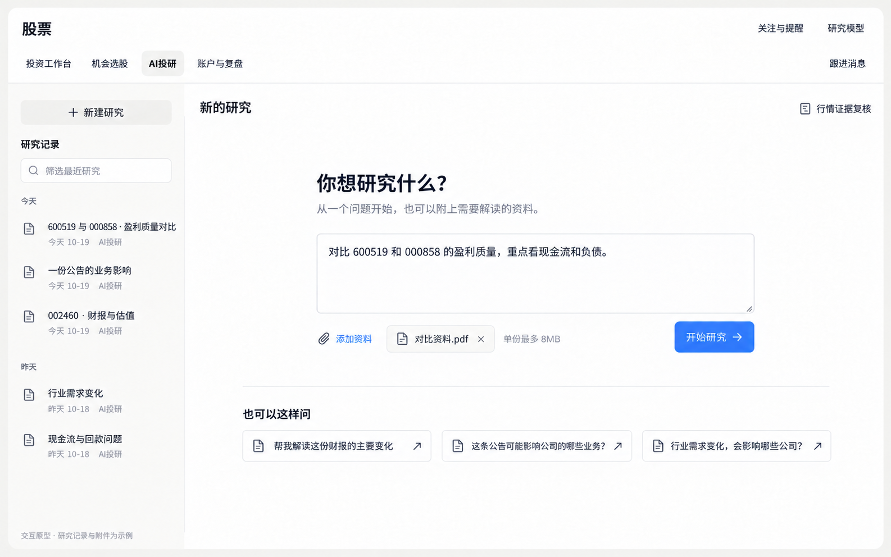
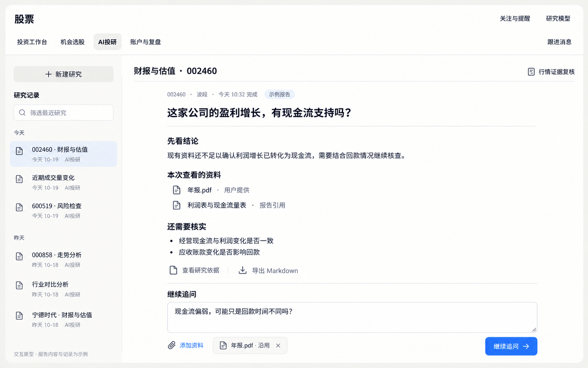

# AI 投研交互原型 V1

> **历史方案，已失效（2026-10-19）**：用户决定撤销独立 AI 投研 Tab，改为由主会话工具和投资工作台右栏承载共享研究任务，报告、依据和追问按需进入同一任务详情。本原型只保留该阶段的讨论记录，不指导当前实现。原图及目录保留以维持既有对话链接。

- 日期：2026-10-19
- 原范围：股票模块独立 AI 投研布局与交互提案；此方向已被上述共享研究方案替代。
- 制作：内置 imagegen；原图与完整提示词保存在本目录关联文件中。
- 能力依据：[Vibe 原生能力与 Tab 映射](stock-vibe-native-capabilities.md)。原生工具、技能步骤、团队预设和已接入业务分别判断，不将全部原生能力写成已验证产品承诺。

## 两个入口的分工

投资工作台围绕当前股票：看行情、已有分析，再快捷发起综合、财报估值、走势或风险研究。这四项共用现有任务模板，不是四种不同的金融算法。

AI 投研围绕一项可持续的问题：可以包含公司、公司对比、行业、事件或用户资料。工作台发起的单股任务进入同一研究工作区，保留原股票、周期和会话；直接进入时不要求先选一只股票或一个交易周期。原生策略、因子、组合等研究方向按实际任务与接通情况使用，不为了展示能力另铺一排未经验证的按钮。

## 界面与操作

- 左侧集中放新建和近期研究记录，按标题筛选；真实空状态不填入示例记录。
- 主区把问题、附件和“开始研究”集中在一起。示例问题只填入可编辑文字，点击开始才执行。
- 从工作台进入时显示原任务对象和周期；研究报告固定展示自身的时点和上下文，不能套用当前其他股票的选择。
- 研究完成后在主阅读区看报告、查依据、导出，并继续原会话追问；不重复展示一份完整报告和第二份会话报告。
- “行情证据复核”保持次级操作，进入已有股票/区间/问题流程；它不代表整份财报或综合研究已通过认证。
- 普通按钮中性，主行动使用股票模块现有强调色；不改全局主题，不使用嵌套卡框或大段常驻解释。

## 原型图

### 直接进入：开放研究问题

示例问题是两家公司盈利质量对比；没有将工作台的四项分析再次作为主分类。

### 从工作台进入：已有单股研究的阅读与追问

此图单独演示 002460 原研究的查看状态，保留原周期和问题；资料、报告及时间均为界面示例。它与上图的公司对比是两个不同的示例任务。

## 可用性边界

本提案只改变用户入口与信息组织。原生有某工具、技能或团队，不代表全部数据源、A 股场景和多步骤业务已经在 Mona 验证。报告来源、缺项、实际执行步骤和参数必须使用真实产物；不可将示例结论、通过徽章或填充数值带入正式页面。

[完整生成提示词](stock-vibe-research-prototype-v1/prompts.md)
