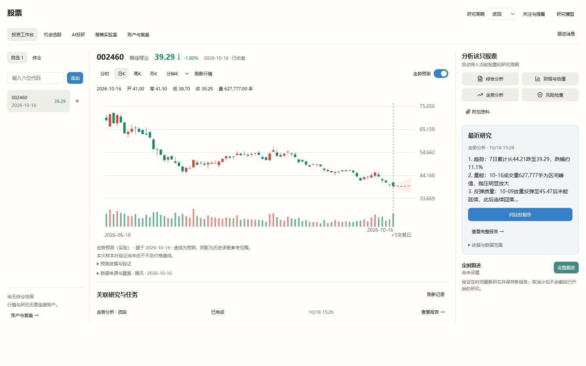
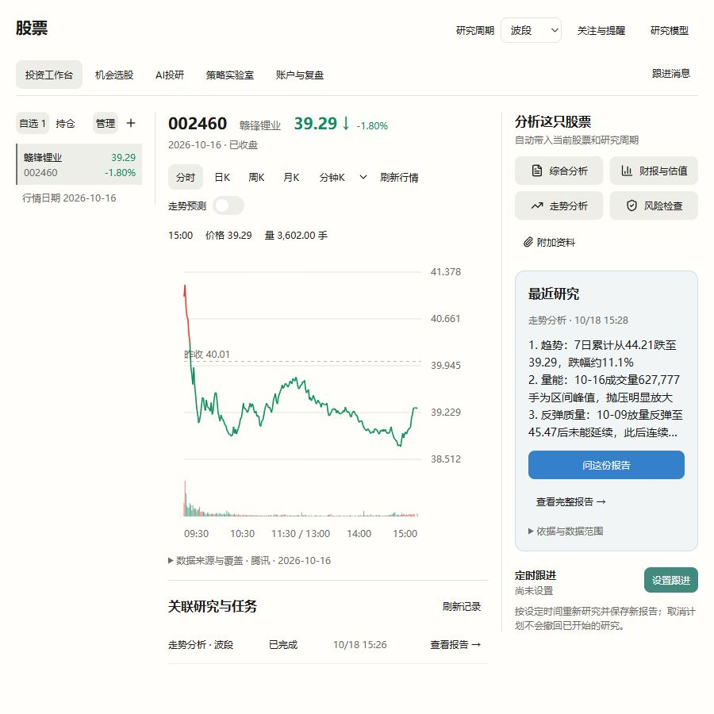
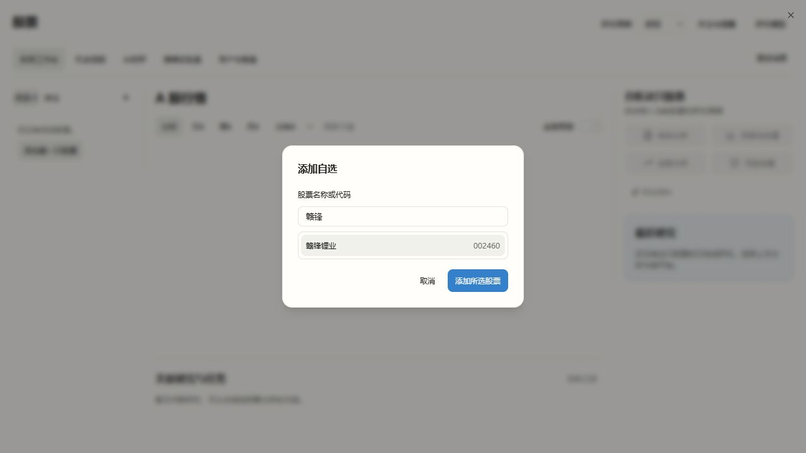
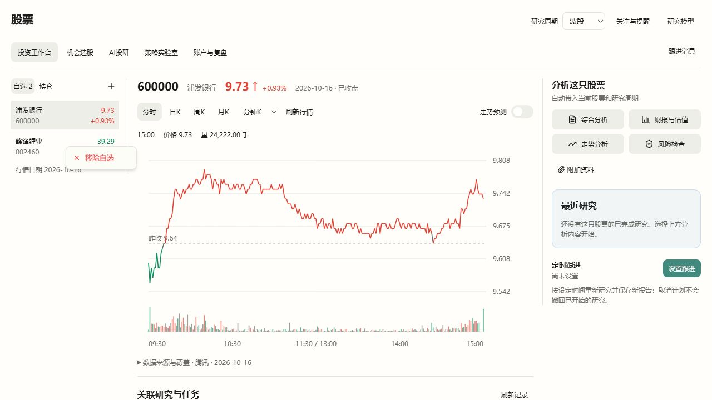
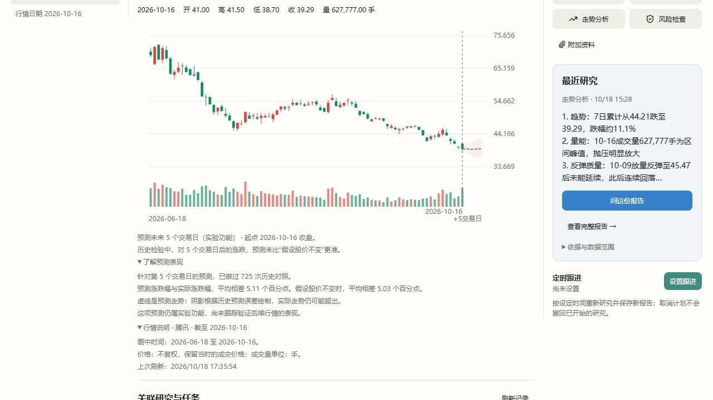

# 投资工作台实施记录

- 日期：2026-10-18。
- 范围：投资工作台；依据[V4功能评估](stock-vibe-workbench-v4.md)、[V6局部视觉](stock-vibe-workbench-v6.md)及用户最新要求。
- 最新视觉要求：四个普通分析按钮统一中性；股票区的主要操作、跟进和预测开关使用彩色；全局外壳、应用侧栏、导航不改；涨红跌绿。
- 来源：锁定Vibe源码 + 0028工作台适配补丁 + 0029行情/实验预测扩展。没有引用已删除的股票业务。

## 功能与真实路径

| 功能 | 实现与数据来源 |
| --- | --- |
| 六位代码自选 | 沿用Mona显示偏好，系统核实后传原生证券身份；显示不带交易所后缀 |
| 自选/持仓 | 读取原生Portfolio持仓快照，只列可识别A股；无快照、读取失败分别说明，不编持仓 |
| 默认分时 | 新原生窄行情服务读取腾讯真实分钟记录；最新日期来自记录，午休压缩，不填虚构分钟，排除收盘后固定价数据 |
| 盘中刷新 | 可见工作台在A股时段每30秒读取；实际开市状态由数据日期、时点和上海交易时段确定；失败保留上次数据并说明未刷新 |
| 日/周/月K、分钟K | 日K走新原生行情投影；其余继续原生历史行情工具，保留实际覆盖与失败说明 |
| 报价红绿 | 最新价与同源昨收比较，涨红跌绿、平盘/昨收缺失中性；不能用开盘价代替昨收 |
| 研究周期 | 顶栏明确为研究周期，与图表周期独立 |
| 四个分析入口 | 综合/财报估值/走势/风险进入原生Session研究问题页，带入股票、任务和周期；用户可补充后发送 |
| 附加资料 | 复用现有研究附件流程，支持界面列出的CSV/Excel/PDF/Word/TXT/Markdown，8MB上限 |
| 任务与报告关联 | 创建Session时将受限上下文写入原生config.mona_workbench；按股票精确读取，不从标题猜归属 |
| 最近研究 | 展示真实完成Attempt报告的原文摘录、任务/周期和报告生成时点；新追问未完成时仍可读取此前完成报告 |
| 看全文与追问 | 全文在本地只读弹窗打开；追问恢复原Session，身份核对后发送，不自动重跑团队 |
| 定时跟进 | 复用原生Scheduled和幂等账本；按北京时间每天或周一至周五执行，明确工作日不等于交易日；可取消未来计划 |
| 跟进消息 | 读取原生已完成研究/真实条件变化事件，进入对应已有报告或情景；查看不 claim/ack 或派发新研究 |
| 局部视觉 | 样式仅在.stock-vibe-workbench作用域，复用现有语义Token；普通分析按钮统一中性 |

旧研究缺少结构化工作台上下文时仍可在AI投研历史中查看，不通过标题猜测并冒充新工作台归属。既有选股、策略和账户页面不在本轮重做。

## 预测扩展与边界

预测不是原生现成服务。新增0029在Vibe原生运行时内计算，Mona只接入展示，没有在宿主重建金融计算。

- 分时、日K开关分别保存，初始关闭；不以验收或模型配置封住整个工作台。
- 日频使用7个原生qlib158单股价量因子、Ridge和原生purged walk-forward；分别建模1–5个交易观测的收益，未来轴只显示+N交易日。
- 盘中日K取最近完整收盘日，训练和指纹同步截断，以该日未复权收盘锚定输出。预测开启时图表暂不含今日未收盘K，当前报价仍单独显示实时值。
- 分时使用明确新增的分钟价量滞后特征，按完整交易日做样本外验证，训练标签不跨夜、不跨缺失分钟；未来点必须晚于当前时间且不超过本日15:00。
- 休市/过期/样本不足时分时返回明确unavailable和空路径；不把已知历史或隔夜假分钟画成未来。
- 原生输出训练截至、样本数、数据指纹、方法版本、样本外MAE及同样本零收益基线。经验残差参考范围不是未来覆盖率承诺。
- 前端仅在股票、周期、as_of与末根实际价格都匹配时叠加虚线；未来不绘K线或成交量。

## 当前验证

- 前端股票模块相关18个测试文件、82项测试通过；随后真实页面发现报告摘录优先展示来源说明，补充原文发现优先的摘录修正及1项回归通过。覆盖代码输入、报价颜色、四任务、报告/追问身份、定时请求未知恢复、预测开关独立及图表时点。
- TypeScript构建类型检查通过；Vite tauri模式构建通过。未因本轮修改全局主题，也未重复构建无关Office编辑器。
- 后端工作台相关46项契约/真实原生Store/调度账本测试通过；行情预测近端回归通过，包含因果性、标签purge、样本外基线、盘中完整日锚点、滞后分钟只输出未来点和协议拒绝；ruff检查通过。
- 真实公共行情：002460在2026-10-16的242条交易分钟记录，日K360根，报价39.29、同源昨收40.01（下跌约1.80%）。
- 真实日频实验完成，但本次样本外平均误差尚未优于不变价格基线，界面如实标明；没有前向效果或盈利结论。
- 当前日期为休市日：盘中连续刷新和分时训练时间边界已由协议/因果回归验证，尚未经交易时段持续观测。
- 正常受管运行包、普通dev启动与真实端到端复核均已完成，见下一节；未以隔离preview替代正常实例。

## 正常开发实例

- 正常运行时库已通过统一安装器激活stock-vibe@0.1.16+mona.workbench.1，ready generation为33192459dbee4e1ad052b2abccb614ba；旧组件与旧generation保留。
- 本地离线包195,769,059字节，SHA256为c61d45e8c7eec53a6462e409d7ea726342727517ebf2eaba32746cfe4af8f84a；含0001–0029，最后补丁SHA256为be564872af4093fe739b6c3108f4bd9e3e097f564e594c36f40758749e17276a。
- 从工作树根目录执行npm run dev（原命令cargo tauri dev --no-watch）成功启动Vite、桌面和正常Services；新功能不需要专用预览实例或额外启用步骤。
- 在正常Services 17174端口按现有本地鉴权读取真实分时与日K，行情/昨收/日期与原生验证一致；日K实际返回5步实验预测，分时休市返回明确不可用原因及空路径。
- 在正常实例创建一个不立即执行的开发核对定时任务，能在原生列表读回，随后取消并确认列表不再包含该任务；没有留下待执行核对计划。
- 使用已配置的默认API模型实际执行一次走势研究，原生Attempt已completed、summary非空、数字证据匹配检查通过；按股票聚合返回同一Session/Attempt的最新报告，无局部错误。
- 通过仅限本机、同源且只读的临时浏览器检查入口读取上述真实Services，核对六位代码添加、实际分时、同源昨收红绿、普通按钮中性、报告全文与关联任务；浏览器入口未代替正常桌面或后端。
- 本地详细证据在.codex_tmp/workbench-normal-evidence.json与.codex_tmp/workbench-runtime-1/installed-verification.json；不包含令牌或提供商密钥。
- 浏览器实际核对了报告全文、原Session追问恢复、日K预测开启与原文摘录；K线默认显示最近80根，历史与未来每个交易观测使用相同横向间距，不人为放大未来时轴。临时只读检查入口已关闭，正常dev保留运行供用户测试。

## 自选交互与窗口缩放修正（2026-10-18）

用户反馈轻微缩放就让右侧研究栏落到图表下面，同时要求重新整理左侧自选区。

- 删除原lg两栏/xl三栏切换。三栏按工作台实际可用空间连续收缩，最小画布为51rem；更窄时只在工作台内横向滚动，研究栏不改排到下方。全局外壳和其他模块不变。
- 图表画布随实际列宽调整，保留坐标文字的可读尺寸；行情、预测计算及历史/未来时间比例不变。
- 左区改为名称/六位代码、最新价/当日涨跌幅的紧凑列表；选中行用中性表面和短标记，金融数据保持涨红跌绿。行情日期集中显示，逐行时点可通过悬停查看。
- 常态只保留加号入口；打开添加弹窗输入六位代码，Enter添加并选中新股票。重复或格式错误在字段旁提示，添加后清空。
- 移除放到明确的管理模式中，行选择与移除分开，移除其他股票不会误切换当前行情。自选较多时提供已有名称/代码筛选，无匹配可清除筛选。
- 持仓说明和账户入口只在持仓视图出现；没有自选时也能独立读取已有持仓快照。
- 非当前标的复用已有原生行情接口补齐名称和报价，缓存60秒、最多2个并发；更新失败保留上次报价与时点，不伪造值。

交互取舍参考[TradingView官方自选列表说明](https://www.tradingview.com/support/solutions/43000745825-mastering-the-tradingview-watchlists/)中的加号进入证券查找、列表显示价格与变化等组织方式；本次仅采用与现有六位代码和原生行情相符的部分。

验证：4个相关前端测试文件28项通过，TypeScript检查与Vite桌面模式构建通过；实际页面验证加号/Enter添加、管理移除、真实名称与报价。依次检查1280、1100、1000、900和780像素宽度，三个面板均保持同一行；780宽度时工作台内部滚动。900宽度下实际三列为176/404/248像素，图表画布与中央列同为404像素。未改后端或重建金融运行包。

## 名称搜索与周期切换修复（2026-10-18）

- 添加自选支持中文名称、名称片段和代码搜索；结果显示证券名称及六位代码，选中后添加，也支持上下键选择、Enter添加。中文输入法组词期间不发起搜索或误提交。重复股票标为已添加。
- 六位代码仍可直接添加，不依赖搜索网络或模型配置。搜索失败和无匹配分别在弹窗内提示；更改查询后，旧请求不能覆盖新结果。
- 0030在受管Vibe运行时内复用原生`symbol_search_tool._search_eastmoney`和HTTP节流；只投影沪深北A股身份并限制最多10条，Services提供有界、鉴权的`GET /api/stock-vibe/symbol-search`。没有复用旧股票模块，也不让模型猜证券代码。
- 实际测试中东方财富搜索返回非证券响应，增加固定腾讯公开证券建议接口作为原生搜索失败时的补充，并返回实际来源；拒绝重定向，解析返回字符串而不执行脚本。原生东方财富缺少证券表的响应改报失败，避免冒充“没有匹配”。真实查询“赣锋”得到“赣锋锂业 / 002460.SZ”，实际来源为腾讯。
- 修复分时切换日K时的`stockPrice(undefined)`崩溃：行情状态同时记录股票与周期，只有匹配当前选择的响应才能进入图表。图表再按请求周期核对字段，缺失OHLC的记录不画成K线，无效价格显示“—”，不补0或虚构价格。
- 同一身份校验覆盖日K、周K、月K等切换，防止新周期暂时展示上一周期行情。

当前受管运行包为`stock-vibe@0.1.16+mona.workbench.2`，包含0001–0030；本地离线包195,771,016字节，SHA256为`8682f38f6f3dbb5902542133cc876f4d451090efba1c22d2c04c462366c5e733`。沿用统一安装器，保留旧版本和用户数据。

验证：5个相关前端文件共50项测试、名称搜索与原生行情后端5项测试通过；TypeScript、Vite桌面构建、宿主Python Ruff及股票依赖边界检查通过。统一运行环境generation为`9d90785e9a14408e5f62b2499f27cba9`。重启正常dev后，Services鉴权搜索“赣锋”返回200和真实候选；页面完成按名称选中并添加，快速切换分时/日K/周K/月K后未出现JavaScript错误。

## 自选排序与右键菜单（2026-10-18）

按用户最新要求，选中股票仅用浅底区分，删除左侧竖线及管理模式。右键自选行可“移除自选”，操作其他行不会切换当前行情；持仓不提供此操作。

自选支持拖动到目标行上半部或下半部，分别插到前方或后方，拖动时显示水平插入位置；同时支持Alt+↑/↓。排序复用已有本地显示设置保存，刷新恢复顺序，当前股票保持不变；筛选排序不会丢失隐藏股票。本次为Mona列表交互适配，不修改Vibe金融逻辑或运行包。

验证：组件拖放上下半行、取消反馈、外部拖放、过滤后排序、右键移除和持仓边界测试通过；父层验证排序持久化且不重复加载当前行情。3个相关前端测试文件36项通过，TypeScript检查与Vite桌面模式构建通过。实际页面验证无左侧选中竖线、无管理按钮、右键移除非当前股票、键盘排序及刷新恢复。浏览器自动化拖动未产生可确认的原生drop，不将其计为真实拖放通过。

## 图表说明改为用户语言（2026-10-18）

- 删除界面的模型版本、特征数量、训练记录数、接口返回记录数，以及“样本外、残差、前向跟踪”等实现术语；原生响应仍保留这些字段用于追溯。
- 默认说明预测范围、起点、实验性质和当前历史表现；“了解预测表现”折叠展示历史对照及平均偏差。比较结果明确针对最远预测点，涨跌幅误差使用百分点，不包装成命中率或未来保证。未超过价格不变对照的事实继续明确展示。
- 行情说明保留用户需要的来源、图中日期范围、价格处理方式、成交量单位和上次刷新时间；预测暂不可用时提供对应的普通说明和可用下一步。
- 行情与预测不匹配时不展示旧预测的表现说明。本次只改图表的展示文案，不修改金融算法、数据或全局样式。9项图表回归及TypeScript检查通过。

已在正常Services的真实002460日K预测页面展开核对，未出现JavaScript错误；两个说明默认折叠，用户按需查看。

## 原生预测能力升级（2026-10-18）

0031替换前述0029中的7因子预测实现。日K先审核全部478项Vibe因子，再以训练窗口筛选输入；比较7组固定方案，按时间隔离选型、独立检验与历史误差校准。没有稳定优势时发布明确的横盘参考。分时复用Vibe时序算子，原生积累20个交易日的真实分钟历史，盘中新观测复用已训练模型。Mona宿主不承担金融计算。

冷计算移至原生后台任务，页面自动显示进度和结果；原生保存预测、训练数据及选型记录，并以到期行情跟踪实际偏差。不会把历史回放或尚未到期的预测计为实际效果。能力逐项映射、具体取舍、真实数据结果、运行包和验证边界见[走势预测交付版](stock-vibe-forecast-v2.md)。

0032进一步纠正短历史验证窗口不足和最终发布模型类别不一致的问题；无有效方向现在明确放弃，不画成横盘预测、不保存为已发出的预测。页面只保留简短状态，有效预测才显示紧凑的成绩。41项相关回归、类型检查及桌面模式构建通过，修正版受管运行包已安装并核对实际页面。此前三股真实对照仍未证明优于价格不变，不能称为最佳预测方案；[修正依据与实测](stock-vibe-forecast-v2.md#0032纠正无有效预测不等于横盘2026-10-18)保留完整边界。

0034按用户进一步要求，改为浅蓝摘要面板，直接显示方向、历史检验、生成时间与保存/更新状态；有有效预测才显示涨跌幅、参考价与范围，有到期结果才显示实际偏差。日K以原生SQLite保存首次结果，包含无方向结果；同一收盘数据在新进程中直接复用，分时不走该缓存。运行包已更新至`0.1.16+mona.forecast.3`，跨新解释器与真实界面核对见[产品UI与日K复用](stock-vibe-forecast-product-ui.md)。本轮未将UI和缓存改进称为预测准确率提升。
