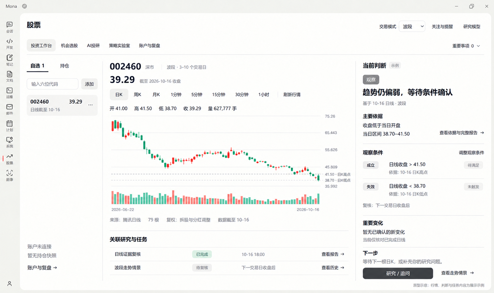

# 投资工作台 V2：功能与原型

- 日期：2026-10-18
- 状态：历史版原型；默认视图与预测范围已由 [V3](stock-vibe-workbench-v3.md) 更新，本文保留用于对照。原型不表示目标已经实现。
- 依据：[最初功能方案](stock-vibe-functional-design-v1.md)、[后续确认的产品决策](../plans/stock-vibe-development-plan.md#21-已确认的产品决策)、[UI 规范](mona-ui-design-system.md)。
- 设计基线：用户提供的当前桌面界面；[基线截图](stock-vibe-workbench-v2/00-current-workbench.png)。
- 本轮交付：工作台范围、交互与状态、开发顺序及一张主界面原型。产品代码未在本轮修改。

## 1. 工作台要解决的问题

选择一只股票后，在同一屏知道行情截至什么时候、当前研究如何判断、判断依赖哪些事实、什么条件会成立或失效，以及接下来可以做什么。

保留当前三栏结构：左侧自选与持仓，中间 K 线，右侧当前判断。关联报告与任务放在图表下方；跨标的重要事项收在可展开入口。首屏优先保持自选、图表和当前判断同时可见。

工作台消费 Vibe 已有研究、情景、账户快照和任务产物；金融计算、条件观察和研究调度仍属于 Vibe。其他 Tab 继续负责完整研究、策略实验及账户连接。

## 2. 应交付的功能

| 区域 | 工作台功能 | 操作与边界 |
| --- | --- | --- |
| 自选与持仓 | 六位代码添加、去重、选择、移除；自选/持仓切换；列表显示可核对的价格与数据时点 | 交易所由系统识别。持仓只读原生账户快照；未连接时显示未连接，不把成交文件推算成当前持仓。 |
| 行情与图表 | 默认日 K；支持的周期切换、成交量、逐根价格、刷新；显示来源、覆盖、复权声明及数据截止时间 | 恢复用户选择。周期无数据、请求失败、过期和加载分别反馈。日线不能被称为实时行情。 |
| 当前判断 | 所选模式、观察期限、结论、主要依据、生成/数据时点、下一步 | 默认先看摘要，详情展开。无研究时提供“开始研究”；依据不足明确缺项；旧报告不套用新行情时点。 |
| 情景与条件 | 图上标注有证据的关键位置；展示成立/失效条件、观测状态、复核时间和历史版本 | 每个条件保留来源与时点。修改后追加版本，不覆盖原判断；数据不足不显示“未触发”冒充已检查。 |
| 重要变化 | 当前标的条件变化摘要；跨标的重要事项折叠查看；点击回到相应报告或情景 | 展示触发事实、时间及相关版本。沿用原生去重与通知，不建立第二套前端盯盘任务。 |
| 关联研究与任务 | 按当前股票查看研究、情景和任务；展示真实阶段；打开报告、查看进度、研究/追问 | 查询和打开结果不新建研究。已有可验证策略产物时才出现“策略验证”入口，并带原产物身份进入实验室。 |
| 全局设置与异常 | 沿用超短线/波段/中短线、关注与提醒、研究模型；覆盖未使用、无结果、缺数据、失败、中断和结果未知 | 账户缺项只限制账户相关结论；模型缺项只影响研究。已接入功能持续可测，不设置验收后启用开关。 |

## 3. 原型布局



- 左侧缩窄，保留列表为主；账户未连接状态放在下方，不虚构资金与持仓。
- 中央保留大图和成交量；图中虚线与右侧条件引用同一组事实。图下增加关联研究与任务。
- 右侧将“研究入口”扩展为“当前判断”：结论 → 依据 → 条件 → 重要变化 → 下一步；主按钮仍是研究/追问。
- 顶部导航、交易模式、关注与提醒、研究模型保持现有位置；“重要事项”作为可展开文本入口。
- 原型中的价格、条件、任务和判断是展示示例；不是新研究结果、实时行情或个性化交易建议。图中 41.50、38.70 引用基线截图中的日 K 高低点，仅演示条件与来源如何对应。
- 未来价格曲线、目标价与概率不在本次范围。当前账户未连接，原型不展示仓位数字或买卖指令。

## 4. 关键操作

| 操作 | 预期行为 |
| --- | --- |
| 切换股票或周期 | 绑定对应数据与研究，清除上一标的正在展示的行情；显示准确的加载/缺数据状态。 |
| 研究 / 追问 | 已有关联会话则继续该会话；首次研究创建原生任务；活动任务优先展示进度，结果未知时核对回执，不能自动重复提交。 |
| 查看依据与完整报告 | 打开当前判断所引用的持久报告，保留其原数据时点与来源。 |
| 调整观察条件 | 读取原情景；修改经原生来源校验后追加新版本，保留修订理由和历史。新条件只按其后可得数据观察。 |
| 查看走势情景 / 历史 | 读取现有版本与条件状态，不因查看而重新研究。 |
| 点击重要变化 | 定位对应标的与被引用的情景/报告版本；不把历史提醒自动改指最新判断。 |
| 查看关联任务或报告 | 读取同一原生运行及产物；已完成、失败、中断、待补充、结果未知分别显示。 |
| 切换到持仓 | 有快照则显示来源、同步时间和允许读取的持仓；无快照则显示未连接及账户与复盘入口。 |

## 5. 逐项开发顺序

先完成这个 Tab 的日常路径，再推进下一个 Tab。按依赖顺序开发，每个阶段完成后保留用户直接测试的入口。

1. **行情与对象一致**：自选/持仓状态、证券身份、K 线和周期、来源与时效；确认现有错误及空数据状态。
2. **判断与条件一致**：读取/生成原生研究和情景，右侧摘要、依据与时间、图上条件、修订历史；无研究和缺证据也能正常使用行情。
3. **操作与跟踪贯通**：关联研究/任务、报告/追问、条件状态和重要变化、已有策略跳转；必要数据缺项有准确说明。

工作台的完成标准：

- 首屏可见自选、当前标的 K 线及判断/明确的无研究状态。
- 列表、图表、条件、报告的股票和时间一致；条件有来源，修改可追溯。
- 在真实正常桌面中完成“选择股票 → 研究 → 看判断和依据 → 保存/修订条件 → 后续查看条件状态 → 打开原报告”的流程。
- 账户未连接、模型未选择、数据缺失等状态不会封住整个工作台；不会补出无依据的仓位、触发或金融结果。
- 查看报告和任务不重复派发，未知写入先核对；功能状态来自真实原生产物。
- 行情源支持的周期逐项核对，未完成分钟数据验证时如实标识，不能把有周期按钮当作行情已可用。

## 6. 原型生成记录

生成方式：内置 image_gen，使用用户截图作为编辑目标；没有用 HTML、CSS、Canvas 或 SVG 代替原型图像。最终图片为第二次定向修订，统一了普通操作的中性色，并避免把待满足条件染成成功色。

### 初次生成提示词

```text
Use case: ui-mockup / precise screenshot edit.
Asset: one polished high-fidelity desktop application prototype in Simplified Chinese, for the Mona stock INVESTMENT WORKBENCH tab.
Input image is the EDIT TARGET and authoritative existing application shell, not a loose style reference. Evolve this exact screenshot into the proposed complete workbench. Preserve the Mona title bar, window controls, vertical left application navigation and icons, warm off-white canvas, large softly rounded white main surface, header "股票", five navigation tabs, and restrained charcoal/neutral visual language. Keep the active tab "投资工作台" and the header controls "交易模式  波段", "关注与提醒", "研究模型". No new branding, no gradients, no dark theme, no decorative dashboard tiles. Render a single full application window, landscape about 2880×1712, retaining the reference aspect ratio. Extremely crisp readable Chinese typography, calm professional desktop UI, natural screen capture appearance.

Design objective: first screen must simultaneously show stock selection, a LARGE historical K-line chart, and a readable evidence-based current judgment. Keep the reference's three-column composition but make the left list narrower to give the center chart and right analysis more room. Use light vertical dividers and whitespace. The current mostly empty right "研究入口" column becomes a meaningful "当前判断" panel. Use lower blank space for related research, not ornamental cards.

Overall arrangement:
- Under the unchanged tab navigation, at far right on the same line a quiet expandable text action "重要事项 0  ▾".
- Main content uses about 14% width for the left stock list, 59% for the center chart/work area, 27% for the right analysis. Generous readable spacing, few borders, no heavy shadows.

LEFT:
Header has two modest text tabs "自选 1" (selected) and "持仓".
A compact input with placeholder "输入六位代码" and a small "添加" button.
One selected stock row on a pale neutral background, only "002460" prominently, a small right-aligned price "39.29", and subdued "日线截至 10-16". A tiny overflow menu is enough; don't waste width on a large remove button. Do not append .SH or .SZ or .BJ to any visible stock code or input.
Below, a subtle account context note with the exact copy "账户未连接" and "暂无持仓快照", and a text link "账户与复盘 →". Show no invented account balances, positions, personalized allocation or trading orders. Keep remaining list area uncluttered.

CENTER:
Top row: large "002460" with small "深市"; a modest observation-period label "波段 · 3–10 个交易日".
A clear quote line "39.29" with subdued "截至 2026-10-16 收盘". This is a historical end-of-day view, never label it real-time and do not add a fabricated daily percentage change.
The familiar interval toolbar remains: "日K" (selected), "周K", "月K", "1分钟", "5分钟", "15分钟", "30分钟", "1小时", and a quiet "刷新行情" at the end.
Small OHLC line exactly "开 41.00   高 41.50   低 38.70   收 39.29   量 627,777 手".
The dominant central element is the red/green historical candlestick and volume chart, similar in shape and scale to the reference: roughly 79 bars declining from about 70 into the high 30s, including a middle consolidation near 50. Use red for up candles and green for down candles, fine pale gray gridlines, price scale on right, dates at bottom from "2026-06-22" to "2026-10-16". Keep it credible and legible, with accurate proportions. Plot ONLY historical candles and volume. Add two subtle gray dashed horizontal observation reference lines near 41.50 and 38.70, with short non-overlapping labels outside the candle bodies: "41.50 · 日K高点" and "38.70 · 日K低点". These are example evidence reference levels, not future prediction curves.
Below chart, a compact source line: "来源：腾讯日线   79 根   复权：拆股与分红调整   数据截至 10-16".
Below a fine divider, a lightweight full-width section "关联研究与任务" with two tidy readable rows:
"日线证据复核" | "已完成" | "10-16 18:00" | text link "查看报告 →"
"波段走势情景" | "待复核" | "下一交易日收盘后" | text link "查看历史 →"
These are illustrative prototype entries; no fake badges of verified profitability.
No huge boxed task cards, no second dashboard. K-line remains visually dominant.

RIGHT:
Title "当前判断" with a small neutral "示例" label.
One modest gray status badge "观察".
Main conclusion in larger semibold text over about two lines: "趋势仍偏弱，等待条件确认".
Subtext: "基于 10-16 日线 · 波段".
Then "主要依据" with two short readable lines: "收盘低于当日开盘" and "当日区间 38.70–41.50"; a quiet text action "查看依据与完整报告 →".
Subsection "观察条件", compact and clear:
"成立" with "日线收盘 > 41.50" and subdued status "待满足"; supporting source text "依据：10-16 日K高点".
"失效" with "日线收盘 < 38.70" and subdued status "未触发"; supporting source text "依据：10-16 日K低点".
Small text action "调整观察条件" should be visible near these conditions.
Show a revision/as-of caption "复核：下一交易日收盘后"; no percentages of confidence, target prices, buy/sell quantities, or unsupported stop-loss orders.
Below thin divider: "重要变化"; content "暂无已确认的新变化" and small note "当前仅核对已完成日线".
Below: "下一步" and simple copy "等待下一根日K，或补充你的研究问题。"
One primary charcoal button "研究 / 追问", and one lighter text action "查看走势情景 →". Do not duplicate the primary action in many places.
All right content fits comfortably in the first screen with no overflow.

Put a small quiet footer in the main white surface: "原型示意 · 行情、判断与任务内容为展示示例". It must be readable without distracting from content.
The screenshot must look like a careful incremental redesign of the provided Mona UI, not a redesigned standalone finance product. Preserve reference shell proportions and typography hierarchy; avoid marketing headlines, bright blue/purple elements, fictional brokerage connection success, raw technical IDs, ports, tool/process names, acceptance/activation banners, futuristic forecast lines, probabilities, and excessive panels. All Chinese labels must be correct and readable.
```

### 定向修订提示词

```text
Edit the supplied Mona investment workbench UI prototype with ONE tightly scoped correction: unify non-financial UI colors with the reference Mona neutral theme.
Keep the complete layout, all Chinese text, all stock/price/date values, sizes, positions, typography, account-not-connected context, candlestick chart, and window shell unchanged.
Change every currently bright blue text link or action (including 查看依据与完整报告, 调整观察条件, 查看报告, 查看历史, 查看走势情景, 账户与复盘 and arrow glyphs) to restrained dark charcoal, matching the other Mona text actions. Change the two blue dashed chart evidence lines to soft neutral gray. The word "成立" in the observation-condition row is a category label and the associated condition is still 待满足; change its currently green tinted category chip to neutral gray, matching the 失效 category chip, so a pending condition is not visually presented as successful.
Preserve red/green price candles and volume, and preserve the green "已完成" task status which really denotes completed work in the prototype. No other changes. Output the same single crisp high-resolution landscape desktop UI screenshot.
```
