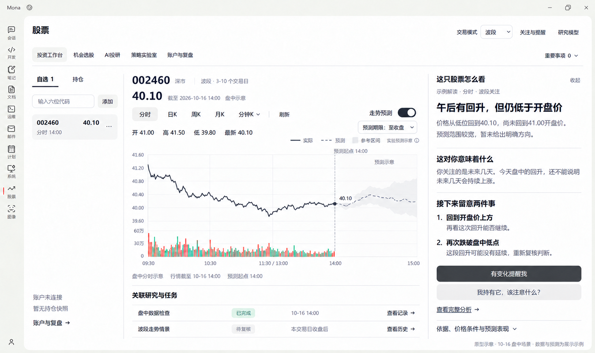
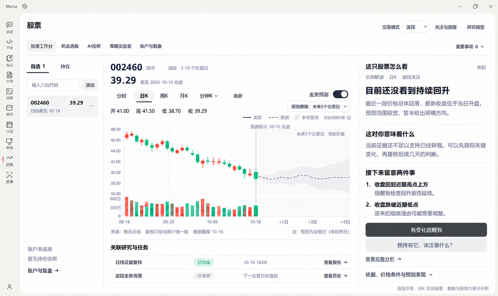

# 投资工作台 V3：默认分时与双周期走势预测

- 日期：2026-10-18
- 状态：讨论草图。按用户最新要求，先依照 [开发标准](../architecture/stock-module-development-standard.md) 完成 [原生能力与 Tab 映射](stock-vibe-native-capabilities.md)，再决定正式界面；本文未核清来源的布局不作为实施依据。尚未实现数值预测，也没有真实预测效果结论。
- 替代范围：[V2](stock-vibe-workbench-v2.md) 中“默认日 K”和“仅有情景、不提供数值预测”的设计。V2 的自选、判断、条件、关联研究与任务结构继续保留。
- 本轮交付：源码核查、官方接口核对、两张生图原型和实施边界；未修改产品运行代码。
- 基础原则：预测扩展放在 Vibe 的数据、因子、量化计算与产物边界；Mona 负责展示和接入，继续不复用旧股票算法。

## 1. 用户要求与图表行为

| 场景 | 默认显示 | 预测行为 |
| --- | --- | --- |
| 正在交易 | 当前交易日的分时价格线及成交量；按行情源实际频率更新，显示数据时间与延迟状态 | 独立开启/关闭分时预测；目标可含未来 5/15/30 分钟、当日收盘。每个目标需对应训练与评价，未完成的期限不冒充可用。 |
| 盘前、节假日或周末 | 最近一个已完成交易日的完整分时，清楚标明日期 | 查看当时已留档预测及实际对照；没有当时记录时不能事后伪造。历史回放需明确标记，并使用当时可得训练样本与特征。下一交易日预测作为不同目标单列。 |
| 午间休市 | 保留本交易日上午分时，标明休市 | 按交易时钟处理预测期限，不把午休当作有连续交易的分钟，不填造行情。 |
| 收盘后 | 本交易日完整分时；下一交易日前保持该日期 | 固定当日记录并评价已到期目标，不改写历史预测。 |
| 用户切换日 K | 原生历史日 K 和成交量，当前未收盘的日 K 明确区分 | 日 K 有独立预测开关与期限。第一版基于最近完整日 K 预测未来交易日收盘价格/收益；不能把尚未收盘的全天量价作为已知特征。 |

交易日以交易所日历与证券状态确定，不能简单减一天或只排除周末。停牌、延迟和数据缺口单独显示，不悄悄把旧数据标成最新交易日行情。分时价格线与 1 分钟 K 线是两个展示类型；不能用日 K 插值伪造分时。

行情刷新不改变用户主动选择的视图。研究持有周期与图表预测期限分别标明：波段用户也可以查看短时预测，短时输出不自动成为波段交易建议。

## 2. 原型

### 默认分时，开启预测（盘中场景示例）



图中模拟 10-16 14:00 的盘中场景，不是当前真实行情或模型输出。实线为观测区，虚线和浅灰带为预测区；预测起点之后不绘制实际成交量。收盘后默认分时为完整交易日，预测对照遵循上一节留档规则。

### 日 K，开启未来交易日预测



日 K 的未来部分只展示预期收盘价格连接线和参考区间，不画成已发生的未来蜡烛。未来期限按交易日计算。两图中的区间均为原型示意，没有声称已完成校准或提供特定覆盖概率。

## 3. 当前代码能复用什么

本节核对锁定归档 `third_party/vibe-trading/vibe-trading-source.zip` 与当前 CP313 依赖锁，不把上游源码存在当作产品已可用。

| 现有能力 | 源码事实 | 对预测的用途与限制 |
| --- | --- | --- |
| Qlib158 风格因子 | 该目录实际包含 154 个因子模块，元数据为日频，市场声明包含中国股票；公式计算输出日期×股票面板 | 可优先选择适合 A 股目标的价量特征；不是已有训练模型，也不能直接当分钟模型。 |
| Alpha101 | 101 个日频模块；其市场元数据未声明中国股票，而部分执行路径没有完全一致地按该元数据过滤 | 价格型公式可研究，但需先核对输入、市场语义和适用性，不能无差别把全部因子标为 A 股已验证。 |
| 因子评测 | 横截面 Spearman IC、IR、榜单与随机对照/样本外检验 | 能帮助研究因子，但排名相关性不是个股上涨概率或未来价格曲线；目标期限改变时要重新评价。 |
| 时间切分与统计工具 | 有 purged walk-forward、bootstrap 等源码；另有 GARCH 波动率和 Markov 状态模型 | 可复用适合部分。波动率和状态概率不能替代价格方向预测；部分统计库不在当前运行包依赖锁内。 |
| 数据与回测 | 腾讯 A 股 loader 为日线；东方财富 loader 有历史分钟 K 线；本地 loader 可读分钟文件；已有回测与产物结构 | 当前链路未见完整实时 tick/推送订阅。此前免费分钟探针未成功，实时分时与训练历史仍要补齐。 |
| 机器学习运行依赖 | 当前锁含 scikit-learn 1.9.1；未锁 LightGBM/XGBoost 等库 | 第一版可优先用已有依赖训练轻量模型，避免先增加大运行包；新增依赖仍走统一运行时版本。 |

源码索引（归档内部路径）：

- `agent/src/factors/registry.py`：因子计算；`factors/zoo/qlib158/roc5.py`：日频收益因子例子；`factors/zoo/alpha101/alpha_001.py`：频率和市场元数据。
- `agent/src/tools/alpha_bench_tool.py`、`factors/bench_runner_strict.py`：因子评测及严格切分。
- `agent/src/quantlib/crossvalidation.py`、`quantlib/timeseries.py`：时间切分、波动率及状态模型。
- `agent/backtest/loaders/tencent_loader.py`、`eastmoney_client.py`：日线与历史分钟调用；当前宿主只验证了所记录的有限样本。

## 4. 建议的最小量化路线

两类预测分别训练、分别评价，共享数据/模型版本与产物结构。

原生已有 ml-strategy 的 walk-forward 代码示例和 ml_quant_lab 的特征工程/模型设计/回测流程，应先复用这些研究与实现基础。本节需要补齐的是目标数据、具体模型实验与持续预测产品服务，不应另建同类研究编排，也不能把现成模板当作已训练的持续预测模型。

| 预测 | 首批候选输入 | 预测目标 | 当前需要新增 |
| --- | --- | --- | --- |
| 日 K | 从现有日频价量因子中选择少量趋势、动量、波动、量能特征；可加有可追溯来源的市场相对强弱 | 未来若干交易日收益，再按同一价格口径还原各时点预期收盘价格与区间 | 成规模历史训练样本、特征筛选、训练/验证、模型保存、推理和持续评价 |
| 分时 | 分钟收益、滚动波动、相对成交量、均价偏离、时段特征；必要时引用上一完整交易日的因子作为背景 | 未来指定交易分钟或当日收盘的收益/价格 | 稳定盘中行情、足够分钟历史、频率适配、独立训练与目标评价；均价类特征必须有正确单位的量/额数据 |

先建立“价格保持不变”等简单基准，再用少量因子配合轻量回归/梯度提升模型；根据样本外结果选择保留的方案。当前 scikit-learn 的 HistGradientBoostingRegressor 可作为候选，支持回归与分位数损失；算法存在不代表本项目已训练有效。Qlib 官方 Alpha158 + LightGBM 工作流可作为训练/验证/测试分开的参考，但不是 Mona 已安装或已跑通的能力。

模型学习的标签应明确为本项目需要的未来收益，而不是直接照搬横截面排名、标准化评分或 Qlib 其他任务的标签。对数收益目标可写作 `r(t,h)=log(P(t+h)/P(t))`，预测价格按一致口径换算。多个预测时点可以连线展示，连线不代表已经预测了中间每一笔成交。

量化模型计算数值；百炼等语言模型解释特征、事件和结果。盘中不对每个行情 tick 启动大模型研究，也不每次重新训练。

## 5. 数据条件与可靠性

- 历史分钟、盘中最新报价、实时分钟累计数据是不同能力，分别验证覆盖与更新频率。不能从历史 K 线 loader 的存在推出实时推送可用。
- 先验证免费源是否满足稳定性和历史范围；增强源是可选数据能力。Tushare 官方把历史分钟 `stk_mins` 与实时分钟 `rt_min` 分为不同接口，均列有单独权限要求；普通东方财富交易账号不等于这些数据权限，也不是公开行情预测必须连接的账户。
- 79 根用于显示的日 K 不是完整训练数据集。样本规模、证券范围、历史成分、复权和缺项应按目标核对，不能用少量画面数据宣称训练完成。
- 训练、调参、校准、最终测试按时间分开；标准化与因子筛选只能在训练段拟合。重叠未来收益标签需做隔离，不能随机打散相邻分钟或日期来报告准确率。
- 分时特征只能使用预测时点之前已收到的数据；历史回放不仅截特征，也要保证模型训练未使用回放时点之后的标签。冻结当时可得模型与配置。
- 逐期限记录价格/收益误差、方向表现、区间覆盖与宽度、相对简单基准表现，并持续保留前向结果。成本与可成交性属于另行策略评价，预测误差不能冒充策略盈利。
- 参考区间需要通过未参与训练和调参的样本核对覆盖。模型名义分位数不自动构成已校准概率，不硬填“80%准确率”。
- 没有训练数据或模型时显示对应预测缺项，仍可看行情、研究和其他已有结果；验证记录不转成整个工作台的启用开关。

## 6. 运行与展示

在 Vibe 扩展边界增加预测产物与工具/接口，沿用原生持久任务及受控文件结构，不在 Mona 前端另算金融预测。

每次预测保留标的、频率、生成时刻、数据截止、预测起点、目标时间网格、数据/特征/模型版本、训练截止、点预测与区间、实验/验证状态及后续实际值。新行情产生新版本，不能用新曲线覆盖旧记录。中断和未知写入遵循现有请求核对规则。

默认界面显示预测开关、起点、期限、最新数据时间和实际/预测图例；算法及验证细节按需查看，不暴露进程、端口或内部工具名。关闭开关隐藏并停止该视图的新增预测订阅，保留已留档结果；行情与研究继续可用。预测不产生自动实盘指令。

### 右侧栏的用户价值

右侧栏帮助普通用户把图表和研究结果转成能理解、能继续操作的信息。默认只保留“发生了什么、与我的关注周期有什么关系、哪些变化值得留意、可以做什么”，详细因子、数学条件和模型表现按需展开，整栏可收起以放大图表。

| 用户真正的问题 | 首屏内容 | 可采取的操作 |
| --- | --- | --- |
| 现在发生了什么？ | 一句具体判断和一到两条事实；解释观察到的回升/回落及预测是否给出清楚方向，不只给“观察/偏多”标签 | 点开原始依据与当前数据时间 |
| 这与我的关注周期有什么关系？ | 区分盘中变化和未来几天的判断；说明哪些证据支持或尚不足以支持当前研究理由 | 查看对应周期分析；不把分时反弹自动转成波段买入建议 |
| 我该留意什么变化？ | 最多两项有来源的观察，说明“发生什么后，为什么需要重新看判断” | 为所选标的和明确条件设置提醒 |
| 我接下来能做什么？ | “有变化提醒我”“我持有它，该注意什么？”“查看完整分析” | 快捷配置同一原生关注策略、提交带当前标的上下文的追问、打开原报告 |

分时图里的文字是示例：价格从低位回升仍低于开盘，给出“再看回升能否延续”和“若再创新低则复核”的意义，不把一个价格不等式单独摆在首屏。

交互约束：

- “有变化提醒我”呈现要跟踪的事实、条件和时段，复用原生情景/关注身份；不得偷偷覆盖用户关闭主动关注的设置，也不另建浏览器轮询调度。
- “我持有它，该注意什么？”是用户主动表达持仓关注的提问入口，不代表系统已经读到真实仓位。个性化数量和比例仍需要真实且充分的账户信息。
- “查看完整分析”打开当前引用的原报告，不因查看再次派发研究。
- “依据、价格条件与预测表现”展开来源、精确定义、模型与样本外结果；没有效果记录就明确没有，不能用好听文案代替数据。
- 总结必须对应当前标的、数据时点、研究周期和原生产物，不能把固定模板写成实时判断。依据不足时说明缺什么，避免塞满没有含义的状态。
- 两张最新原型的右栏已经统一调整；早期 `01/02` 图片保留作为迭代记录，当前设计引用 `03/04`。


## 7. 开发顺序

1. 先把默认分时、交易日选择、盘中更新、休市与缺数据状态做实，日 K 仍可切换。
2. 在同一工作台先完成日频预测实验与留档，使用真实历史数据和独立测试期，显示实际效果。
3. 分钟历史与盘中数据稳定后完成分时模型、预测曲线与到期核对；验证其与日频目标的差异。
4. 回到工作台原有判断、条件、任务与重要变化流程，区分模型预测、研究情景和实际触发事实。

实现一个预测系统在工程上可行；能否比简单基准更准、在哪些目标上有用，要以真实样本外和后续观察衡量。本方案不承诺准确价格路径或投资收益。

## 8. 本次核对的官方资料

核对日期：2026-10-18。

- [Qlib 数据与 Alpha158 处理](https://qlib.readthedocs.io/en/latest/component/data.html)：说明特征、标签与数据处理；其默认标签不能直接当作本项目的所有预测目标。
- [Qlib Alpha158 + LightGBM 工作流](https://github.com/microsoft/qlib/blob/main/examples/benchmarks/LightGBM/workflow_config_lightgbm_Alpha158.yaml)：训练、验证和测试区间分开。
- [scikit-learn HistGradientBoostingRegressor](https://scikit-learn.org/stable/modules/generated/sklearn.ensemble.HistGradientBoostingRegressor.html)：候选回归/分位数损失接口。
- [Tushare 历史分钟](https://tushare.pro/document/2?doc_id=370)、[实时分钟](https://tushare.pro/document/2?doc_id=374)：接口分别存在且需对应权限；本次没有使用用户凭据或向其账户请求数据。
- [XtData 行情接口](https://dict.thinktrader.net/nativeApi/xtdata.html)：有 tick/分钟订阅能力说明，但当前 Mona 未接入该连接器，不能当作已有能力。

## 9. 原型生成记录

使用内置 image_gen，编辑 V2 原型生成两个目标视图，再定向校正日 K 末根蜡烛颜色。没有通过代码绘制或后期编辑图像。两图均明确标注原型与预测示例，不表示算法已实现。

### 分时原型提示词

```text
Edit the supplied Mona investment-workbench prototype into the DEFAULT INTRADAY view with an optional quantitative trend prediction overlay. This is a design prototype, not a real market result. Preserve the existing Mona window shell, left app navigation, five stock tabs, three columns, typography, white/ivory background, restrained charcoal/gray palette, header settings, and account-not-connected note. Do not redesign the application or add decorative dashboard cards. Produce one full crisp Chinese desktop screenshot at the same landscape proportions.

The user requires the default chart to be 分时 (intraday price line), not 日K and not one-minute candlesticks. The chart should normally show the latest trading day; this particular mockup illustrates the market OPEN state at 14:00 on 2026-10-16. Clearly label it "盘中示意 · 10-16 14:00", not actual live data today.

Make these coordinated changes:
1. Center stock code stays "002460" with small 深市. Quote becomes "40.10". Left selected-stock row also reads "40.10" and "分时 14:00" so prices and timestamps agree. Keep six-digit input, never visible exchange suffixes.
2. Chart toolbar: "分时" active in a pale neutral chip, then "日K", "周K", "月K", "分钟K ▾", "刷新". On the right, a clearly visible "走势预测" toggle in the ON state, charcoal track with white knob. Below toolbar, compact controls "预测期限：至收盘 ▾", and legend "实际 ━   预测 ┄   参考区间". Small caption "实验预测示意" makes clear the output is illustrative. Keep the top-level holding/research mode 波段; intraday forecast horizon is independently labeled.
3. Replace the entire central historical candlestick chart with a genuine-looking INTRADAY LINE chart and historical volume below. Time axis spans 09:30, 10:30, 11:30 / 13:00, 14:00, 15:00, with the midday break compressed. Price scale is approximately 39.5–41.6. Solid charcoal observed price line starts around 41.00, fluctuates realistically, dips toward 39.80, recovers slightly, and ends exactly at 40.10 at 14:00, about three quarters of the chart's trading-time width. Observed volume bars stop at 14:00.
4. A thin vertical neutral dotted separator at 14:00 labeled "预测起点 14:00". To its RIGHT only, draw a charcoal dashed conditional prediction line from the last observed point toward the 15:00 close, with an unobtrusive pale-gray widening uncertainty band. Keep modest non-monotonic fluctuations; no guaranteed rally. No observed solid line, no future volume bars, no completed candles in the future region. Label future area "预测示意". No percentages of confidence, no artificial accuracy or verified-profit badges.
5. Small quote details above the chart: "开 41.00   高 41.50   低 39.80   最新 40.10". Footer: "盘中分时示意   行情截至 10-16 14:00   预测起点 14:00". Do not label a daily historical loader as a verified real-time data provider; omit the old 腾讯日线 / 79根 footer for this mockup.
6. Preserve the right 当前判断 / 示例 section. Its text may remain "趋势仍偏弱，等待条件确认". Update basis caption to "基于 14:00 分时 · 波段" and evidence to "价格低于开盘 41.00" and "盘中行情截至 14:00". Keep the evidence/report text link in dark charcoal.
7. Rename the right condition section "波段观察条件". Preserve daily-close thresholds "日线收盘 > 41.50" and "日线收盘 < 38.70", but BOTH statuses are "待收盘核对" to avoid treating unfinished-day conditions as evaluated. Use neutral category chips and neutral text actions. Review caption "复核：本交易日收盘后".
8. Important changes: "暂无已确认的新变化". Note "预测更新保留历史版本". Next step text "查看预测依据，或补充研究问题。" Keep the charcoal "研究 / 追问" button and the text action 查看走势情景.
9. Related-research section below the chart: first row "盘中数据检查 | 已完成 | 10-16 14:00 | 查看记录 →"; second row "波段走势情景 | 待复核 | 本交易日收盘后 | 查看历史 →". Do not leave a future 18:00 completed task in a 14:00 mockup.
10. Readable quiet footer: "原型示意 · 10-16 盘中场景 · 数据与预测为展示示例".

Keep all text readable and accurately spelled Simplified Chinese. Preserve the left 账户未连接 / 暂无持仓快照; no holdings, orders, allocation, raw software IDs or activation/acceptance banners. All ordinary action links remain neutral charcoal, no bright blue. Forecast curve and interval are optional illustrative quantitative output, visually separated from observations.
```

### 日 K 原型提示词

```text
Edit the supplied Mona workbench screenshot to show the OTHER required state: the user has manually switched from default 分时 to 日K, with 走势预测 enabled for the next five trading days.
Keep exactly the same Mona shell, dimensions, three-column composition, navigation, neutrals, six-digit code 002460, account-not-connected note, toggle styling, right sidebar organization, and related research area. Do not redesign.

Specific coordinated changes:
- The chart tabs stay 分时, 日K, 周K, 月K, 分钟K ▾, 刷新. Highlight 日K, not 分时.
- Keep 走势预测 toggle ON. Dropdown reads "预测期限：未来5个交易日 ▾". Legend stays 实际 (solid) / 预测 (dashed) / 参考区间 and a small "实验预测示意" label. No probability, target-return percentage, fake success score or claim of validated accuracy.
- Center quote and left stock-row quote are both 39.29; captions "截至 2026-10-16 收盘" and "日线截至 10-16". Small OHLC row "开 41.00   高 41.50   低 38.70   收 39.29".
- Replace the intraday price line with a large historical red/green candlestick chart and historical volume. Show approximately the last month of historical daily candles, ranging from about 48 to 39, with the final actual candle at the 2026-10-16 boundary closing at 39.29 (open41.00, high41.50, low38.70). Dates left of the boundary such as 09-16, 09-25, 10-09, 10-16. Historical candles occupy about 70–75% of the chart width.
- A vertical subtle dashed line at the last actual date, labeled "预测起点 10-16 收盘". To its RIGHT, five future trading-day steps labeled "+1日", "+3日", "+5日". Show only a charcoal dashed illustrative future CLOSE-price estimate with modest up/down variation and pale-gray widening reference band. NO future filled candlesticks and NO future volume. Keep future estimate near the last observed price, within a reasonable 37–43 range, without promising a rally. Label future area "未来5个交易日 · 预测示意".
- Small chart footer: "来源：腾讯日线   复权口径与原行情一致   数据截至 10-16". Emphasize that prediction days mean trading days, not calendar days.
- Right 当前判断 / 示例 and 观察 badge remain. Heading "趋势仍偏弱，等待条件确认". Caption "基于 10-16 日线 · 波段". Main basis lines "收盘低于当日开盘" and "当日区间 38.70–41.50".
- Conditions remain daily-close thresholds >41.50 and <38.70, with statuses "待满足" and "未触发", neutral chips; review "下一交易日收盘后". No personalized position size.
- Related research first row: "日线证据复核 | 已完成 | 10-16 18:00 | 查看报告 →"; second "波段走势情景 | 待复核 | 下一交易日收盘后 | 查看历史 →".
- Important changes note "预测更新保留历史版本"; next step "查看预测依据，或补充研究问题。"
- Bottom footer "原型示意 · 日K预测场景 · 数据与预测为展示示例".
All text is Simplified Chinese, readable and correctly spelled; all ordinary links in dark charcoal. It must look like switching one chart tab within the same exact application.
```

### 日 K 定向修订提示词

```text
Make one precise correction to the supplied Mona 日K prediction mockup. Preserve the entire window, all layout, text, values, other candles, prediction line/band, and volume exactly as shown.
The FINAL ACTUAL daily candle immediately at the vertical "预测起点 10-16 收盘" line is currently red but its displayed open is 41.00 and close is 39.29. Under the Chinese stock color convention used by this app it must be GREEN, since close is below open.
Change only that final actual candlestick to green and make its body span open 41.00 (top) to close39.29 (bottom), with high41.50 and low38.70 wick extremes aligned to the existing price scale. Change its corresponding final historical volume bar below to the same green. The dashed future CLOSE estimate must start at the last close39.29 exactly. No future candlesticks or future volume may be added. Do not change any other part of the mockup.
```

### 面向普通用户的分时右栏修订

```text
Edit ONLY the RIGHT SIDEBAR of this supplied Mona intraday workbench prototype to make its value obvious to an ordinary stock user. Preserve everything outside the right sidebar exactly: shell, left navigation, stock list, 002460 code, quote40.10, intraday observed line, prediction toggle and future band, timestamps and chart controls, related tasks, and the sample-data footer. Keep the same fonts, white background and neutral charcoal links, no bright blue.

The right sidebar must no longer be a database-style dump of 成立 / 失效 / 阈值 / 状态. It should explain what the user is seeing, why it matters to their selected holding period, and give useful actions. Use only three calm reading sections and a small collapsed details row. Layout all text within the existing sidebar without clipping. No nested cards, badges or high-density technical metrics.

New sidebar exact copy and hierarchy:
Header: "这只股票怎么看" with a small unobtrusive "收起" text action on the right.
Small context line: "示例解读 · 分时 · 波段关注".
Main semibold headline, two lines if needed: "午后有回升，但仍低于开盘价".
Supporting plain-language body: "价格从低位回到40.10，尚未回到41.00开盘价。"
A smaller line: "预测范围较宽，暂未给出明确方向。"
Then a light divider.

Section heading: "这对你意味着什么"
Readable body: "你关注的是未来几天。今天盘中的回升，还不能说明未来几天会持续上涨。"
No invented buy/sell signal, personalized position size, or certainty claim.
Then a light divider.

Section heading: "接下来留意两件事"
Item 1 in plain language with short bold first phrase: "回到开盘价上方"
Explanation below: "再看这次回升能否继续。"
Item 2: "再次跌破盘中低点"
Explanation: "这段回升可能没有延续，重新复核判断。"
Do NOT display mathematical inequalities or generic “成立/失效” status chips here. Details remain accessible below.
Then modest vertical space.

One full-width primary charcoal button: "有变化提醒我".
Below it a light secondary full-width question action: "我持有它，该注意什么？"
A plain text link: "查看完整分析 →".
Bottom small collapsed detail row, separated by a fine divider: "依据、价格条件与预测表现  ▾".
All ordinary links must be dark charcoal. Keep the existing left account-not-connected state; the sidebar must not assume actual holdings or expose fake account data.
This is a readable user-oriented analysis pane, not financial advice or a validated forecast. All content is illustrative as the existing footer says. Preserve chart and its data exactly.
```

### 面向普通用户的日 K 右栏修订

```text
Input image1 is the EDIT TARGET: the Mona 日K forecast screen. Input image2 is a SUPPORTING REFERENCE only for the new user-friendly RIGHT SIDEBAR.
Change ONLY the right sidebar of image1, using the structure, typography, spacing, neutral actions and clarity from the right sidebar of image2. Preserve all other parts of image1 exactly: 日K remains selected, forecast toggle ON, five-trading-day forecast, all daily candles including the GREEN final actual candle, future dashed close estimate/band, code002460, both39.29 quote values, historical OHLC, chart footer/dates, left account-not-connected context, and related research rows. Never replace the daily chart with the reference's intraday line.

New RIGHT SIDEBAR exact copy:
Header "这只股票怎么看" with small "收起".
Context "示例解读 · 日K · 波段关注".
Semibold main headline "目前还没看到持续回升".
Body "最近一段价格总体回落，最新收盘低于当日开盘。"
Smaller line "预测范围较宽，暂未给出明确方向。"
Light divider.

Section title "这对你意味着什么".
Body "当前证据还不足以支持已经转强。可以先跟踪关键变化，再复核后续几天的判断。"
No personalized trade instruction or certainty.
Light divider.

Section title "接下来留意两件事".
Item1 bold "收盘回到近期高点上方".
Explanation "提醒我检查回升能否延续。"
Item2 bold "收盘跌破近期低点".
Explanation "原来的观察理由可能需要调整。"
No generic 成立/失效 status chips or mathematical inequalities.

Then a full-width primary charcoal button "有变化提醒我".
A lighter full-width question action "我持有它，该注意什么？".
Text link "查看完整分析 →".
Bottom collapsed details row after a fine divider: "依据、价格条件与预测表现  ▾".
Fit the right column comfortably with no cut-off text; all action text dark charcoal, no bright blue. Keep the original footer that clearly says this is a prototype and forecast illustration. No invented account balances, buy/sell suggestions, model accuracy percentages or verified profitability.
```
