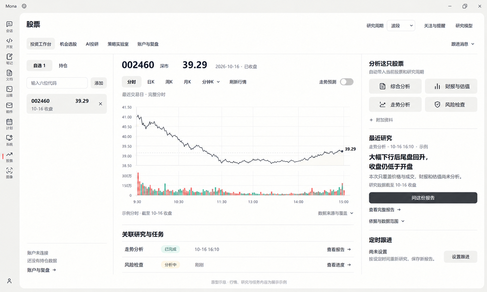
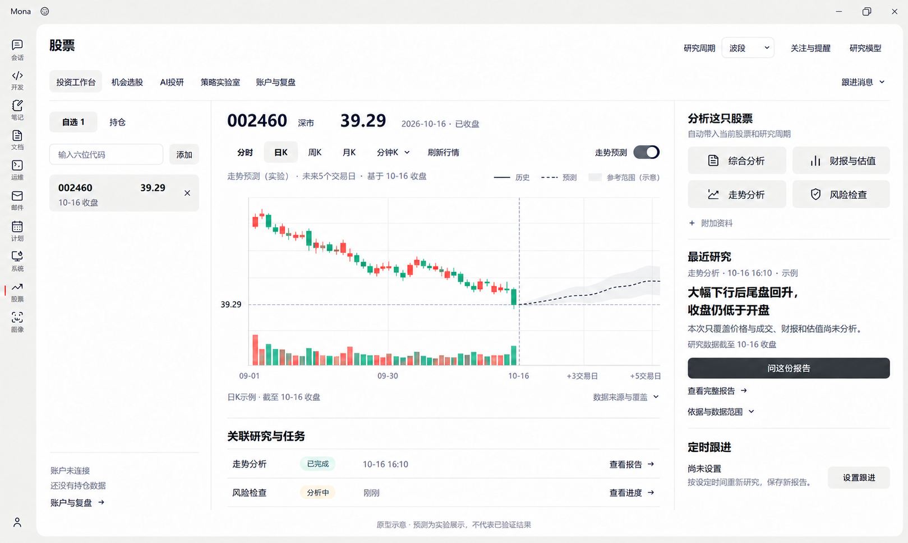

# 投资工作台 V4：功能价值评估与原型

- 日期：2026-10-18
- 视觉更新：用户明确只调整股票模块内部，现以[V6局部彩色UI原型](stock-vibe-workbench-v6.md)为准，全局外壳与导航保持原样；本文件的功能价值评估仍保留作为依据。
- 状态：依据原生能力清单形成的功能评估与原型提案；不代表页面或新增数据/预测服务已经实现。
- 依据：[开发标准](../architecture/stock-module-development-standard.md)、[原生能力与Tab映射](stock-vibe-native-capabilities.md)、[原生工具/技能清单](stock-vibe-native-capabilities/tools-skills-inventory.json)、[原生页面清单](stock-vibe-native-capabilities/frontend-inventory.json)。
- 设计基线：[用户当前界面](stock-vibe-workbench-v2/00-current-workbench.png)。原型采用内置图像生成，沿用现有 Mona 外壳、导航和三栏结构。
- 范围：只评估投资工作台；原生专业功能按既有五 Tab 规划归位，不再从卡片标题倒推金融功能。

## 1. 用户任务与评估尺度

普通投资者首先需要：找到关注/持有的股票 → 看当前和历史行情 → 按问题发起研究 → 读已有结果并核对依据 → 继续追问或安排跟进。

“有价值”不等于所有功能都常驻首页。评估同时看使用频率、是否有可靠输入/结果、用户看完能做什么，以及是否属于这个 Tab。预测潜在有价值，但其实际效果尚未验证，不能按已兑现收益能力评价。

## 2. 逐项评估

| 功能项 | 普通投资者价值 | 用户心智评估 | 原生依据 / 接入缺口 | 本次取舍 |
| --- | --- | --- | --- | --- |
| 自选股票管理 | 高：快速找到自己关注的股票 | 符合常见看盘习惯；只输六位代码 | Mona自选适配；可复用原生证券查询 | 保留在左侧：添加、选择、移除；有名称数据时显示名称 |
| 自选 / 持仓切换 | 高，有真实持仓时更有价值 | 符合“关注”和“已持有”的区别 | 原生Portfolio快照 + Mona适配 | 保留；未连接时说明没有持仓数据，不填假持仓 |
| 默认最近交易日分时、盘中更新 | 必需：先看今天或最近交易日发生了什么 | 符合看盘心智；分时线不等于1分钟K线 | 原生行情/连接器基础；完整A股分时接入需补齐 | 中央默认分时；休市看最近完整交易日，标明数据时间 |
| 日K、周K、月K等切换 | 高：换时间尺度判断走势 | 符合常用股票软件；周期入口紧邻图表 | 原生历史行情 + Mona图表适配 | 保留在图表工具栏；不支持的周期说明实际缺项 |
| 研究周期：超短线 / 波段 / 中短线 | 中高：让研究贴合用户看的期限 | 需与图表周期分开；用“研究周期”表达 | Mona上下文适配到原生研究 | 顶栏保留小控件，不额外创建一套交易执行模式 |
| 分时走势预测 | 有条件价值高：提供短时参考；效果须实测 | 容易被当成确定走势，需分清实际与预测 | 原生ML研究/因子基础可复用；持续预测服务新增 | 保留独立开关，默认关闭；明确起点、期限与实验状态 |
| 日K走势预测 | 有条件价值高：辅助观察未来几天；效果须实测 | 用交易日表达期限，不能画成已发生的未来K线 | 原生ML/回测可复用；日频预测模型与服务新增 | 保留独立开关；与分时分别训练、评价和留档 |
| 行情与报告来源、时点、覆盖 | 高：知道信息是否及时、有何缺项 | 应贴近结果；普通用户优先看“截至何时” | 原生provenance/报告/产物 + Mona投影 | 图下和报告旁简明显示，完整细节展开 |
| 综合分析 | 高：想先整体了解一只股票时有明确入口 | 符合“帮我看看这只股票”，无需自己选研究团队 | 原生公司研究、Session、equity/fundamental团队 | 右栏保留；自动带入股票与研究周期，输出有依据的综合报告 |
| 财报与估值 | 中高：理解公司经营及价格所依赖的假设 | 符合“公司怎么样、现在贵不贵”；避免只给一个合理价 | 原生财报/公司工具、估值技能及计算库 | 右栏保留；资料或假设不足时说明缺项，区分事实与估计 |
| 走势分析 | 高：解释当前价量变化，衔接看图后的疑问 | 符合“最近怎么走、发生了什么”；应与未来预测分开 | 原生价量工具、技术技能与分析团队 | 右栏保留；解释历史依据，不以技术指标冒充预测效果 |
| 风险检查 | 高：发现研究中的风险和信息缺口 | 符合“这只股票需要注意什么”；个人风险需真实持仓 | 原生风险研究、量化工具；组合分析有额外数据条件 | 右栏保留；未连接账户也能研究标的风险，不编个人仓位 |
| 最近研究摘要 | 高：快速读到已有发现，减少翻长报告 | 符合；必须说明任务、时间和覆盖，不能固定套话 | 原生Session/Swarm报告 + 摘要适配 | 右栏重点展示；没有报告时提供分析入口，不编结论 |
| 问这份报告 / 查看全文与依据 | 高：能弄懂结论并继续研究 | 符合；用户围绕同一问题继续问 | 原生Session、报告与文件；团队后续问答需关联适配 | 摘要旁保留；查看不触发重跑，追问携带原报告来源 |
| 为研究补充资料 | 中高：可分析公告、文件或截图 | “附加资料”容易理解；不占默认大区域 | 原生文档/图像/附件研究 + 已有上传 | 作为任务入口的小操作，完整编辑在AI投研 |
| 定时跟进研究 | 中，有持续需求时高：省去重复提问 | 需用户主动设置；不能与实时盯盘混称 | 原生Scheduled + Mona接入 | 轻入口；有计划时显示下次时间，完成后关联新报告 |
| 关联任务进度与报告 | 高，有任务时：知道是否做完、结果在哪 | 符合异步研究习惯；按当前股票关联 | 原生Session/Swarm/Run状态与产物 | 图下少量最近记录；完整历史进入投研/报告详情 |
| 重要变化与跟进消息 | 高，有真实消息时：避免漏掉已完成研究或变化 | 可展开看；空列表无需占据主图 | 原生任务结果 + 已有宿主情景/通知扩展 | 导航附近轻入口；明确事件来源，不冒充全市场实时事件引擎 |
| 固定“成立 / 失效”数学条件卡 | 有条件：能复核特定计划，但不适合每股常驻 | 没有对应报告时难懂；价格不等式本身不解释意义 | 已有宿主情景扩展，非原生通用必填字段 | 有真实条件时在报告/详情中解释其意义，不做默认空模板卡 |
| 完整因子榜单、IC/IR参数 | 对专业研究有价值，普通用户日常看盘价值低 | 不符合默认工作台心智，容易误当上涨概率 | 原生Alpha Zoo/bench/compare | 放策略实验室及专业详情 |
| 完整组合相关性 / 风险矩阵 | 有条件高：需要多个资产和真实篮子 | 适合看组合，不适合单只股票常驻 | 原生Correlation、Portfolio风险分析 | 放账户与复盘；有可靠结果时可引用简明风险摘要 |
| Shadow复盘全流程 | 对复盘有价值，对日常看盘非高频 | 从成交到规则回测是一项独立任务 | 原生Trade Journal/Shadow | 放账户与复盘，工作台可链接已有结果 |
| 实盘买入 / 卖出 | 当前范围不适用 | 看盘用户熟悉，但会被理解为已连接账户可交易 | 原生部分连接器有受控执行；普通东财没有现成直连 | 当前工作台不提供下单按钮 |

## 3. 原生任务与可见操作对应

| 用户操作 | 对应原生基础 | 用户输入及结果 | 适配边界 |
| --- | --- | --- | --- |
| 综合分析 | equity_research_team / fundamental_research_team、会话研究、数据工具与grounding | 自动带入当前股票和研究周期；返回原生报告、过程和引用 | 选择经A股适配的预设与输入；当前Mona只开放固定两节点团队，不能把按钮画出就称已接通 |
| 财报与估值 | 财报/公司资料工具、financial-statement/valuation技能、fundamental研究；原生估值计算 | 有来源的财务分析及可计算时的估值结果 | 输入/假设不足时说明缺项；CLI playbook是研究步骤，不能当已算出的合理价 |
| 走势分析 | 原生价量数据、技术分析工具/技能及适用团队 | 对历史走势和成交的研究及依据 | 与计算未来价格的预测服务分开，不能以技术指标冒充预测效果 |
| 风险检查 | 原生风险研究/量化工具；有账户或篮子时可用Portfolio风险能力 | 标的或组合的实际风险与数据范围 | 无真实持仓时做标的风险，不编造个人仓位和账户风险 |
| 问这份报告 | Session消息、原报告与证据引用 | 单人报告在关联会话继续；团队报告可进入带原来源的后续会话 | Swarm并无原地继续聊天的同等入口，不能把追问实现为自动重跑团队 |
| 设置定时跟进 | 原生Scheduled任务、时间/时区、报告与投递记录 | 由用户主动选择时间和研究内容，保存新的研究结果 | 定时研究不等于实时价格条件盯盘；原生工作日cron不自动等于交易所日历 |

所有可见摘要必须引用当前标的的真实原生产物及其数据时点。没有已完成报告时，只展示清楚的任务入口和“还没有这只股票的研究”，不摆示例结论；有缺项时如实说明，不要求先连账户才能研究。

## 4. 布局与交互决定

- 左侧：自选/持仓、六位代码输入、当前标的列表；账户未连接时显示简明状态和账户与复盘入口。
- 中央：默认分时，日K等周期就在主图旁。预测是用户主动开启的可选项，分时与日K分别保存开关和期限；默认关闭。
- 右侧：先提供“综合分析/财报与估值/走势分析/风险检查”任务入口，再显示真实最近研究摘要、问报告/看全文、来源与覆盖；保留定时跟进轻入口。
- 图下：与当前股票关联的最近任务/报告及进度，不新增第二套任务系统。
- 跟进消息：轻量展开入口，有真实事件才列出；不在右栏常驻“暂无变化”的大区域。
- 完整因子参数、相关性矩阵、Shadow步骤、团队与执行环境控制不占工作台首屏。
- 行情刷新与重新研究是不同动作；切股票/图表周期可以读取已有结果，不能自动重复派发研究。
- 数据时点与报告生成时间分别显示；图表切换不能改写旧报告的结论或来源。
- 原生数值和状态由Vibe提供，Mona只做适配与展示。原生没有所需摘要结构时，补最小结构化投影并保留正文及证据引用。

## 5. 原型状态

原型一演示非交易时段的默认状态：显示最近完整交易日分时，预测关闭；原型二演示用户切到日K并手动开启预测。盘中默认显示本交易日分时并按数据源实际频率更新；分时也支持同位置预测开关。图中的分时轨迹、研究/任务及预测均为设计示例，不是已取得的真实分钟行情或已训练的预测结果。

分时历史与实时更新需要先验证可靠数据源。预测研发优先复用原生ml-strategy、ml_quant_lab、因子与回测，不另造研究编排；模型、持续推理、版本留档及前向评价仍需补齐。未满足某项输入只影响该项功能，不封住工作台或其他已可测能力。

## 6. 实施范围与必要验证

本轮只交付功能评估、映射与原型，未修改产品代码。后续按工作台的行情/对象一致、原生任务与报告关联、预测与持续跟进顺序实现；逐项记录当前实现和真实验证。

重点检查：默认分时日期/交易时段正确；六位代码一致；研究确实到达对应原生流程；报告、资料、任务身份关联正确；无报告/缺数据/账户未连接/失败时用户仍能理解可用操作；查看和重连不重复发起任务。必要回归围绕这些行为，不用静态原型或测试数量代替功能完成。

## 7. 生图记录

生成方式：内置 image_gen，参考用户当前界面进行图像编辑；未用代码绘图替代原型图像。两张最终图均已目视核对，最终日K图简化价格轴，避免把示意曲线当成精确行情。

- 最终默认分时：[01-default-intraday.png](stock-vibe-workbench-v4/01-default-intraday.png)
- 最终日K预测：[02-daily-prediction.png](stock-vibe-workbench-v4/02-daily-prediction.png)
- 精确提示词、参考路径与修订记录：[prompts.md](stock-vibe-workbench-v4/prompts.md)
