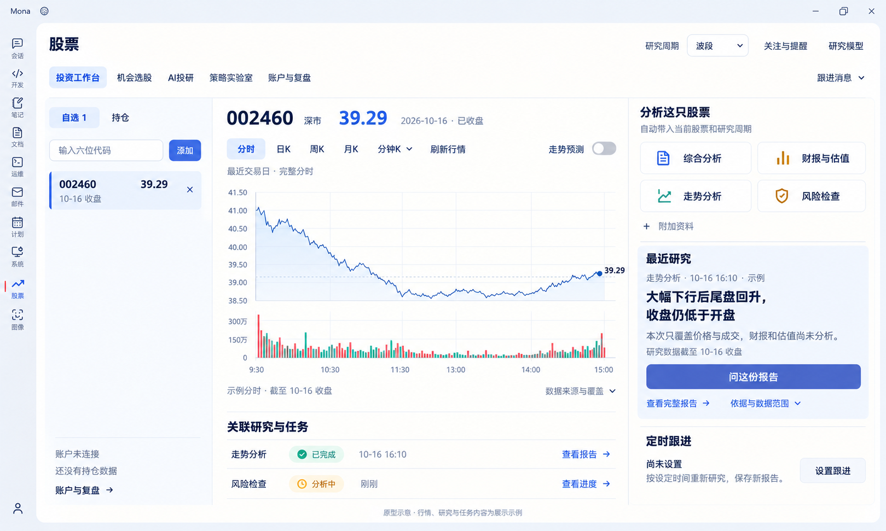
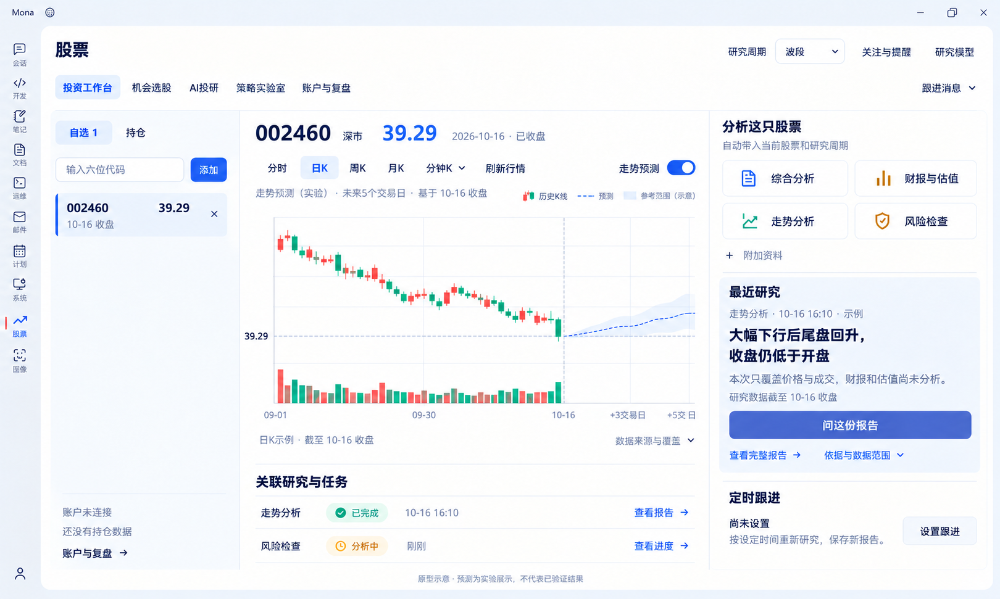

# 投资工作台 V5：彩色 UI 原型

- 日期：2026-10-18。
- 范围纠正：本版外壳及导航改色超出用户意图，视觉以[V6仅股票模块局部配色](stock-vibe-workbench-v6.md)为准；不得按本版全局染蓝。
- 用户要求：重新设计黑白灰原型的视觉；本次采用彩色方案。
- 功能依据：[V4 功能价值评估](stock-vibe-workbench-v4.md)与[原生能力映射](stock-vibe-native-capabilities.md)。沿用三栏及业务功能，本次交付视觉设计，尚未应用到运行中的页面。

## 视觉决定

| 区域 | 设计 |
| --- | --- |
| 外壳与工作面 | 浅雾蓝外壳、暖白内容区，用轻微色差和留白区分层次 |
| 导航与主要操作 | 蓝色/靛蓝主动作、浅蓝选中；最近研究的问报告是主要动作 |
| 正文 | 深蓝灰正文，次要文字降低字重与强调度，避免纯黑堆叠 |
| 分时图 | 蓝色实线配很淡的面积填充，成交量仍为涨红跌绿 |
| 日K预测 | 历史蜡烛涨红跌绿；蓝色预测虚线与淡蓝参考范围，有起点/期限/图例 |
| 研究入口 | 四个入口保持轻边界，小图标使用克制蓝、青绿、暖金；不做四个实心主按钮 |
| 最近研究 | 局部浅蓝阅读面，突出摘要、来源和继续追问，定时跟进使用次级样式 |
| 状态 | 完成/分析中同时保留图标与文字，颜色不是唯一识别方式 |

用户本次明确要求优先于旧原型的中性配色取舍。落地时将此视觉映射到共享语义 Token 和组件，不在业务页面硬编码色值，也不据此修改其他模块主题。

## 原型

默认分时，走势预测关闭：



日K，用户开启走势预测：



两图均保留六位代码输入、研究周期、原生分析入口、报告追问、定时跟进和关联任务。图中行情、报告、任务及预测为原型示例。已目视核对布局、文字、图表历史/预测分界和各状态一致性。

## 生图记录

使用内置 image_gen 图像编辑，`transparent_background: false`；均使用 `referenced_image_paths`，未同时提供 `num_last_images_to_include`。生成原件保留，并复制最终图到上述项目路径。

### 默认分时

- 参考：`docs/design/stock-vibe-workbench-v4/01-default-intraday.png`。
- 原件：`C:/Users/liuzhe/.codex/generated_images/01a143d6-9091-7571-a64d-1b13fe0afa82/exec-e22b9f1e-a9f4-422e-b2f8-ff9a415e7521.png`。

```text
Use case: ui-mockup / style-transfer
Asset: Mona中文桌面股票工作台高保真彩色UI原型，完整横向应用截图，约16:10。编辑目标为参考图。

用户明确不喜欢原图的黑白灰视觉，请认真重新设计视觉层次，让它像成熟、清爽、有质感的投资研究产品，而不是给旧灰色按钮随便涂色。沿用原图所有业务功能和三栏信息架构；不新增业务、指标、卡片数字或交易按钮。

视觉方向：暖白工作表面，浅雾蓝外壳，深靛蓝的品牌交互，低饱和蓝色行情图，少量青绿与暖金点缀。调色参考：应用外壳#F1F3F8，主工作面#FFFEFB，正文深蓝灰#26364A，次要文字#65748A；主要动作深靛蓝#4B60B8，选中浅蓝#EAF0FF；图表蓝#527CA8，辅助青绿#438A7E，暖金#BD873C。没有纯黑大块，也没有整页深蓝底。边框薄、圆角约8px，阴影极轻。字体清晰、阅读友好、留白精确；大标题和价格有字重层级，正文不发灰发虚。保持专业桌面工具，禁止玻璃拟态、发光、霓虹、海报、3D、渐变大背景和过多装饰。

保留Mona窗口外壳及左侧应用竖栏，竖栏图标用深蓝灰，股票当前入口保留原有短红色身份标记。顶部“股票”和五页签文字完全不变，投资工作台选中态改为浅蓝底+深靛蓝字，不要黑灰胶囊。顶部“研究周期 波段”“关注与提醒”“研究模型”保持，跟进消息入口保持。

三栏保持原图比例与结构，但提升分组和空间层次：
左栏：背景轻微雾蓝白，自选1/持仓分段中自选用浅蓝选中；六位代码输入清晰；“添加”用小型深靛蓝按钮。选中002460股票行有柔和浅蓝背景、左侧细蓝标记，价格39.29，10-16收盘，删除×。不要新加股票名称或涨跌幅。底部账户未连接、还没有持仓数据、账户与复盘入口均保持。
中央：白色主画布，002460、深市、39.29、2026-10-16已收盘不改。分时当前选中改为浅蓝底深靛蓝字，日K周K月K分钟K刷新行情保持原文字。走势预测开关仍关闭灰色，不能打开，也不要画任何未来线。最近交易日·完整分时保持。大图的实际分时折线从原来的黑色改为清晰低饱和蓝#527CA8，线下仅很淡的蓝色面积渐隐，图中实际走势形状、9:30至15:00时间、39.29终点保持。成交量仍为A股红涨绿跌，不改方向、不新增数据。网格更轻，坐标可读。
图下“关联研究与任务”保留两行，不增加卡片；已完成用轻青绿色徽标，分析中用浅暖金徽标，查看报告/进度用深靛蓝文字链接。
右栏：背景保持暖白。分析这只股票标题有层级，四个入口“综合分析”“财报与估值”“走势分析”“风险检查”仍为2×2，改为白底、轻边界、整齐8px圆角；图标分别用克制蓝/暖金/青绿/赭金小色块或线条，文字一律深蓝灰，不要四张饱和彩色卡片。附加资料保持轻入口。
“最近研究”是右栏的重点：把原有最近研究区域组织成一块淡蓝白#F0F4FF阅读面，细边框或无边框均可，舒适内边距。保留“走势分析 · 10-16 16:10 · 示例”，主句“大幅下行后尾盘回升，收盘仍低于开盘”，正文“本次只覆盖价格与成交，财报和估值尚未分析。”，研究数据截至10-16收盘。主按钮“问这份报告”改为深靛蓝实心白字；查看完整报告、依据与数据范围采用蓝色轻文字链接。不要使用黑色主按钮。
定时跟进区域保留尚未设置、原说明与设置跟进，采用清爽次级样式，不和报告抢视觉。
底部精确文字“原型示意 · 行情、研究与任务内容为展示示例”。整体呈现温润、清晰、有色彩但安静的高质量金融研究UI。必须完整保留功能、中文和三栏；只设计一张应用截图，不加外部解释和色板。
```

### 日K预测

- 参考一：上述默认分时彩色原件，用作编辑目标及视觉标准。
- 参考二：`docs/design/stock-vibe-workbench-v4/02-daily-prediction.png`，仅用作图表状态依据。
- 原件：`C:/Users/liuzhe/.codex/generated_images/01a143d6-9091-7571-a64d-1b13fe0afa82/exec-3316d5ac-d057-4e68-a0b1-ed26bfbf3a78.png`。

```text
Use case: ui-mockup / style-transfer
生成一张完整的Mona投资工作台彩色高保真截图，和图1是同一产品同一视觉设计，状态为“日K + 走势预测已开启”。

输入图角色：
图1是编辑目标、最终彩色UI样式标准。必须保留它的浅雾蓝外壳、暖白主画布、深蓝灰文字、靛蓝按钮、浅蓝选中、左自选栏、右研究摘要浅蓝阅读面、四个彩色小图标和下方任务列表，文字与布局比例不变。
图2仅作为中央日K图表及预测交互状态的内容依据，不采用图2的黑白灰UI。不要把两个窗口拼接，只输出一张完整窗口。

只对图1中央主图区域作这些更改：
“分时”取消选中，改为“日K”浅蓝选中。走势预测开关开启，用靛蓝轨道，白色圆点在右。原来的“最近交易日·完整分时”替换为小字“走势预测（实验） · 未来5个交易日 · 基于10-16收盘”。图例用小型红绿蜡烛“历史K线”、蓝色虚线“预测”、淡蓝色块“参考范围（示意）”。
采用图2的历史蜡烛走势、最新39.29水平参考线、10-16历史/未来分界、右侧预测范围和日期：09-01、09-30、10-16、+3交易日、+5交易日。当前真实收盘39.29，图中最后真实绿色蜡烛的实体底部和预测起点严格在39.29同一水平，虚线从此连续接出，预测范围渐宽。预测主线用蓝#527CA8虚线，范围是低透明度淡蓝，不能使用红绿暗示预测涨跌。K线和量柱仍为A股红涨绿跌，未来区没有任何蜡烛或量柱。主图不必重新添加价格数字，纵轴仅保留39.29参考线数值，与图2相同，不发明精确预测值或涨跌幅。预测和历史用细竖虚线隔开。
图下“日K示例 · 截至10-16收盘”，来源入口保持。顶端002460深市39.29、2026-10-16已收盘，左自选39.29，全都与图1一致。图表切换不影响右栏原有最近研究内容和任务列表。
最底部说明“原型示意 · 预测为实验展示，不代表已验证结果”。保持图1清爽有质感的彩色界面，不增加黑色主按钮、黑色预测线、弹窗、新功能、装饰图、外部说明或色板。中文清晰。
```
