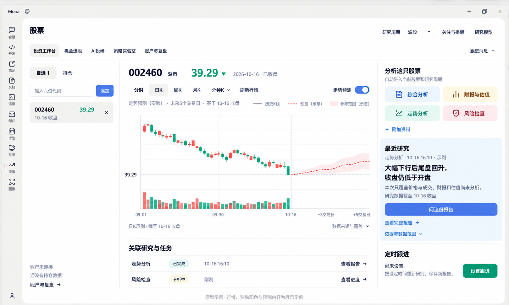

# 投资工作台 V6：仅股票模块局部配色

- 日期：2026-10-18。
- 开发口径更新：普通分析按钮统一中性，主要操作与预测开关彩色；按用户要求停止生图，直接实现。当前状态见[实施记录](stock-vibe-workbench-implementation.md)。
- 用户最新约束：只改股票模块配色；全局外壳和导航不变；右侧按钮、开关等控件使用彩色；有涨跌含义的数据使用红绿。
- 功能依据：[V4功能评估](stock-vibe-workbench-v4.md)与[原生能力映射](stock-vibe-native-capabilities.md)。本版替代V5的视觉方案，功能布局沿用原评估。
- 本次为原型设计更新，未修改全局主题或产品代码。

## 作用范围

| 区域 | 约束 |
| --- | --- |
| Mona标题栏、应用侧栏、外壳 | 保留用户截图中的中性外观，不染蓝、不换图标 |
| 股票标题、五Tab导航、顶栏入口 | 保持原样，不全局更换导航选中颜色 |
| 股票区右栏 | 四类研究入口使用低饱和浅蓝/暖金/青绿/玫瑰；摘要为局部浅蓝阅读面；问报告蓝色，设置跟进青绿 |
| 股票区控件 | 添加按钮、开启的预测开关使用股票区局部蓝色；开关不表达预测准确度，不额外增加滑块 |
| 报价、自选价及涨跌 | 同一标的同一口径，涨红跌绿、平盘中性；颜色之外保留方向/符号，日期和代码保持中性 |
| 历史K线及成交柱 | A股红涨绿跌，不能随UI主色改成蓝色 |
| 预测 | 未来路径相对预测起点上行用红、下行用绿；保持虚线、未来分界与实验示意，未来不画实际K线/成交量 |

报价颜色实施时必须比较最新价与有效昨收，不能由日内开盘价或最后一根蜡烛推断当日涨跌。无有效昨收时保持中性，不能猜测。本图39.29的绿色仅演示“较昨收下跌”状态，不是对该日期真实涨跌的核验，未填入没有来源的涨跌额或百分比。

预测范围为示意，不是有验证覆盖率的概率区间。分时默认、盘中更新及分时/日K分别开启预测的约定不变；本图只演示日K开启预测的状态。

实施配色时仅在股票模块内部映射语义Token与共享控件，不全局替换primary/action等变量，不影响其他模块。

## 最终原型



已目视核对：全局保持中性、标注红框移除、右栏按钮及预测开关彩色、报价与自选价同为绿色、K线涨红跌绿、未来上行预测红色且无未来量柱。

## 内置生图记录

- 方式：内置image_gen图像编辑，`transparent_background: false`，使用`referenced_image_paths`。
- 用户参考图：[00-user-markup.png](stock-vibe-workbench-v6/00-user-markup.png)，复制自本轮用户附件，生成时使用原附件路径。
- 生成原件：`C:/Users/liuzhe/.codex/generated_images/01a143d6-9091-7571-a64d-1b13fe0afa82/exec-bb64578e-4f39-48ce-aa6b-21831e7c4cca.png`，原件保留，最终文件已复制到项目。
- 图中行情、涨跌配色、研究、任务和预测均为原型示例，不是已实现或验证结果。

精确提示词：

```text
Use case: ui-mockup / precise-object-edit
编辑这张用户标注的Mona投资工作台截图，生成一张修正后的高保真原型。必须严格局部修改，整体比例、位置、功能和全部中文保持原图。输出完整窗口，删除用户画的三个红色矩形批注框。

最重要的范围约束：
Mona顶端窗口标题栏、左侧应用竖栏（会话/开发/笔记/文档/运维/邮件/计划/系统/股票/画像）、外壳背景、股票页标题、上方五个Tab导航及其灰色选中、研究周期/关注与提醒/研究模型，都完全保留原来暖白/灰色视觉，不染蓝、不改变图标和文字颜色，不增加蓝色外壳！本次只在股票工作区内部做下面的改动。不要沿用上一版全局浅蓝外壳方案。

1. 右侧栏的控件认真设计彩色UI：
“分析这只股票”四个按钮仍是原来2×2位置和大小。综合分析用淡蓝底+深蓝字图标，财报与估值用很淡暖金底+深赭金字图标，走势分析用淡青绿底+深青绿字图标，风险检查用很淡暖玫瑰底+深玫瑰字图标。饱和度低，颜色轻，清晰边界，不是四块深色实心砖，正文可读性好。附加资料使用蓝色小图标和链接。
“最近研究”及摘要组织成一块浅冰蓝阅读区域，保留原来的主句“大幅下行后尾盘回升，收盘仍低于开盘”、来源时点和范围正文。主按钮“问这份报告”改为清晰的中蓝色实心白字（约#4D70C8），绝对不要黑色或深到像黑色的按钮。查看完整报告、依据与数据范围用蓝色轻链接。标题与正文仍用清晰深灰，不要把整块文字全部变彩色。
“定时跟进”仍保留原说明、尚未设置和位置；“设置跟进”用青绿色实心按钮、白字，和研究蓝色形成有层级的次级行动。右侧背景整体仍为白色，只有摘要的局部浅色阅读面，细分隔线，圆角约8px，留白整齐，无大阴影。

2. 股票区中央“走势预测”开关当前已开启：改为中蓝色开启轨道，白圆点在右，保留文字与原位置。它表示开关状态，不代表收益，不能用黑灰轨道。不要新加任何滑块或功能。股票区“添加”小按钮可用同一蓝色，其他原有导航和页签保持中性。

3. 金融数据有涨跌含义时必须涨红跌绿：
此图以“当前报价下跌”的配色状态示例显示。中间大报价39.29、自选列表39.29、图表最后实际39.29参考值统一用清晰证券绿色（约#17966A），报价旁可放很小的绿色向下箭头。六位代码002460、日期、市场文字仍深灰；不要用蓝色表示涨跌。不要新增未提供的具体涨跌额或百分比。
实际日K蜡烛和成交柱保持A股红涨绿跌，最后一根绿色下跌蜡烛不改。当前预测路径从39.29温和向上，未来预测虚线改为证券红色，配极淡红色参考范围；如果路径下降才用绿色。预测从10-16最后真实K线收盘高度接出，历史与未来仍有竖虚线，未来仍然没有K线和成交量。图例写“历史K线”“预测（示意）”“参考范围（示意）”，预测使用红色虚线，和真实K线区别明确。
保留“走势预测（实验）·未来5个交易日·基于10-16收盘”、横轴09-01/09-30/10-16/+3交易日/+5交易日、39.29报价，所有图表空间和几何关系维持。

4. 其他信息不变：左自选行保留灰底，只价格用绿；底部关联研究与任务不改；已完成用浅绿徽标加文字，分析中用浅金徽标加文字。底部准确显示“原型示意 · 行情、涨跌配色与预测内容为展示示例”。
最终效果是“原本的Mona中性外壳 + 股票模块局部彩色控件 + 涨红跌绿的金融数据”，绝不能把整个App变蓝，也不能在最终图保留红色批注框。
```
