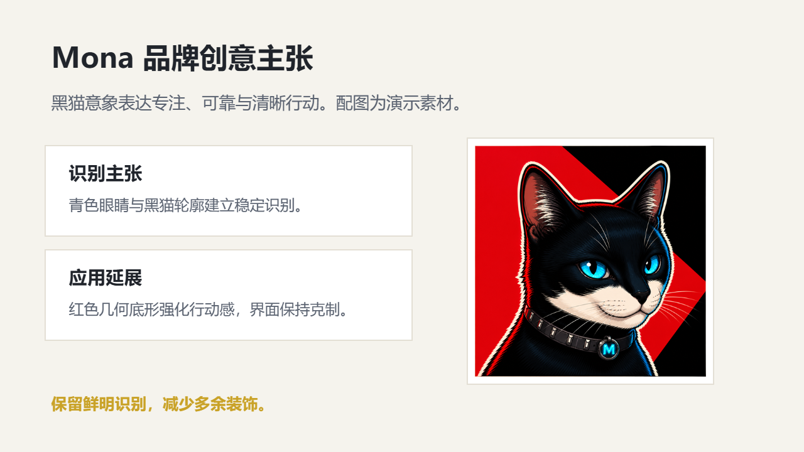

# 品牌提案

呈现品牌主张、受众定位、创意概念、视觉方向和传播计划。

创建时在 `slide_add_preset.content` 填 `scenario: "brand-proposal"`。后续成功写入的预设页继承场景；不修改已完成页面。当前能力目录可用 `presetScenario: "brand-proposal"` 查询容量和可用对象。

## 与自由原生构图混排

使用 `slide_add_design` 时可沿用以下 `palette`；品牌颜色与真实内容优先。

```json
{"background": "#F5F3ED", "ink": "#20242B", "muted": "#5A6270", "accent": "#C9A227", "surface": "#FFFFFF", "line": "#D8D2C4"}
```

## 页面表达

| 页面用途 | 原生预设 | 内容关系 |
|---|---|---|
| 品牌提案封面 | `light-cover-split` | `none` |
| 品牌主张 | `light-transition-statement` | `none` |
| 受众与市场背景 | `light-editorial-essay` | `none` |
| 品牌价值结构 | `light-hierarchy-branch` | `hierarchy` |
| 视觉方向与情绪板 | `light-gallery` | `parallel` |
| 品牌定位比较 | `light-comparison-split` | `parallel` |
| 传播与发布节奏 | `light-timeline` | `sequence` |
| 创意与执行团队 | `light-team-grid` | `hierarchy` |
| 品牌概念与创意论证 | `brand-concept-proposal` | `none` |

正文写用户提供的实际内容；所有图片路径必须指向已取得的真实素材。数组、数字、单位、来源和关系遵守当前预设容量；不适配时组合原生对象，不删事实或缩小整页。

下图为 `brand-concept-proposal` 的真实 Office 渲染；示例资料仅验证构图，不代表业务结论。


