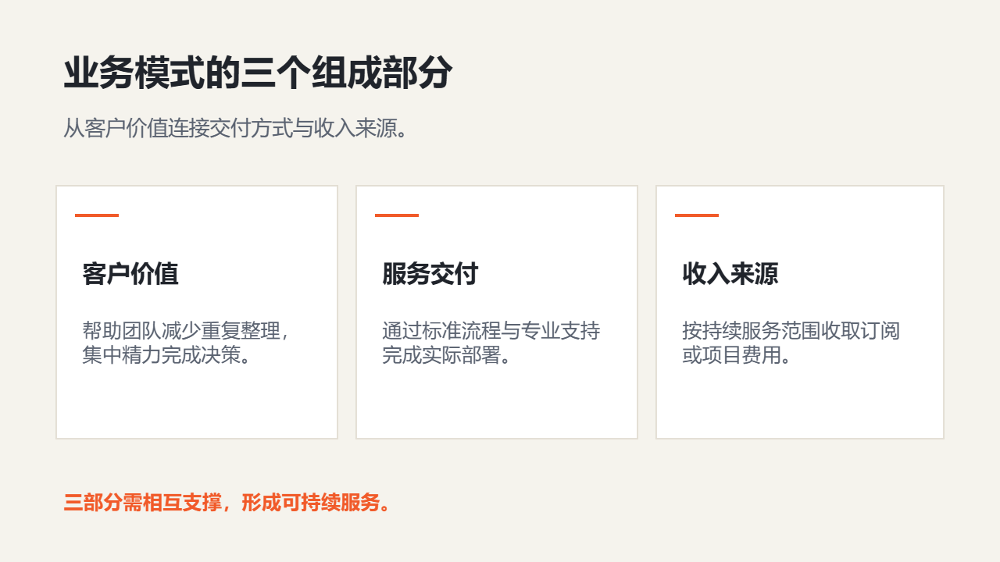

# 商业路演

讲清用户问题、商业模式、增长证据、团队能力和融资诉求。

创建时在 `slide_add_preset.content` 填 `scenario: "business-pitch"`。后续成功写入的预设页继承场景；不修改已完成页面。当前能力目录可用 `presetScenario: "business-pitch"` 查询容量和可用对象。

## 与自由原生构图混排

使用 `slide_add_design` 时可沿用以下 `palette`；品牌颜色与真实内容优先。

```json
{"background": "#F5F3ED", "ink": "#20242B", "muted": "#5A6270", "accent": "#F15A29", "surface": "#FFFFFF", "line": "#D8D2C4"}
```

## 页面表达

| 页面用途 | 原生预设 | 内容关系 |
|---|---|---|
| 路演封面 | `light-cover-split` | `none` |
| 用户问题与主张 | `light-transition-statement` | `none` |
| 市场背景 | `light-editorial-essay` | `none` |
| 商业模式 | `light-hierarchy-branch` | `hierarchy` |
| 增长与验证指标 | `light-metric-spotlight` | `none` |
| 市场与增长证据 | `light-chart-evidence` | `none` |
| 竞争格局 | `light-comparison-split` | `parallel` |
| 核心团队 | `light-team-grid` | `hierarchy` |
| 融资计划与资金用途 | `light-closing-callout` | `none` |
| 商业主张封面 | `light-product-hero` | `none` |
| 商业案例图片页 | `light-case` | `parallel` |
| 商业模式与收入闭环 | `pitch-business-model` | `parallel` |

正文写用户提供的实际内容；所有图片路径必须指向已取得的真实素材。数组、数字、单位、来源和关系遵守当前预设容量；不适配时组合原生对象，不删事实或缩小整页。

下图为 `pitch-business-model` 的真实 Office 渲染；示例资料仅验证构图，不代表业务结论。


