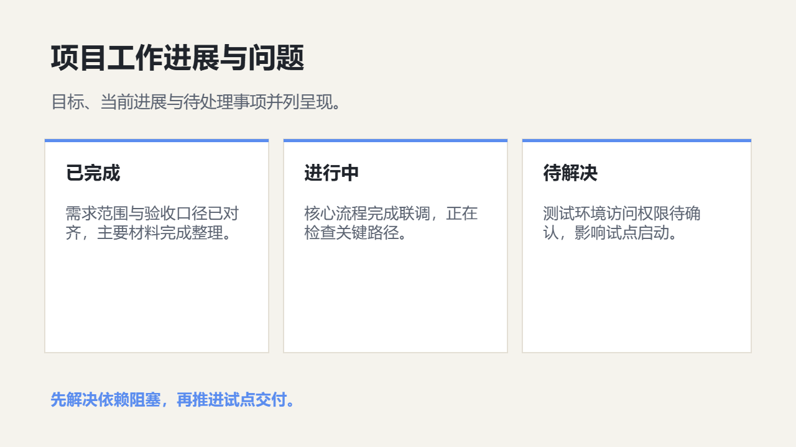

# 企业汇报

汇报经营状况、关键指标、项目推进、差距和后续行动。

创建时在 `slide_add_preset.content` 填 `scenario: "business-report"`。后续成功写入的预设页继承场景；不修改已完成页面。当前能力目录可用 `presetScenario: "business-report"` 查询容量和可用对象。

## 与自由原生构图混排

使用 `slide_add_design` 时可沿用以下 `palette`；品牌颜色与真实内容优先。

```json
{"background": "#F5F3ED", "ink": "#20242B", "muted": "#5A6270", "accent": "#5B8DEF", "surface": "#FFFFFF", "line": "#D8D2C4"}
```

## 页面表达

| 页面用途 | 原生预设 | 内容关系 |
|---|---|---|
| 年度或阶段汇报封面 | `light-cover-split` | `none` |
| 经营背景与目标 | `light-editorial-essay` | `none` |
| 关键指标总览 | `light-metric-spotlight` | `none` |
| 指标变化趋势 | `light-timeline` | `sequence` |
| 经营数据证据 | `light-chart-evidence` | `none` |
| 目标与实际对照 | `light-comparison-split` | `parallel` |
| 问题与行动计划 | `light-process-steps` | `sequence` |
| 结论与请求 | `light-closing-callout` | `none` |
| 经营概览网格 | `light-overview` | `parallel` |
| 单项经营指标 | `light-metric` | `none` |
| 经营图表洞察 | `light-chart-insight` | `none` |
| 项目状态总览 | `report-project-status` | `parallel` |

正文写用户提供的实际内容；所有图片路径必须指向已取得的真实素材。数组、数字、单位、来源和关系遵守当前预设容量；不适配时组合原生对象，不删事实或缩小整页。

下图为 `report-project-status` 的真实 Office 渲染；示例资料仅验证构图，不代表业务结论。


