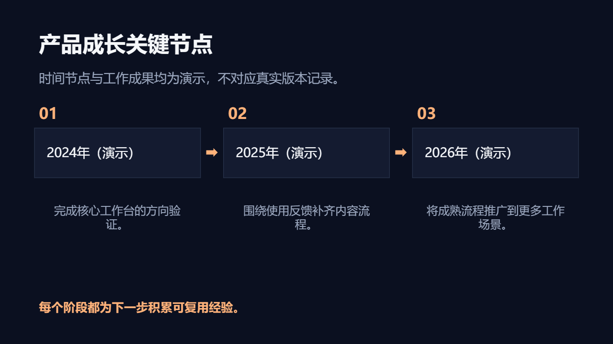

# 企业故事

讲述企业起点、关键里程碑、团队成长和客户实践。

创建时在 `slide_add_preset.content` 填 `scenario: "company-story"`。后续成功写入的预设页继承场景；不修改已完成页面。当前能力目录可用 `presetScenario: "company-story"` 查询容量和可用对象。

## 与自由原生构图混排

使用 `slide_add_design` 时可沿用以下 `palette`；品牌颜色与真实内容优先。

```json
{"background": "#0B1020", "ink": "#F5F7FA", "muted": "#9AA6BD", "accent": "#FFB27A", "surface": "#141B30", "line": "#27324A"}
```

## 页面表达

| 页面用途 | 原生预设 | 内容关系 |
|---|---|---|
| 企业故事封面 | `dark-cover-split` | `none` |
| 使命与初心 | `dark-transition-statement` | `none` |
| 企业起点与背景 | `dark-editorial-essay` | `none` |
| 团队与组织 | `dark-team-grid` | `hierarchy` |
| 客户与实践故事 | `dark-gallery` | `parallel` |
| 发展历程时间线 | `dark-timeline` | `sequence` |
| 成长数据 | `dark-metric-spotlight` | `none` |
| 企业价值与能力 | `dark-hierarchy-branch` | `hierarchy` |
| 未来愿景 | `dark-closing-callout` | `none` |
| 企业发展里程碑 | `story-milestones` | `sequence` |

正文写用户提供的实际内容；所有图片路径必须指向已取得的真实素材。数组、数字、单位、来源和关系遵守当前预设容量；不适配时组合原生对象，不删事实或缩小整页。

下图为 `story-milestones` 的真实 Office 渲染；示例资料仅验证构图，不代表业务结论。


