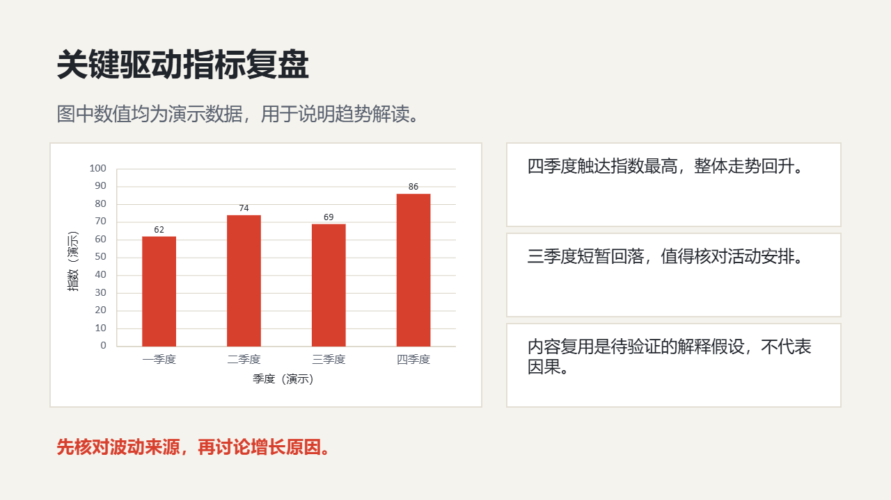

# 经营数据

复盘指标走势、分部表现、关键驱动因素和经营动作。

创建时在 `slide_add_preset.content` 填 `scenario: "data-review"`。后续成功写入的预设页继承场景；不修改已完成页面。当前能力目录可用 `presetScenario: "data-review"` 查询容量和可用对象。

## 与自由原生构图混排

使用 `slide_add_design` 时可沿用以下 `palette`；品牌颜色与真实内容优先。

```json
{"background": "#F5F3ED", "ink": "#20242B", "muted": "#5A6270", "accent": "#D8402E", "surface": "#FFFFFF", "line": "#D8D2C4"}
```

## 页面表达

| 页面用途 | 原生预设 | 内容关系 |
|---|---|---|
| 经营复盘封面 | `light-cover-split` | `none` |
| 核心指标记分板 | `light-metric-spotlight` | `none` |
| 指标趋势 | `light-timeline` | `sequence` |
| 图表证据与结论 | `light-chart-evidence` | `none` |
| 区域或产品表现 | `light-parallel-grid` | `parallel` |
| 目标与实际差异 | `light-comparison-split` | `parallel` |
| 复盘后的经营动作 | `light-process-steps` | `sequence` |
| 结论摘要 | `light-closing-callout` | `none` |
| 经营驱动因素拆解 | `data-driver-review` | `none` |

正文写用户提供的实际内容；所有图片路径必须指向已取得的真实素材。数组、数字、单位、来源和关系遵守当前预设容量；不适配时组合原生对象，不删事实或缩小整页。

下图为 `data-driver-review` 的真实 Office 渲染；示例资料仅验证构图，不代表业务结论。


