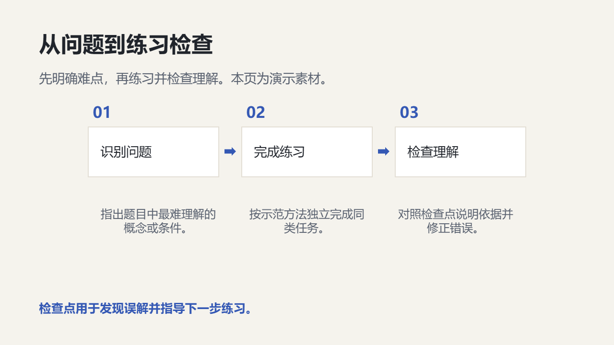

# 教学培训

设计学习目标、知识结构、讲解示例、练习实验和学习检查。

创建时在 `slide_add_preset.content` 填 `scenario: "education-training"`。后续成功写入的预设页继承场景；不修改已完成页面。当前能力目录可用 `presetScenario: "education-training"` 查询容量和可用对象。

## 与自由原生构图混排

使用 `slide_add_design` 时可沿用以下 `palette`；品牌颜色与真实内容优先。

```json
{"background": "#F5F3ED", "ink": "#20242B", "muted": "#5A6270", "accent": "#3458B4", "surface": "#FFFFFF", "line": "#D8D2C4"}
```

## 页面表达

| 页面用途 | 原生预设 | 内容关系 |
|---|---|---|
| 课程或培训封面 | `light-cover-split` | `none` |
| 学习目标 | `light-transition-statement` | `none` |
| 课程结构 | `light-parallel-grid` | `parallel` |
| 核心概念关系图 | `light-hierarchy-branch` | `hierarchy` |
| 讲解示例 | `light-gallery` | `parallel` |
| 实验对照 | `light-comparison-split` | `parallel` |
| 课堂讲解流程 | `light-process-steps` | `sequence` |
| 学习检查点 | `light-metric-spotlight` | `none` |
| 知识回顾 | `light-closing-callout` | `none` |
| 长流程教学步骤 | `light-process-long` | `sequence` |
| 知识掌握四象限 | `light-matrix-2x2` | `matrix` |
| 课堂练习与反馈 | `education-practice` | `sequence` |

正文写用户提供的实际内容；所有图片路径必须指向已取得的真实素材。数组、数字、单位、来源和关系遵守当前预设容量；不适配时组合原生对象，不删事实或缩小整页。

下图为 `education-practice` 的真实 Office 渲染；示例资料仅验证构图，不代表业务结论。


