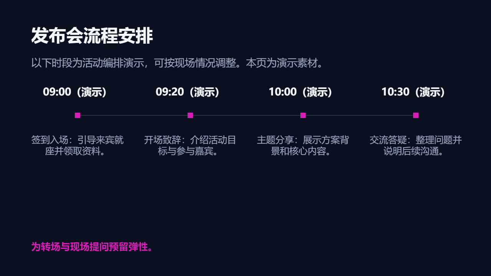

# 活动策划

组织活动目标、议程、嘉宾阵容、现场执行、风险和效果指标。

创建时在 `slide_add_preset.content` 填 `scenario: "event-planning"`。后续成功写入的预设页继承场景；不修改已完成页面。当前能力目录可用 `presetScenario: "event-planning"` 查询容量和可用对象。

## 与自由原生构图混排

使用 `slide_add_design` 时可沿用以下 `palette`；品牌颜色与真实内容优先。

```json
{"background": "#0B1020", "ink": "#F5F7FA", "muted": "#9AA6BD", "accent": "#D61FB5", "surface": "#141B30", "line": "#27324A"}
```

## 页面表达

| 页面用途 | 原生预设 | 内容关系 |
|---|---|---|
| 活动主视觉封面 | `dark-cover-split` | `none` |
| 活动主张与目标 | `dark-transition-statement` | `none` |
| 活动内容板块 | `dark-parallel-grid` | `parallel` |
| 活动议程 | `dark-timeline` | `sequence` |
| 嘉宾与演出阵容 | `dark-team-grid` | `hierarchy` |
| 现场体验与场景 | `dark-gallery` | `parallel` |
| 观众体验流程 | `dark-process-steps` | `sequence` |
| 现场风险预案 | `dark-matrix-2x2` | `matrix` |
| 触达与活动效果 | `dark-metric-spotlight` | `none` |
| 现场执行流程表 | `event-run-of-show` | `sequence` |

正文写用户提供的实际内容；所有图片路径必须指向已取得的真实素材。数组、数字、单位、来源和关系遵守当前预设容量；不适配时组合原生对象，不删事实或缩小整页。

下图为 `event-run-of-show` 的真实 Office 渲染；示例资料仅验证构图，不代表业务结论。


