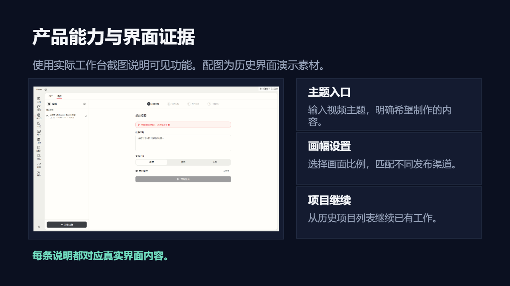

# 产品展示

说明产品价值、核心能力、使用场景、效果证据和发布计划。

创建时在 `slide_add_preset.content` 填 `scenario: "product-showcase"`。后续成功写入的预设页继承场景；不修改已完成页面。当前能力目录可用 `presetScenario: "product-showcase"` 查询容量和可用对象。

## 与自由原生构图混排

使用 `slide_add_design` 时可沿用以下 `palette`；品牌颜色与真实内容优先。

```json
{"background": "#0B1020", "ink": "#F5F7FA", "muted": "#9AA6BD", "accent": "#72DFC1", "surface": "#141B30", "line": "#27324A"}
```

## 页面表达

| 页面用途 | 原生预设 | 内容关系 |
|---|---|---|
| 产品主视觉封面 | `dark-cover-split` | `none` |
| 产品价值主张 | `dark-editorial-essay` | `none` |
| 核心能力矩阵 | `dark-parallel-grid` | `parallel` |
| 产品效果指标 | `dark-metric-spotlight` | `none` |
| 产品组成与模块关系 | `dark-hierarchy-branch` | `hierarchy` |
| 典型使用场景 | `dark-gallery` | `parallel` |
| 方案或版本对照 | `dark-comparison-split` | `parallel` |
| 发布与采用路径 | `dark-process-steps` | `sequence` |
| 产品主张与主视觉 | `dark-product-hero` | `none` |
| 产品指标侧栏 | `dark-metric` | `none` |
| 产品案例与图片 | `dark-case` | `parallel` |
| 功能与用户价值证据 | `product-feature-proof` | `none` |

正文写用户提供的实际内容；所有图片路径必须指向已取得的真实素材。数组、数字、单位、来源和关系遵守当前预设容量；不适配时组合原生对象，不删事实或缩小整页。

下图为 `product-feature-proof` 的真实 Office 渲染；示例资料仅验证构图，不代表业务结论。


