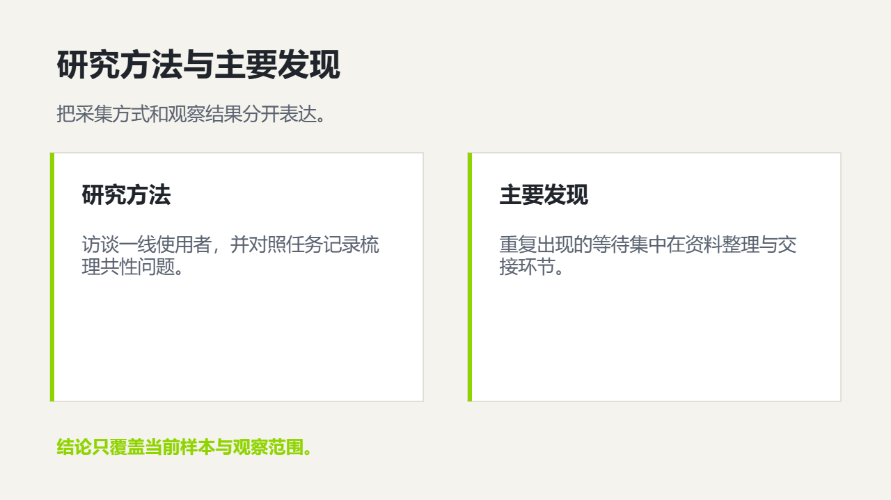

# 调研报告

呈现研究问题、方法、证据、比较分析、发现和建议。

创建时在 `slide_add_preset.content` 填 `scenario: "research-report"`。后续成功写入的预设页继承场景；不修改已完成页面。当前能力目录可用 `presetScenario: "research-report"` 查询容量和可用对象。

## 与自由原生构图混排

使用 `slide_add_design` 时可沿用以下 `palette`；品牌颜色与真实内容优先。

```json
{"background": "#F5F3ED", "ink": "#20242B", "muted": "#5A6270", "accent": "#8FD400", "surface": "#FFFFFF", "line": "#D8D2C4"}
```

## 页面表达

| 页面用途 | 原生预设 | 内容关系 |
|---|---|---|
| 调研报告封面 | `light-cover-split` | `none` |
| 研究问题与范围 | `light-editorial-essay` | `none` |
| 调研框架 | `light-parallel-columns` | `parallel` |
| 研究流程 | `light-process-steps` | `sequence` |
| 证据图表 | `light-chart-evidence` | `none` |
| 对象或样本比较 | `light-comparison-split` | `parallel` |
| 案例材料 | `light-gallery` | `parallel` |
| 研究建议 | `light-closing-callout` | `none` |
| 研究对象对比 | `light-comparison` | `parallel` |
| 研究执行流程 | `light-process-map` | `sequence` |
| 研究框架层级 | `light-architecture` | `hierarchy` |
| 方法与发现证据链 | `research-method-findings` | `parallel` |

正文写用户提供的实际内容；所有图片路径必须指向已取得的真实素材。数组、数字、单位、来源和关系遵守当前预设容量；不适配时组合原生对象，不删事实或缩小整页。

下图为 `research-method-findings` 的真实 Office 渲染；示例资料仅验证构图，不代表业务结论。


