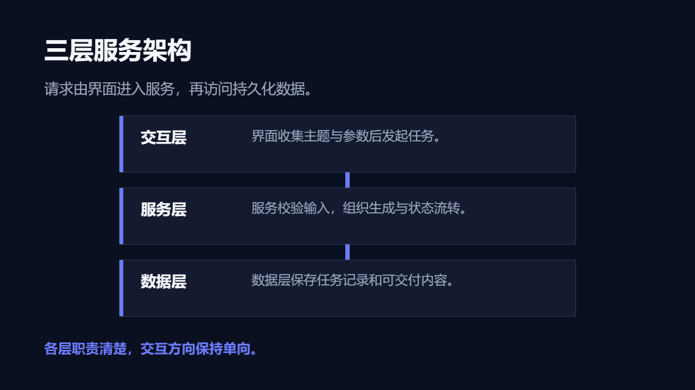

# 技术方案

呈现技术背景、系统分层、方案取舍、风险和实施路线。

创建时在 `slide_add_preset.content` 填 `scenario: "technical-proposal"`。后续成功写入的预设页继承场景；不修改已完成页面。当前能力目录可用 `presetScenario: "technical-proposal"` 查询容量和可用对象。

## 与自由原生构图混排

使用 `slide_add_design` 时可沿用以下 `palette`；品牌颜色与真实内容优先。

```json
{"background": "#0B1020", "ink": "#F5F7FA", "muted": "#9AA6BD", "accent": "#6C7CFF", "surface": "#141B30", "line": "#27324A"}
```

## 页面表达

| 页面用途 | 原生预设 | 内容关系 |
|---|---|---|
| 技术方案封面 | `dark-cover-split` | `none` |
| 现状与约束 | `dark-editorial-essay` | `none` |
| 系统关系图 | `dark-hierarchy-branch` | `hierarchy` |
| 数据流与处理步骤 | `dark-process-steps` | `sequence` |
| 备选方案对比 | `dark-comparison-split` | `parallel` |
| 技术风险矩阵 | `dark-matrix-2x2` | `matrix` |
| 性能与验证证据 | `dark-chart-evidence` | `none` |
| 实施里程碑 | `dark-timeline` | `sequence` |
| 系统架构层级 | `dark-architecture` | `hierarchy` |
| 纵向实施流程 | `dark-process-long` | `sequence` |
| 横向技术流程 | `dark-process-map` | `sequence` |
| 技术分层堆栈 | `technical-layer-stack` | `sequence` |

正文写用户提供的实际内容；所有图片路径必须指向已取得的真实素材。数组、数字、单位、来源和关系遵守当前预设容量；不适配时组合原生对象，不删事实或缩小整页。

下图为 `technical-layer-stack` 的真实 Office 渲染；示例资料仅验证构图，不代表业务结论。


