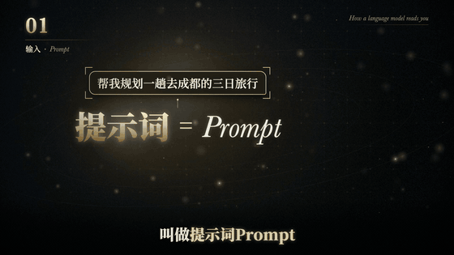

# dashi-animationstyle：风格动画（Claude Code skill）

把一段 15–60 秒的中文知识口播，交给 Claude 做成某种画风的讲解动画：1920×1080、30 帧/秒的 mp4，带口播和字幕，能直接拖进剪映接着剪。

画面全部由 Claude 用 HTML / Canvas 写代码画出来，再用无头 Chrome 逐帧截图合成，**不用生图模型**。

下面 7 张动图是同一段 21 秒口播（讲「AI 怎么读懂一句话」）在 7 套风格里的同一个 5 秒（7.6–12.6 秒：提示词 → 分词器把句子剪成 Token）。

> 出品：《大师的AI小灶》。完整展示视频（7 套同步平铺 + 每套完整一遍）发在 X：[@dashiAIxz](https://x.com/dashiAIxz)。

## 自带 7 套风格

| | |
|---|---|
| **1 立体卡通**：炭黑底、光面立体物件、杂志分栏。适合讲科学原理、实验过程<br> | **2 黑底科技**：近黑底、暖金细线、衬线字由虚到实。适合讲高端科技概念、历史趋势<br> |
| **3 超现实拼贴**：米灰海报、特粗衬线大标题、一个大比喻。适合讲思维方式、认知<br> | **4 复古剪纸**：皱纸上一层层剪纸，定格跳动。适合有态度的观点<br> |
| **5 复古报刊**：整版报纸，往下潜进深蓝插图区。适合科普解读、专题报道<br> | **6 扁平流程图**：奶油底、琥珀标题带、编号横向流程。适合讲步骤、原理、因果链<br> |
| **7 手绘笔记**：米白纸、墨蓝钢笔线稿 + 一种橙，逐笔描、逐字写。适合讲概念拆解、观察记录<br> | 每套的 3 张高清截图在 `styles/<风格>/静帧/`，配色、字体、动效写在 `styles/<风格>/风格卡.md`。 |

## 三种用法

1. **现成风格**：交一段口播，说「把这段口播做成手绘笔记风格」。Claude 转写出字幕、写分镜给你确认，再画 3 张静帧给你确认，然后出整段。
2. **照参考图做新风格**：给一张你喜欢的画面（截图、海报、插画）或一段视频，说「照这张图的画风做」。结果不保证，一般要出 2–4 轮静帧才像。
3. **用一句话描述**：例如「像小学教室黑板报那样的粉笔风，温暖一点」。Claude 先问几个问题，查 skill 里的风格词典（27 种风格的配色、字体、动效），出 2–3 个方向的静帧给你挑。

## 安装

**环境**：macOS（只在 Apple 芯片上测过）、Node 22 以上、ffmpeg、Google Chrome。whisper-cpp 可选（自动转写字幕用；没有的话给一份文字稿也能做）。

```bash
brew install node ffmpeg
git clone https://github.com/chuspeeism/dashi-animationstyle.git ~/.claude/skills/dashi-animationstyle
```

装好后在 Claude Code 里说：「检查一下风格动画的环境，再渲一个例子看看。」Claude 会跑自检，然后用自带的 Token 例子渲一段 21 秒的成片（Apple M2 Max 上每套 34–72 秒）。

**字体**：兰亭黑、圆体、手札体、翩翩体是 macOS「按需下载」的字体。自检会列出缺哪几个，打开「字体册」搜字体名、点「下载」即可；不下载也能渲，那几个字体会退回苹方。

## 用时和限制

- 一段 20–30 秒的口播套现成风格：实测一次约 30 分钟（23 秒、9 个镜头、手绘笔记），内容离例子越远越久，按 1 小时准备。中间会停两次请你确认（分镜、3 张静帧）。
- 照参考做一套新风格：每套 1 小时到 1 小时 45 分；我们照 11 份参考做了 11 套，留了 7 套。
- 一次只适合 15–60 秒的一段；整条 10 分钟的视频挑最需要画面的几段做。
- 配乐、音效、和真人画面穿插回剪映做。好不好看要你自己判断，不满意就按「第几秒、哪个东西、改成什么」提意见。
- 只在 macOS 上测过，只用 Claude Opus 5.5 测过。

## 目录

| 位置 | 内容 |
|---|---|
| `SKILL.md` | 给 Claude 读的完整说明：三种用法的步骤、规矩、做不到的事 |
| `styles/<风格>/` | 每套风格：`风格卡.md`（配色、字体、构图、动效、踩过的坑）、`模板.html`（新作品从它改）、`示例_Token.html`（例子的完整页面）、`静帧/` |
| `pipeline/` | 自检、新建作品、转写字幕、生成时间线、渲染、取色、丰富度检查、共用动效部件 |
| `knowledge/` | 风格词典（27 种风格）、讲解动画通用规则（字号、对比度、安全区、动效时长，带出处）、动效和画面变化、做 11 套样片的经验、风格卡模板 |
| `examples/token/` | 自带例子：21 秒口播「AI 怎么读懂一句话」的音频、字幕、分镜、时间线 |
| `docs/` | README 用的动图 |

## 版本

| 版本 | 内容 |
|---|---|
| v1.0 | 7 套风格的模板和例子；转写、分镜、渲染、自检脚本 |
| v1.1 | 按一次观众实测修订：字幕识别改正、裁口播、扫片和卡点检查 |
| v1.2 | 第二、三种用法；风格词典、通用规则；动效知识、共用转场部件、丰富度检查 |
| v1.3 | 7 套例子按动效规则重做；模板自带背景动效和转场；去掉字幕时字幕底带一起去掉；整理成公开版 |

## 许可

代码和文档：MIT（见 `LICENSE`）。

`examples/token/口播.wav` 是作者本人的声音，取自 B 站视频《【告别AI文盲】5分钟速通AI黑话！》（BV1tMHYzkEnY），只供试用这个 skill，不要用在别的作品里。

skill 不带任何字体和第三方图片；用法二里你给的参考图只放在你自己的作品目录里，版权由你自己负责，成片里不出现原图。
